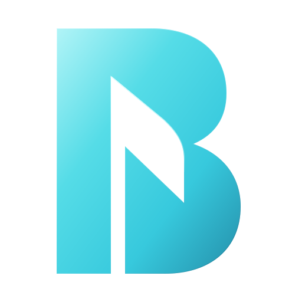
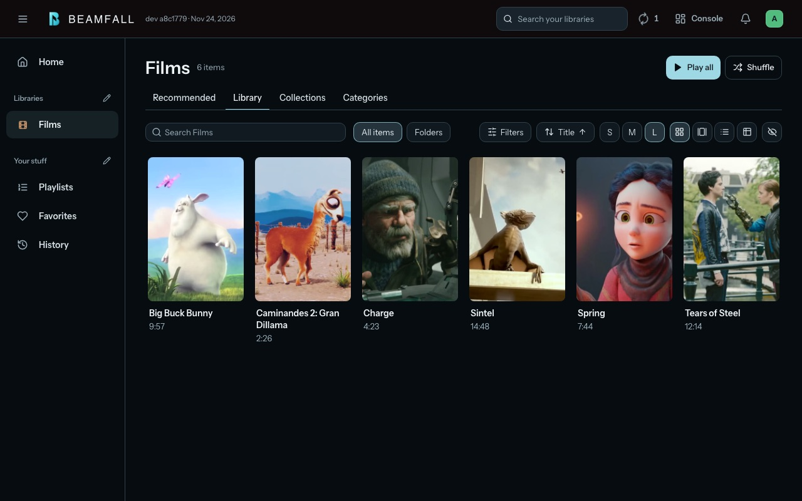
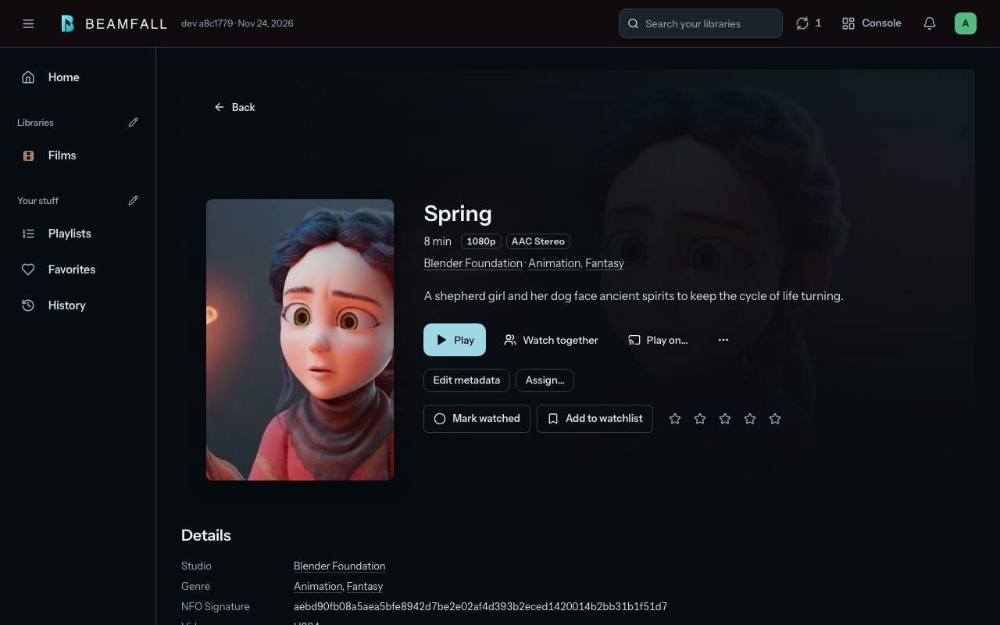
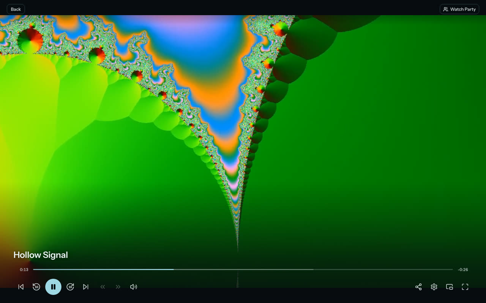
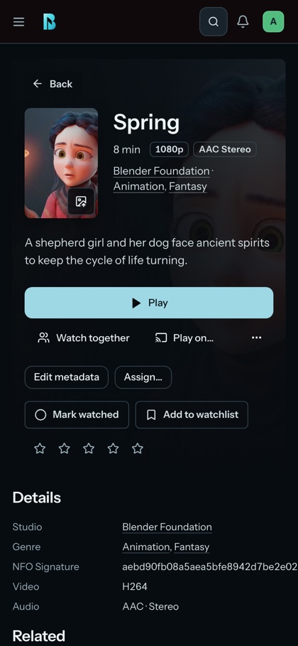
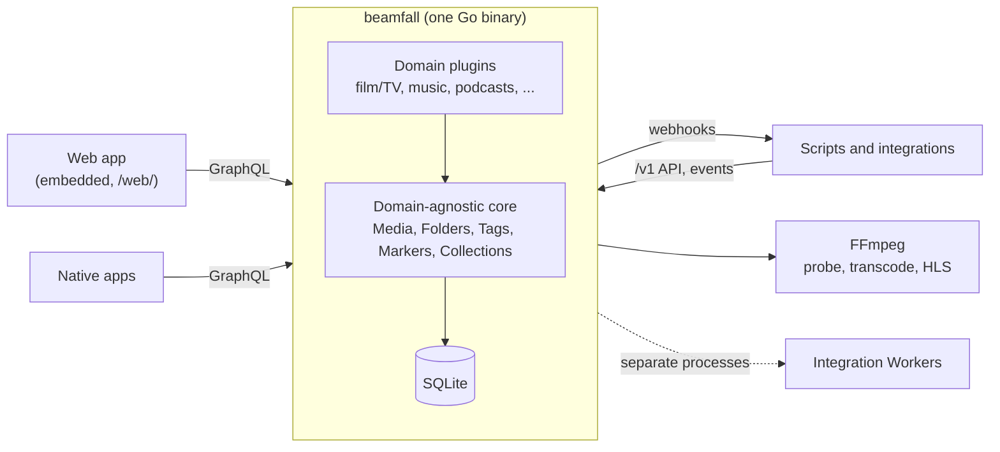

<p align="center">
  
</p>

<h1 align="center">Beamfall Core</h1>

<p align="center">
  <strong>A self-hosted media server for everything you own, in one Go binary.</strong><br>
  Films and shows, music, podcasts, audiobooks, photos, family archives, and karaoke,
  streamed to any browser, with no account, no cloud, and no telemetry.
</p>

<p align="center">
  <a href="LICENSE"></a>
  <a href="go.mod"></a>
  
</p>

<p align="center">
  
</p>

> [!IMPORTANT]
> **Pre-release.** No version has been tagged yet, so there are no published binaries or container
> images. You run Core today by [building it from source](#quick-start), natively or as a Docker
> image. [Project status](#project-status) lists exactly what is and isn't in place.

## Why Beamfall

- **One server for the whole household's media.** Seven library types ship in the box, each with
  its own browsing and metadata, on one domain-agnostic core.
- **Yours, start to finish.** It reads the folders you already have. There is no Beamfall account
  and no telemetry, the update check is off until you turn it on, and remote access stays off
  until you configure it.
- **Small to run.** One Go binary with embedded SQLite that calls FFmpeg for media work. There is
  no database server or separate web server, and no runtime services to manage.
- **Built to be checked.** The code is AGPL-3.0, the API has a published OpenAPI document, and the
  [Verification Claims Register](docs/security/CLAIMS.md) records what has been tested and what
  each check does *not* prove.

## Highlights

| | |
|---|---|
| **Playback that adapts** | Direct play when the device can handle the file. Otherwise Core remuxes or transcodes to HLS, using Intel Quick Sync, VA-API, NVIDIA NVENC, or Apple VideoToolbox when present, and tone-maps HDR for SDR screens when the FFmpeg build supports it and tone mapping is on in the Console (Dolby Vision profile 5 is refused). |
| **Seven library types** | Film and TV, music, podcasts, audiobooks, photos, family archive, and karaoke (MP3+G with CD+G rendering, and timed LRC lyrics). Activate only the ones you need. |
| **Bring your history** | Importers for Plex, Emby, Jellyfin, Trakt, and NFO sidecars; Last.fm, ListenBrainz, and Navidrome; OPML, Overcast, and AntennaPod; Audiobookshelf; and Immich. |
| **Watch comfortably** | Intro, recap, and credits skip detection; trickplay scrubbing previews; styled ASS subtitles rendered with libass; preferred audio and subtitle languages per Profile; Chromecast from Chromium browsers over HTTPS. |
| **A household of Profiles** | Each Profile has its own library access, content-rating ceilings, stream limit, and transcode permission, all enforced by the server. A PIN guards restricted content. |
| **Organize your way** | Collections, smart collections, Tags, and Markers; full-text search; duplicate detection; and watch folders that rescan when files change. |
| **Music visualizers** | Audio-reactive visuals and photo slideshow transitions from [Oscillux](https://github.com/beamfall/oscillux), Beamfall's open-source visuals engine. |
| **Safe by default** | Deletes go to a server-side Trash. `beamfall backup` and `beamfall restore` save and restore the server's databases and settings (your media files stay where they are). Remote access is off until you choose direct HTTPS with an ACME certificate or a relay. |
| **Built for integrations** | A versioned `/v1` Developer API ([OpenAPI 3.1](docs/api/openapi.json)) with scoped keys, a server-sent event stream, HMAC-signed webhooks, an opt-in Jellyfin-compatible API, and `beamfall mcp`, a Model Context Protocol server for AI agents. |

## Screenshots

<table>
  <tr>
    <td width="50%"></td>
    <td width="50%"></td>
  </tr>
  <tr>
    <td>Detail pages built from your metadata: local NFO sidecars here, or a metadata provider.</td>
    <td>The web player: direct play, or HLS when the browser needs it.</td>
  </tr>
</table>

<p align="center">
  <br>
  <sub>The web app at phone width.</sub>
</p>

<sub>All screenshots are of the web app from this repository, running on a local server. The films, posters, and metadata are synthetic demo content generated for these images.</sub>

## Clients and platforms

| Surface | Status |
|---|---|
| **Server** | Linux and macOS, natively or in Docker. On Windows, WSL2 and Docker Desktop are documented but untested. Native Windows is not supported. |
| **Web app** | Ships with the server at `/web/` and is in this repository. It covers first-run setup, browsing, playback, and the Beamfall Console for administration. It works in any modern browser, can be installed as a Progressive Web App, and casts to Chromecast from Chromium browsers over HTTPS. |
| **Native apps** | Apps for Mac, iPhone and iPad, Apple TV, and Android are separate products. They are in development and not yet released. They use Core's network API, and Core never needs them to run. |

## Quick start

You need Git, Go at the version in [`go.mod`](go.mod), Node.js 22.22 or newer with npm, and
`ffmpeg` and `ffprobe` on `PATH`. For the Docker route you need only Git and Docker Engine 25 or
newer with BuildKit (the default builder).

### Docker (image built from source)

```sh
git clone https://github.com/beamfall/core.git && cd core
docker build -t beamfall-core:local .
docker run -d --name beamfall -p 2326:2326 \
  -v beamfall-data:/data -v /path/to/media:/media:ro \
  beamfall-core:local
```

The image bundles FFmpeg and the web app. For hardware transcoding, public HTTPS, or TrueNAS, use
the [Compose overlays](packaging/compose/README.md) with `BEAMFALL_IMAGE=beamfall-core:local`.
On Unraid, put `beamfall-core:local` in the template's **Repository** field. Docker on macOS
transcodes on the CPU only.

### Native binary

```sh
git clone https://github.com/beamfall/core.git && cd core
npm --prefix internal/web/app ci
npm --prefix internal/web/app run build
go build -o beamfall ./cmd/beamfall
./beamfall serve --addr 0.0.0.0:2326 --data-dir "$HOME/beamfall-data"
```

The web build writes to the ignored `internal/web/app-dist/production`, and `go build` embeds it.
Skip it and a plain `go build` serves only the placeholder page committed in
`internal/web/app-dist`. `make web-build` runs the UI's checks before building.

### Finish setup in your browser

Open `http://<server-address>:2326/web/` from a browser on your home network. No token is needed
there. The server also prints a one-time setup link for the machine it runs on: use
`docker logs beamfall` to see it. Setup asks for an admin password, the kinds of media you have,
and the folders that hold them, then scans them.

For a platform walkthrough, see the [install guides](docs/operations/install/README.md) for Linux,
macOS, Unraid, and Windows through WSL2. For local development, `make dev-run`
starts a server on `http://127.0.0.1:8090` with a throwaway data directory and a fixed dev admin
password (see the [`Makefile`](Makefile)).

<details>
<summary><strong>Command-line reference</strong></summary>

| Command | What it does |
|---|---|
| `beamfall serve` | Run the server (the default command). |
| `beamfall library list` | List library ids, names, and roots (the ids `scan --library-id` takes). |
| `beamfall scan` | Queue a library scan. |
| `beamfall backup` / `beamfall restore` | Request a server-side backup; restore one while the server is stopped. |
| `beamfall token` | Manage local API tokens. |
| `beamfall export-config` / `apply-config` | Export or apply a Console config document: background workers, plugin activation, and Libraries with their roots. `apply-config` creates missing Libraries and roots and never removes one. |
| `beamfall reset-admin-password` | Set the local admin password while the server is stopped. |
| `beamfall pairing-code` | Mint a one-time owner pairing code to sign a browser back in. Run it on the server host while the server is stopped, then start the server to redeem it. |
| `beamfall mcp` | Run a Model Context Protocol stdio server for AI agents. |
| `beamfall capabilities` / `version` | Print runtime capabilities or build metadata. |

`library list`, `scan`, `backup`, `token list`, and `token revoke` talk to the running server with
`--token`. Mint one while the server is stopped; `--access` picks its tier (`cli` by default,
`diagnostics` adds most admin reads plus cancelling and retrying jobs, `agent` adds most admin changes), so give each token the lowest
tier that does the job.

```sh
# With the server stopped, capture the token it prints, then start the server again.
TOKEN=$(./beamfall token create --name operator --data-dir "$HOME/beamfall-data")
./beamfall library list --token "$TOKEN"   # set LIBRARY_ID and ROOT from its output
./beamfall scan --token "$TOKEN" --library-id "$LIBRARY_ID" --root "$ROOT"
```

</details>

## How it's built



- **A modular monolith.** `cmd/beamfall` plus `internal/<capability>`, from scratch in Go with no
  lineage to any earlier server. [`ARCHITECTURE.md`](docs/architecture/ARCHITECTURE.md) has the
  package map. Where it and the architecture test in `internal/conformance` disagree, the test
  wins.
- **A domain-agnostic core.** The core serves playable Media organized by Folders, Tags, Markers,
  and Collections, and a vocabulary test keeps domain words out of it. Films, albums, and episodes
  come from the first-party plugins: separate public Go modules (`github.com/beamfall/plugin-<id>`)
  built on the public [plugin SDK](https://github.com/beamfall/plugin-sdk) and compiled in by
  [`cmd/beamfall/bundles.go`](cmd/beamfall/bundles.go).
- **Third-party code runs out of process.** Integration Workers are separate processes, each pinned to
  a SHA-256 hash or an Ed25519 signing key that verifies its detached signature, behind a narrow local API with a closed permission vocabulary.
- **Two APIs.** Clients use a hand-written GraphQL contract in `internal/graph`, held in place by
  conformance tests. Integrations use the stable `/v1` Developer API. Each cross-repository wire
  boundary is registered in [`contracts/registry.json`](contracts/registry.json).
- **Measured.** `make bench` builds a synthetic library of 100,000 media items and holds each query
  to a P95 budget, for example 1 ms for "recently added" and 60 ms for full-text search.

Domain language is defined in [`CONTEXT.md`](CONTEXT.md).

## Build and test

| Command | What it runs |
|---|---|
| `make build` / `make test` | `go build ./...` / `go test ./...` |
| `make web-build` | The web app's checks, typecheck, and production build. |
| `make gate` | The full pre-merge gate: gofmt, golangci-lint, Go tests with a coverage ratchet, architecture, vocabulary, golden and wire-contract conformance tests, race checks, the web app build, typecheck, Vitest and Playwright smoke tests, and repository policy checks. It needs Python 3, Node.js and npm, `golangci-lint`, and Playwright's Chromium. |
| `make gate-preflight` | The fast subset of the gate: selftests and static data lints. Not a merge signal. |
| `make bench` | The 100k-item query budgets plus scan, direct-play, and transcode performance floors. The release gate runs it. |
| `make orient` | A one-page map of the codebase. |
| `make coverage` | The feature-coverage ledger: `testing/features.yaml` against markers in the tests. |

## Project status

| Area | Status |
|---|---|
| Releases | None yet. [`release.yml`](.github/workflows/release.yml) runs on a `v*` tag and is built to produce signed archives with an SBOM and SLSA provenance, plus a cosign-signed amd64/arm64 image at `ghcr.io/beamfall/core`. No tag exists, so none of these have been published. |
| Server | Builds and runs from source with the Go version in [`go.mod`](go.mod), natively or as a Docker image built from this repository. |
| CI | Changes merge on a green local `make gate` run on the exact commit. The hosted workflows in [`.github/workflows`](.github/workflows) are not yet green and are not the merge signal. |
| Cross-repo checks | Some checks need sibling Beamfall repositories. Without a sibling checkout they clone and verify the pinned version where a source is configured, or else skip loudly or fail; a missing checkout never counts as a pass. |
| Deployment templates | The [Compose](packaging/compose/README.md), [Unraid](packaging/unraid/beamfall-core.xml), and [TrueNAS](packaging/truenas/README.md) templates are included. Their release path expects a digest-pinned image, so it becomes usable with the first release; until then, point them at an image you built. |
| Supported versions | Before the first stable release, security reports should name a `main` revision ([`SECURITY.md`](SECURITY.md)). |

## Documentation

Start at [`docs/README.md`](docs/README.md), which has paths for running and recovering a server,
integrating with the API, the architecture, writing plugins, and contributing. Revision-specific
checks are in the [Verification Claims Register](docs/security/CLAIMS.md).

**Questions?** Search or ask in [GitHub Issues](https://github.com/beamfall/core/issues). Posts
there are public, so leave out passwords, tokens, and pairing codes.

## Contributing and security

Read [`CONTRIBUTING.md`](CONTRIBUTING.md) and the [CLA](CLA.md) before opening a change. This
project follows a [Code of Conduct](CODE_OF_CONDUCT.md).

Report vulnerabilities privately, never in a public issue: email security@beamfall.com or use
GitHub's [private vulnerability reporting](https://github.com/beamfall/core/security/advisories/new).
[`SECURITY.md`](SECURITY.md) describes what to include and the scope.

## License

[AGPL-3.0](LICENSE). The server and the embedded web app are free software.

- The `LICENSE` file ends with a trademark notice under AGPL-3.0 section 7(e): the Beamfall name
  and logo are not licensed with the code. See [`TRADEMARKS.md`](TRADEMARKS.md).
- Third-party notices are in [`NOTICE`](NOTICE).
- The project is published under the `github.com/beamfall` organization
  (`github.com/beamfall/core`).
