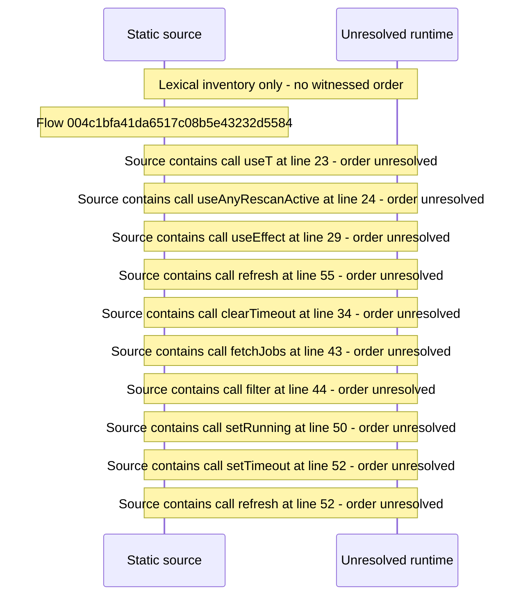

# Server activity indicator \(running jobs and rescans\) in the shell — flow-diagram

Source revision: d658ad5b71dcb67da0ae540d6d5ff80ca8efefd5. Trust: generated. Freshness: pinned source; run docs flows check for a later revision.

<!-- flowdocs:paragraph:3e597afee5d80bfa22564d704454121e -->
Static source inventory only; sequence and runtime ordering are unresolved\.

Source: internal/web/app/src/components/beamfall/ServerActivity\.tsx:19; symbol: ACTIVE\_POLL\_MS; span SHA256: 15aee462f01638cfa092a2b1c1be144490603ce140d97ff5961dfcbedeaf4d7f.

