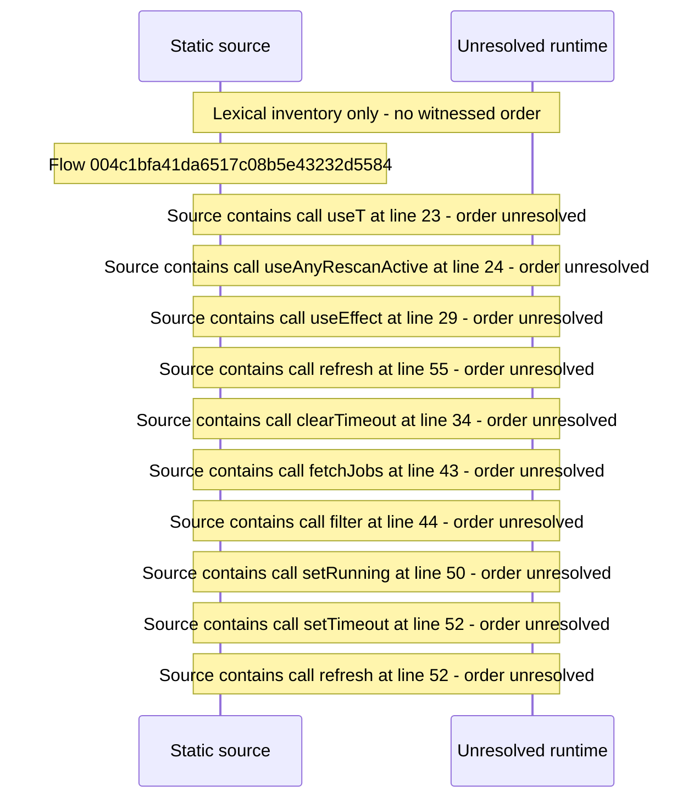

# Server activity indicator \(running jobs and rescans\) in the shell — flow-diagram

Source revision: d442b4a6a38de86be0670669b3a3f6aa47e80b22. Trust: generated. Freshness: pinned source; run docs flows check for a later revision.

<!-- flowdocs:paragraph:3e597afee5d80bfa22564d704454121e -->
Static source inventory only; sequence and runtime ordering are unresolved\.

Source: internal/web/app/src/components/beamfall/ServerActivity\.tsx:22; symbol: ServerActivity; span SHA256: fa0d4a07644d2f7afae61ab1daf203693a17f2c36308e0a3f7dadee7beaa286c.

