# Manage manual and smart collections — flow-diagram

Source revision: e417fb394873a04fbd27fb8d5bcbca5484c8747f. Trust: generated. Freshness: pinned source; run docs flows check for a later revision.

<!-- flowdocs:paragraph:53c48a58745ade83b87ae75f77ce4902 -->
Static source inventory only; sequence and runtime ordering are unresolved\.

Source: internal/web/app/src/areas/manage/pages/CollectionsPage\.tsx:388; symbol: CollectionRow; span SHA256: 5ca5177ddfc8b2d4a18487bf9a9fd06dd63e1931236eb8f812e720300a1d9470.

```mermaid
sequenceDiagram
    participant S as Static source
    participant U as Unresolved runtime
    Note over S,U: Lexical inventory only - no witnessed order
    Note over S: Flow 01980267f2da1b8a6a45d6a38088bf67
    Note over S,U: Source contains call useT at line 409 - order unresolved
    Note over S,U: Source contains call useState at line 410 - order unresolved
    Note over S,U: Source contains call useState at line 411 - order unresolved
    Note over S,U: Source contains call useT at line 67 - order unresolved
    Note over S,U: Source contains call useSession at line 68 - order unresolved
    Note over S,U: Source contains call useState at line 71 - order unresolved
    Note over S,U: Source contains call useEffect at line 75 - order unresolved
    Note over S,U: Source contains call setLibraryID at line 76 - order unresolved
    Note over S,U: Source contains call setTab at line 80 - order unresolved
    Note over S,U: Source contains call t at line 82 - order unresolved
    Note over S,U: Source contains call t at line 86 - order unresolved
    Note over S,U: Source contains call t at line 97 - order unresolved
    Note over S,U: Source contains call t at line 109 - order unresolved
    Note over S,U: Source contains call t at line 113 - order unresolved
    Note over S,U: Source contains call t at line 117 - order unresolved
    Note over S,U: Source contains call map at line 120 - order unresolved
    Note over S,U: Source contains call t at line 130 - order unresolved
    Note over S,U: Source contains call useT at line 146 - order unresolved
    Note over S,U: Source contains call useState at line 148 - order unresolved
    Note over S,U: Source contains call useState at line 149 - order unresolved
    Note over S,U: Source contains call useState at line 150 - order unresolved
    Note over S,U: Source contains call useState at line 153 - order unresolved
    Note over S,U: Source contains call useState at line 154 - order unresolved
    Note over S,U: Source contains call useRef at line 157 - order unresolved
    Note over S,U: Source contains call useCallback at line 159 - order unresolved
    Note over S,U: Source contains call async at line 160 - order unresolved
    Note over S,U: Source contains call setError at line 162 - order unresolved
    Note over S,U: Source contains call setCollections at line 163 - order unresolved
    Note over S,U: Source contains call fetchCollections at line 166 - order unresolved
    Note over S,U: Source contains call setCollections at line 167 - order unresolved
    Note over S,U: Source contains call setError at line 169 - order unresolved
    Note over S,U: Source contains call t at line 169 - order unresolved
    Note over S,U: Source contains call useEffect at line 175 - order unresolved
    Note over S,U: Source contains call load at line 176 - order unresolved
    Note over S,U: Source contains call useMemo at line 183 - order unresolved
    Note over S,U: Source contains call filter at line 186 - order unresolved
    Note over S,U: Source contains call sort at line 187 - order unresolved
    Note over S,U: Source contains call localeCompare at line 187 - order unresolved
    Note over S,U: Source contains call useT at line 513 - order unresolved
    Note over S,U: Source contains call useState at line 517 - order unresolved
    Note over S,U: Source contains call useEffect at line 519 - order unresolved
    Note over S,U: Source contains call setMembers at line 520 - order unresolved
    Note over S,U: Source contains call sort at line 520 - order unresolved
    Note over S,U: Source contains call useT at line 787 - order unresolved
    Note over S,U: Source contains call useState at line 788 - order unresolved
    Note over S,U: Source contains call useState at line 789 - order unresolved
    Note over S,U: Source contains call useState at line 790 - order unresolved
    Note over S,U: Source contains call useT at line 661 - order unresolved
    Note over S,U: Source contains call useState at line 663 - order unresolved
    Note over S,U: Source contains call useRef at line 665 - order unresolved
    Note over S,U: Source contains call useCallback at line 667 - order unresolved
    Note over S,U: Source contains call async at line 668 - order unresolved
    Note over S,U: Source contains call setError at line 670 - order unresolved
    Note over S,U: Source contains call setSmart at line 671 - order unresolved
    Note over S,U: Source contains call fetchSmartCollections at line 674 - order unresolved
    Note over S,U: Source contains call setSmart at line 675 - order unresolved
    Note over S,U: Source contains call setError at line 677 - order unresolved
    Note over S,U: Source contains call t at line 677 - order unresolved
    Note over S,U: Source contains call useEffect at line 683 - order unresolved
    Note over S,U: Source contains call load at line 684 - order unresolved
    Note over S,U: Source contains call useMemo at line 690 - order unresolved
    Note over S,U: Source contains call find at line 691 - order unresolved
    Note over S,U: Source contains call trim at line 414 - order unresolved
    Note over S,U: Source contains call setEditing at line 415 - order unresolved
    Note over S,U: Source contains call onRename at line 416 - order unresolved
    Note over S,U: Source contains call async at line 558 - order unresolved
    Note over S,U: Source contains call split at line 560 - order unresolved
    Note over S,U: Source contains call map at line 561 - order unresolved
    Note over S,U: Source contains call trim at line 561 - order unresolved
    Note over S,U: Source contains call filter at line 562 - order unresolved
    Note over S,U: Source contains call addCollectionMedia at line 565 - order unresolved
    Note over S,U: Source contains call setAddIDs at line 566 - order unresolved
    Note over S,U: Source contains call onChanged at line 567 - order unresolved
    Note over S,U: Source contains call onError at line 569 - order unresolved
    Note over S,U: Source contains call async at line 195 - order unresolved
    Note over S,U: Source contains call setError at line 196 - order unresolved
    Note over S,U: Source contains call trim at line 197 - order unresolved
    Note over S,U: Source contains call createCollection at line 200 - order unresolved
    Note over S,U: Source contains call setNewName at line 205 - order unresolved
    Note over S,U: Source contains call setNewParent at line 206 - order unresolved
    Note over S,U: Source contains call reload at line 207 - order unresolved
    Note over S,U: Source contains call setError at line 209 - order unresolved
    Note over S,U: Source contains call t at line 209 - order unresolved
    Note over S,U: Source contains call setMembers at line 545 - order unresolved
    Note over S,U: Source contains call persistOrder at line 546 - order unresolved
    Note over S,U: Source contains call async at line 549 - order unresolved
    Note over S,U: Source contains call removeCollectionMedia at line 551 - order unresolved
    Note over S,U: Source contains call onChanged at line 552 - order unresolved
    Note over S,U: Source contains call onError at line 554 - order unresolved
    Note over S,U: Source contains call async at line 213 - order unresolved
    Note over S,U: Source contains call setError at line 214 - order unresolved
    Note over S,U: Source contains call updateCollection at line 216 - order unresolved
    Note over S,U: Source contains call reload at line 217 - order unresolved
    Note over S,U: Source contains call setError at line 219 - order unresolved
    Note over S,U: Source contains call t at line 219 - order unresolved
    Note over S,U: Source contains call async at line 227 - order unresolved
    Note over S,U: Source contains call setError at line 230 - order unresolved
    Note over S,U: Source contains call updateCollection at line 234 - order unresolved
    Note over S,U: Source contains call setError at line 236 - order unresolved
    Note over S,U: Source contains call t at line 236 - order unresolved
    Note over S,U: Source contains call updateCollection at line 241 - order unresolved
    Note over S,U: Source contains call updateCollection at line 244 - order unresolved
    Note over S,U: Source contains call catch at line 244 - order unresolved
    Note over S,U: Source contains call reload at line 246 - order unresolved
    Note over S,U: Source contains call setError at line 247 - order unresolved
    Note over S,U: Source contains call t at line 247 - order unresolved
    Note over S,U: Source contains call async at line 261 - order unresolved
    Note over S,U: Source contains call setError at line 262 - order unresolved
    Note over S,U: Source contains call restoreCollection at line 264 - order unresolved
    Note over S,U: Source contains call reload at line 265 - order unresolved
    Note over S,U: Source contains call setError at line 267 - order unresolved
    Note over S,U: Source contains call t at line 267 - order unresolved
    Note over S,U: Source contains call async at line 792 - order unresolved
    Note over S,U: Source contains call trim at line 793 - order unresolved
    Note over S,U: Source contains call trim at line 794 - order unresolved
    Note over S,U: Source contains call updateSmartCollection at line 798 - order unresolved
    Note over S,U: Source contains call trim at line 802 - order unresolved
    Note over S,U: Source contains call createSmartCollection at line 806 - order unresolved
    Note over S,U: Source contains call trim at line 810 - order unresolved
    Note over S,U: Source contains call onSaved at line 813 - order unresolved
    Note over S,U: Source contains call onError at line 815 - order unresolved
    Note over S,U: Source contains call async at line 526 - order unresolved
    Note over S,U: Source contains call reorderCollectionMedia at line 528 - order unresolved
    Note over S,U: Source contains call map at line 530 - order unresolved
    Note over S,U: Source contains call onChanged at line 532 - order unresolved
    Note over S,U: Source contains call setMembers at line 534 - order unresolved
    Note over S,U: Source contains call sort at line 534 - order unresolved
    Note over S,U: Source contains call onChanged at line 535 - order unresolved
    Note over S,U: Source contains call onError at line 536 - order unresolved
    Note over S,U: Source contains call load at line 193 - order unresolved
    Note over S,U: Source contains call useMemo at line 191 - order unresolved
    Note over S,U: Source contains call find at line 191 - order unresolved
    Note over S,U: Source contains call useMemo at line 190 - order unresolved
    Note over S,U: Source contains call filter at line 190 - order unresolved
```

