# Manage manual and smart collections — flow-diagram

Source revision: 6742c2361d684c662e9ccb84d344a2200c377582. Trust: generated. Freshness: pinned source; run docs flows check for a later revision.

<!-- flowdocs:paragraph:53c48a58745ade83b87ae75f77ce4902 -->
Static source inventory only; sequence and runtime ordering are unresolved\.

Source: internal/web/app/src/areas/manage/pages/CollectionsPage\.tsx:364; symbol: CollectionRow; span SHA256: 5ca5177ddfc8b2d4a18487bf9a9fd06dd63e1931236eb8f812e720300a1d9470.

```mermaid
sequenceDiagram
    participant S as Static source
    participant U as Unresolved runtime
    Note over S,U: Lexical inventory only - no witnessed order
    Note over S: Flow 01980267f2da1b8a6a45d6a38088bf67
    Note over S,U: Source contains call useT at line 385 - order unresolved
    Note over S,U: Source contains call useState at line 386 - order unresolved
    Note over S,U: Source contains call useState at line 387 - order unresolved
    Note over S,U: Source contains call useT at line 67 - order unresolved
    Note over S,U: Source contains call useSession at line 68 - order unresolved
    Note over S,U: Source contains call useState at line 71 - order unresolved
    Note over S,U: Source contains call useEffect at line 75 - order unresolved
    Note over S,U: Source contains call setLibraryID at line 76 - order unresolved
    Note over S,U: Source contains call setTab at line 80 - order unresolved
    Note over S,U: Source contains call t at line 84 - order unresolved
    Note over S,U: Source contains call t at line 86 - order unresolved
    Note over S,U: Source contains call t at line 89 - order unresolved
    Note over S,U: Source contains call t at line 93 - order unresolved
    Note over S,U: Source contains call t at line 97 - order unresolved
    Note over S,U: Source contains call map at line 100 - order unresolved
    Note over S,U: Source contains call t at line 108 - order unresolved
    Note over S,U: Source contains call useT at line 123 - order unresolved
    Note over S,U: Source contains call useState at line 125 - order unresolved
    Note over S,U: Source contains call useState at line 126 - order unresolved
    Note over S,U: Source contains call useState at line 127 - order unresolved
    Note over S,U: Source contains call useState at line 130 - order unresolved
    Note over S,U: Source contains call useState at line 131 - order unresolved
    Note over S,U: Source contains call useRef at line 134 - order unresolved
    Note over S,U: Source contains call useCallback at line 136 - order unresolved
    Note over S,U: Source contains call async at line 137 - order unresolved
    Note over S,U: Source contains call setError at line 139 - order unresolved
    Note over S,U: Source contains call setCollections at line 140 - order unresolved
    Note over S,U: Source contains call fetchCollections at line 143 - order unresolved
    Note over S,U: Source contains call setCollections at line 144 - order unresolved
    Note over S,U: Source contains call setError at line 146 - order unresolved
    Note over S,U: Source contains call t at line 146 - order unresolved
    Note over S,U: Source contains call useEffect at line 152 - order unresolved
    Note over S,U: Source contains call load at line 153 - order unresolved
    Note over S,U: Source contains call useMemo at line 160 - order unresolved
    Note over S,U: Source contains call filter at line 163 - order unresolved
    Note over S,U: Source contains call sort at line 164 - order unresolved
    Note over S,U: Source contains call localeCompare at line 164 - order unresolved
    Note over S,U: Source contains call useT at line 500 - order unresolved
    Note over S,U: Source contains call useState at line 504 - order unresolved
    Note over S,U: Source contains call useEffect at line 506 - order unresolved
    Note over S,U: Source contains call setMembers at line 507 - order unresolved
    Note over S,U: Source contains call sort at line 507 - order unresolved
    Note over S,U: Source contains call useT at line 781 - order unresolved
    Note over S,U: Source contains call useState at line 782 - order unresolved
    Note over S,U: Source contains call useState at line 783 - order unresolved
    Note over S,U: Source contains call useState at line 784 - order unresolved
    Note over S,U: Source contains call useT at line 654 - order unresolved
    Note over S,U: Source contains call useState at line 656 - order unresolved
    Note over S,U: Source contains call useRef at line 658 - order unresolved
    Note over S,U: Source contains call useCallback at line 660 - order unresolved
    Note over S,U: Source contains call async at line 661 - order unresolved
    Note over S,U: Source contains call setError at line 663 - order unresolved
    Note over S,U: Source contains call setSmart at line 664 - order unresolved
    Note over S,U: Source contains call fetchSmartCollections at line 667 - order unresolved
    Note over S,U: Source contains call setSmart at line 668 - order unresolved
    Note over S,U: Source contains call setError at line 670 - order unresolved
    Note over S,U: Source contains call t at line 670 - order unresolved
    Note over S,U: Source contains call useEffect at line 676 - order unresolved
    Note over S,U: Source contains call load at line 677 - order unresolved
    Note over S,U: Source contains call useMemo at line 683 - order unresolved
    Note over S,U: Source contains call find at line 684 - order unresolved
    Note over S,U: Source contains call trim at line 390 - order unresolved
    Note over S,U: Source contains call setEditing at line 391 - order unresolved
    Note over S,U: Source contains call onRename at line 392 - order unresolved
    Note over S,U: Source contains call async at line 545 - order unresolved
    Note over S,U: Source contains call split at line 547 - order unresolved
    Note over S,U: Source contains call map at line 548 - order unresolved
    Note over S,U: Source contains call trim at line 548 - order unresolved
    Note over S,U: Source contains call filter at line 549 - order unresolved
    Note over S,U: Source contains call addCollectionMedia at line 552 - order unresolved
    Note over S,U: Source contains call setAddIDs at line 553 - order unresolved
    Note over S,U: Source contains call onChanged at line 554 - order unresolved
    Note over S,U: Source contains call onError at line 556 - order unresolved
    Note over S,U: Source contains call async at line 172 - order unresolved
    Note over S,U: Source contains call setError at line 173 - order unresolved
    Note over S,U: Source contains call trim at line 174 - order unresolved
    Note over S,U: Source contains call createCollection at line 177 - order unresolved
    Note over S,U: Source contains call setNewName at line 182 - order unresolved
    Note over S,U: Source contains call setNewParent at line 183 - order unresolved
    Note over S,U: Source contains call reload at line 184 - order unresolved
    Note over S,U: Source contains call setError at line 186 - order unresolved
    Note over S,U: Source contains call t at line 186 - order unresolved
    Note over S,U: Source contains call setMembers at line 532 - order unresolved
    Note over S,U: Source contains call persistOrder at line 533 - order unresolved
    Note over S,U: Source contains call async at line 536 - order unresolved
    Note over S,U: Source contains call removeCollectionMedia at line 538 - order unresolved
    Note over S,U: Source contains call onChanged at line 539 - order unresolved
    Note over S,U: Source contains call onError at line 541 - order unresolved
    Note over S,U: Source contains call async at line 190 - order unresolved
    Note over S,U: Source contains call setError at line 191 - order unresolved
    Note over S,U: Source contains call updateCollection at line 193 - order unresolved
    Note over S,U: Source contains call reload at line 194 - order unresolved
    Note over S,U: Source contains call setError at line 196 - order unresolved
    Note over S,U: Source contains call t at line 196 - order unresolved
    Note over S,U: Source contains call async at line 204 - order unresolved
    Note over S,U: Source contains call setError at line 207 - order unresolved
    Note over S,U: Source contains call updateCollection at line 211 - order unresolved
    Note over S,U: Source contains call setError at line 213 - order unresolved
    Note over S,U: Source contains call t at line 213 - order unresolved
    Note over S,U: Source contains call updateCollection at line 218 - order unresolved
    Note over S,U: Source contains call updateCollection at line 221 - order unresolved
    Note over S,U: Source contains call catch at line 221 - order unresolved
    Note over S,U: Source contains call reload at line 223 - order unresolved
    Note over S,U: Source contains call setError at line 224 - order unresolved
    Note over S,U: Source contains call t at line 224 - order unresolved
    Note over S,U: Source contains call async at line 238 - order unresolved
    Note over S,U: Source contains call setError at line 239 - order unresolved
    Note over S,U: Source contains call restoreCollection at line 241 - order unresolved
    Note over S,U: Source contains call reload at line 242 - order unresolved
    Note over S,U: Source contains call setError at line 244 - order unresolved
    Note over S,U: Source contains call t at line 244 - order unresolved
    Note over S,U: Source contains call async at line 786 - order unresolved
    Note over S,U: Source contains call trim at line 787 - order unresolved
    Note over S,U: Source contains call trim at line 788 - order unresolved
    Note over S,U: Source contains call updateSmartCollection at line 792 - order unresolved
    Note over S,U: Source contains call trim at line 796 - order unresolved
    Note over S,U: Source contains call createSmartCollection at line 800 - order unresolved
    Note over S,U: Source contains call trim at line 804 - order unresolved
    Note over S,U: Source contains call onSaved at line 807 - order unresolved
    Note over S,U: Source contains call onError at line 809 - order unresolved
    Note over S,U: Source contains call async at line 513 - order unresolved
    Note over S,U: Source contains call reorderCollectionMedia at line 515 - order unresolved
    Note over S,U: Source contains call map at line 517 - order unresolved
    Note over S,U: Source contains call onChanged at line 519 - order unresolved
    Note over S,U: Source contains call setMembers at line 521 - order unresolved
    Note over S,U: Source contains call sort at line 521 - order unresolved
    Note over S,U: Source contains call onChanged at line 522 - order unresolved
    Note over S,U: Source contains call onError at line 523 - order unresolved
    Note over S,U: Source contains call load at line 170 - order unresolved
    Note over S,U: Source contains call useMemo at line 168 - order unresolved
    Note over S,U: Source contains call find at line 168 - order unresolved
    Note over S,U: Source contains call useMemo at line 167 - order unresolved
    Note over S,U: Source contains call filter at line 167 - order unresolved
```

