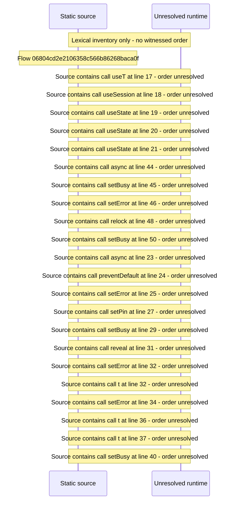

# Manage restrictions — flow-diagram

Source revision: 5ffe7939da2318f5153b1a20d0ef6ef94deef162. Trust: generated. Freshness: pinned source; run docs flows check for a later revision.

<!-- flowdocs:paragraph:81591007b037041f06a2388546b4035c -->
Static source inventory only; sequence and runtime ordering are unresolved\.

Source: internal/web/app/src/areas/manage/pages/RestrictionsPage\.tsx:16; symbol: RestrictionsPage; span SHA256: 417dbc6d2a1bbd8599adf1cdd5447cc8a1ddd58b2d00abca38ee259921f56a2a.

