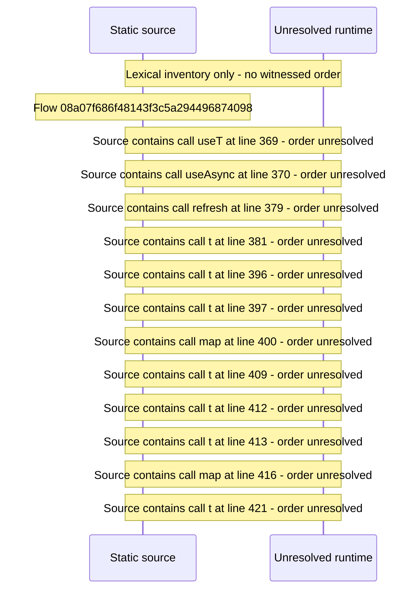

# Console qBittorrent ingest connection and outcomes — flow-diagram

Source revision: 6742c2361d684c662e9ccb84d344a2200c377582. Trust: generated. Freshness: pinned source; run docs flows check for a later revision.

<!-- flowdocs:paragraph:aebd45d90840183e184200d63458ba48 -->
Static source inventory only; sequence and runtime ordering are unresolved\.

Source: internal/web/app/src/areas/console/sections/RemoteAccess\.tsx:117; symbol: QB\_OUTCOME; span SHA256: 974482f2a9553d3517a2b9ec34f3668717f270709c24d1e6ee63eeada0c060da.

