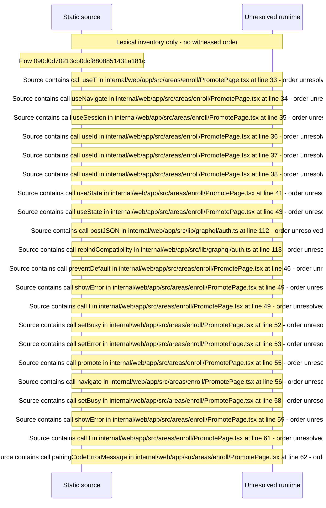

# Promote an enrolled browser to a manager device — flow-diagram

Source revision: 6742c2361d684c662e9ccb84d344a2200c377582. Trust: generated. Freshness: pinned source; run docs flows check for a later revision.

<!-- flowdocs:paragraph:4e9dde93fcd9f338a9dc234b54dddd72 -->
Static source inventory only; sequence and runtime ordering are unresolved\.

Source: internal/web/app/src/areas/enroll/PromotePage\.tsx:32; symbol: PromotePage; span SHA256: f5a6481e3b322f72550819d0b73f61a52ac2e6cc5a95d9eaf4f34dba04c53f31.

