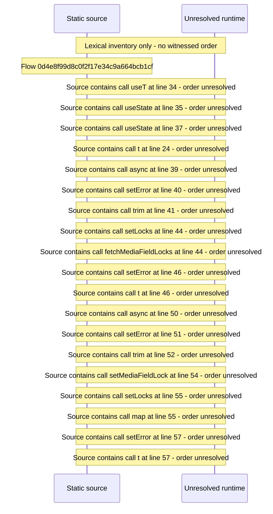

# Manage field locks — flow-diagram

Source revision: d658ad5b71dcb67da0ae540d6d5ff80ca8efefd5. Trust: generated. Freshness: pinned source; run docs flows check for a later revision.

<!-- flowdocs:paragraph:e35f7b44d54280c504b07d7dc8194888 -->
Static source inventory only; sequence and runtime ordering are unresolved\.

Source: internal/web/app/src/areas/manage/pages/FieldLocksPage\.tsx:33; symbol: FieldLocksPage; span SHA256: 629fe5a8e1682004ada517a9e50ed36652f52d34446b7e26053fc1b83ad6cb3b.

