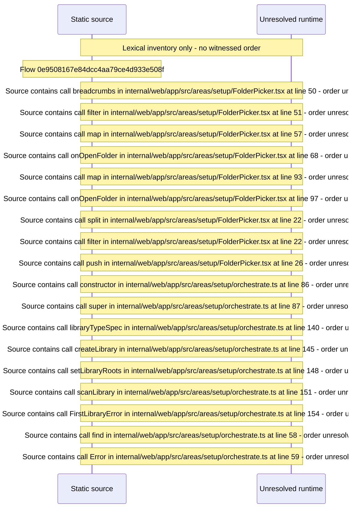

# Setup: pick a library type and folder, create the first Library and scan — flow-diagram

Source revision: e2ffd915f3bda309ca8792f07724053b048ba15f. Trust: generated. Freshness: pinned source; run docs flows check for a later revision.

<!-- flowdocs:paragraph:9c4b31b78600baf2f03fad35648f8643 -->
Static source inventory only; sequence and runtime ordering are unresolved\.

Source: internal/web/app/src/areas/setup/FolderPicker\.tsx:12; symbol: Crumb; span SHA256: 8dc484cd4428026505f71f33237f8927be749ec80598b5c47633346e6be964aa.

