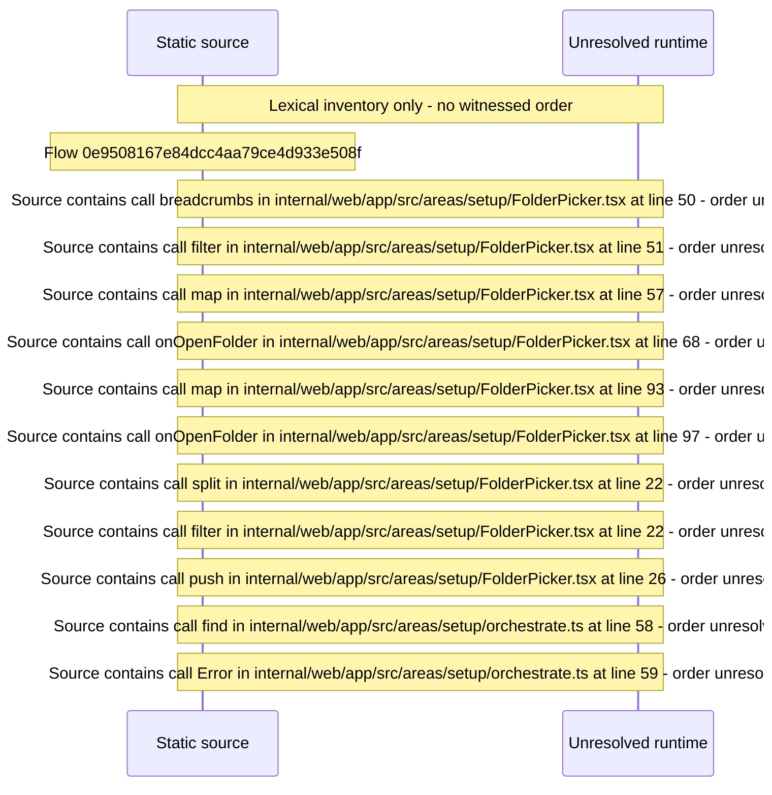

# Setup: pick a library type and folder, create the first Library and scan — flow-diagram

Source revision: d442b4a6a38de86be0670669b3a3f6aa47e80b22. Trust: generated. Freshness: pinned source; run docs flows check for a later revision.

<!-- flowdocs:paragraph:9c4b31b78600baf2f03fad35648f8643 -->
Static source inventory only; sequence and runtime ordering are unresolved\.

Source: internal/web/app/src/areas/setup/FolderPicker\.tsx:41; symbol: FolderPicker; span SHA256: 56637f07f224a16796fbe78c7c3253cd5f8eb8f4f2563bf44e469fdd9b78fe4f.

