# Viewer media card: preview dwell, state overlay, card menu, artwork — flow-diagram

Source revision: d658ad5b71dcb67da0ae540d6d5ff80ca8efefd5. Trust: generated. Freshness: pinned source; run docs flows check for a later revision.

<!-- flowdocs:paragraph:7ed54513f84204eb1d819ccf1fe69a28 -->
Static source inventory only; sequence and runtime ordering are unresolved\.

Source: internal/web/app/src/areas/viewer/components/MediaItemCard\.tsx:259; symbol: CardStateOverlay; span SHA256: 26335e262852cff9dc288f54e524fdb41d5b7de94e8e3b75867f868698d359ae.

```mermaid
sequenceDiagram
    participant S as Static source
    participant U as Unresolved runtime
    Note over S,U: Lexical inventory only - no witnessed order
    Note over S: Flow 17717802bf0fe3c8d0f8324328ac9a31
    Note over S,U: Source contains call useNavigate in internal/web/app/src/areas/viewer/components/MediaItemCard.tsx at line 49 - order unresolved
    Note over S,U: Source contains call useViewerIdentity in internal/web/app/src/areas/viewer/components/MediaItemCard.tsx at line 50 - order unresolved
    Note over S,U: Source contains call useT in internal/web/app/src/areas/viewer/components/MediaItemCard.tsx at line 51 - order unresolved
    Note over S,U: Source contains call useLocation in internal/web/app/src/areas/viewer/components/MediaItemCard.tsx at line 52 - order unresolved
    Note over S,U: Source contains call useState in internal/web/app/src/areas/viewer/components/MediaItemCard.tsx at line 53 - order unresolved
    Note over S,U: Source contains call useState in internal/web/app/src/areas/viewer/components/MediaItemCard.tsx at line 54 - order unresolved
    Note over S,U: Source contains call cardState in internal/web/app/src/areas/viewer/components/MediaItemCard.tsx at line 56 - order unresolved
    Note over S,U: Source contains call t in internal/web/app/src/areas/viewer/components/MediaItemCard.tsx at line 59 - order unresolved
    Note over S,U: Source contains call t in internal/web/app/src/areas/viewer/components/MediaItemCard.tsx at line 60 - order unresolved
    Note over S,U: Source contains call artworkSlotURL in internal/web/app/src/areas/viewer/components/MediaItemCard.tsx at line 61 - order unresolved
    Note over S,U: Source contains call useRef in internal/web/app/src/areas/viewer/components/MediaItemCard.tsx at line 64 - order unresolved
    Note over S,U: Source contains call matchMedia in internal/web/app/src/areas/viewer/components/MediaItemCard.tsx at line 293 - order unresolved
    Note over S,U: Source contains call useT in internal/web/app/src/areas/viewer/components/MediaItemCardMenu.tsx at line 41 - order unresolved
    Note over S,U: Source contains call useState in internal/web/app/src/areas/viewer/components/MediaItemCardMenu.tsx at line 42 - order unresolved
    Note over S,U: Source contains call useState in internal/web/app/src/areas/viewer/components/MediaItemCardMenu.tsx at line 43 - order unresolved
    Note over S,U: Source contains call useItemActions in internal/web/app/src/areas/viewer/components/MediaItemCardMenu.tsx at line 44 - order unresolved
    Note over S,U: Source contains call useEffect in internal/web/app/src/areas/viewer/components/MediaItemCardMenu.tsx at line 50 - order unresolved
    Note over S,U: Source contains call clearTimeout in internal/web/app/src/areas/viewer/components/MediaItemCardMenu.tsx at line 52 - order unresolved
    Note over S,U: Source contains call t in internal/web/app/src/areas/viewer/lib/cardState.ts at line 26 - order unresolved
    Note over S,U: Source contains call t in internal/web/app/src/areas/viewer/lib/cardState.ts at line 32 - order unresolved
    Note over S,U: Source contains call min in internal/web/app/src/areas/viewer/lib/cardState.ts at line 40 - order unresolved
    Note over S,U: Source contains call max in internal/web/app/src/areas/viewer/lib/cardState.ts at line 40 - order unresolved
    Note over S,U: Source contains call round in internal/web/app/src/areas/viewer/lib/cardState.ts at line 40 - order unresolved
    Note over S,U: Source contains call timeLeftLabel in internal/web/app/src/areas/viewer/lib/cardState.ts at line 41 - order unresolved
    Note over S,U: Source contains call max in internal/web/app/src/areas/viewer/lib/cardState.ts at line 57 - order unresolved
    Note over S,U: Source contains call ceil in internal/web/app/src/areas/viewer/lib/cardState.ts at line 57 - order unresolved
    Note over S,U: Source contains call t in internal/web/app/src/areas/viewer/lib/cardState.ts at line 59 - order unresolved
    Note over S,U: Source contains call floor in internal/web/app/src/areas/viewer/lib/cardState.ts at line 59 - order unresolved
    Note over S,U: Source contains call t in internal/web/app/src/areas/viewer/lib/cardState.ts at line 61 - order unresolved
    Note over S,U: Source contains call queueWindow in internal/web/app/src/areas/viewer/components/MediaItemCard.tsx at line 128 - order unresolved
    Note over S,U: Source contains call navigate in internal/web/app/src/areas/viewer/components/MediaItemCard.tsx at line 131 - order unresolved
    Note over S,U: Source contains call navigate in internal/web/app/src/areas/viewer/components/MediaItemCard.tsx at line 133 - order unresolved
    Note over S,U: Source contains call entityLinkState in internal/web/app/src/areas/viewer/components/MediaItemCard.tsx at line 133 - order unresolved
    Note over S,U: Source contains call setTimeout in internal/web/app/src/areas/viewer/components/MediaItemCard.tsx at line 140 - order unresolved
    Note over S,U: Source contains call fetchPreviewInfo in internal/web/app/src/areas/viewer/components/MediaItemCard.tsx at line 142 - order unresolved
    Note over S,U: Source contains call then in internal/web/app/src/areas/viewer/components/MediaItemCard.tsx at line 143 - order unresolved
    Note over S,U: Source contains call setPreviewClip in internal/web/app/src/areas/viewer/components/MediaItemCard.tsx at line 145 - order unresolved
    Note over S,U: Source contains call catch in internal/web/app/src/areas/viewer/components/MediaItemCard.tsx at line 148 - order unresolved
    Note over S,U: Source contains call setPreviewClip in internal/web/app/src/areas/viewer/components/MediaItemCard.tsx at line 150 - order unresolved
    Note over S,U: Source contains call useCallback in internal/web/app/src/areas/viewer/components/MediaItemCard.tsx at line 66 - order unresolved
    Note over S,U: Source contains call clearTimeout in internal/web/app/src/areas/viewer/components/MediaItemCard.tsx at line 68 - order unresolved
    Note over S,U: Source contains call preloadPlayer in internal/web/app/src/areas/viewer/components/MediaItemCard.tsx at line 157 - order unresolved
    Note over S,U: Source contains call clearPreviewTimer in internal/web/app/src/areas/viewer/components/MediaItemCard.tsx at line 158 - order unresolved
    Note over S,U: Source contains call canStartPreview in internal/web/app/src/areas/viewer/components/MediaItemCard.tsx at line 159 - order unresolved
    Note over S,U: Source contains call beginPreviewDwell in internal/web/app/src/areas/viewer/components/MediaItemCard.tsx at line 162 - order unresolved
    Note over S,U: Source contains call stopPreview in internal/web/app/src/areas/viewer/components/MediaItemCard.tsx at line 88 - order unresolved
    Note over S,U: Source contains call useCallback in internal/web/app/src/areas/viewer/components/MediaItemCard.tsx at line 73 - order unresolved
    Note over S,U: Source contains call clearPreviewTimer in internal/web/app/src/areas/viewer/components/MediaItemCard.tsx at line 74 - order unresolved
    Note over S,U: Source contains call setPreviewClip in internal/web/app/src/areas/viewer/components/MediaItemCard.tsx at line 76 - order unresolved
    Note over S,U: Source contains call writeText in internal/web/app/src/areas/viewer/components/MediaItemCardMenu.tsx at line 59 - order unresolved
    Note over S,U: Source contains call then in internal/web/app/src/areas/viewer/components/MediaItemCardMenu.tsx at line 59 - order unresolved
    Note over S,U: Source contains call setCopied in internal/web/app/src/areas/viewer/components/MediaItemCardMenu.tsx at line 61 - order unresolved
    Note over S,U: Source contains call clearTimeout in internal/web/app/src/areas/viewer/components/MediaItemCardMenu.tsx at line 62 - order unresolved
    Note over S,U: Source contains call setTimeout in internal/web/app/src/areas/viewer/components/MediaItemCardMenu.tsx at line 63 - order unresolved
    Note over S,U: Source contains call setCopied in internal/web/app/src/areas/viewer/components/MediaItemCardMenu.tsx at line 63 - order unresolved
    Note over S,U: Source contains call setCopied in internal/web/app/src/areas/viewer/components/MediaItemCardMenu.tsx at line 65 - order unresolved
```

