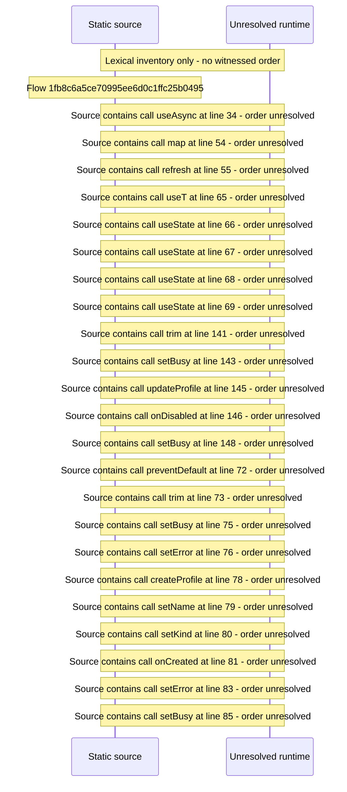

# Console access: create and manage Profiles — flow-diagram

Source revision: 5ffe7939da2318f5153b1a20d0ef6ef94deef162. Trust: generated. Freshness: pinned source; run docs flows check for a later revision.

<!-- flowdocs:paragraph:082d93d1fb01651ea0d2deaff818dcc3 -->
Static source inventory only; sequence and runtime ordering are unresolved\.

Source: internal/web/app/src/areas/console/sections/AccessAdmin\.tsx:6; symbol: AccessAdmin; span SHA256: c16358ed09362a9e222e69940c34cbc673fdce2e160503341857566a3346f415.

