# Viewer header live search with keyboard shortcut — flow-diagram

Source revision: e2ffd915f3bda309ca8792f07724053b048ba15f. Trust: generated. Freshness: pinned source; run docs flows check for a later revision.

<!-- flowdocs:paragraph:e71473953fa4f9ba274a6c9c0a4133b8 -->
Static source inventory only; sequence and runtime ordering are unresolved\.

Source: internal/web/app/src/areas/viewer/components/HeaderSearch\.tsx:24; symbol: Cell; span SHA256: 3b7bbd9317fb2ac063f6d5a3e62b50b6060e672f1448364128bed90693a799f7.

```mermaid
sequenceDiagram
    participant S as Static source
    participant U as Unresolved runtime
    Note over S,U: Lexical inventory only - no witnessed order
    Note over S: Flow 219ee2ba822318eb61cc59b0c0f9ce8f
    Note over S,U: Source contains call useI18n in internal/web/app/src/areas/viewer/components/HeaderSearch.tsx at line 40 - order unresolved
    Note over S,U: Source contains call useDisplayLocale in internal/web/app/src/areas/viewer/components/HeaderSearch.tsx at line 41 - order unresolved
    Note over S,U: Source contains call useNavigate in internal/web/app/src/areas/viewer/components/HeaderSearch.tsx at line 42 - order unresolved
    Note over S,U: Source contains call useLocation in internal/web/app/src/areas/viewer/components/HeaderSearch.tsx at line 43 - order unresolved
    Note over S,U: Source contains call useViewerIdentity in internal/web/app/src/areas/viewer/components/HeaderSearch.tsx at line 44 - order unresolved
    Note over S,U: Source contains call useState in internal/web/app/src/areas/viewer/components/HeaderSearch.tsx at line 48 - order unresolved
    Note over S,U: Source contains call useState in internal/web/app/src/areas/viewer/components/HeaderSearch.tsx at line 49 - order unresolved
    Note over S,U: Source contains call useLiveSearch in internal/web/app/src/areas/viewer/components/HeaderSearch.tsx at line 50 - order unresolved
    Note over S,U: Source contains call useSearchShortcut in internal/web/app/src/areas/viewer/components/HeaderSearch.tsx at line 51 - order unresolved
    Note over S,U: Source contains call groupSearchRows in internal/web/app/src/areas/viewer/components/HeaderSearch.tsx at line 55 - order unresolved
    Note over S,U: Source contains call slice in internal/web/app/src/areas/viewer/components/HeaderSearch.tsx at line 55 - order unresolved
    Note over S,U: Source contains call map in internal/web/app/src/areas/viewer/components/HeaderSearch.tsx at line 58 - order unresolved
    Note over S,U: Source contains call flatMap in internal/web/app/src/areas/viewer/components/HeaderSearch.tsx at line 61 - order unresolved
    Note over S,U: Source contains call searchRowPlayPath in internal/web/app/src/areas/viewer/components/HeaderSearch.tsx at line 62 - order unresolved
    Note over S,U: Source contains call useEffect in internal/web/app/src/areas/viewer/components/HeaderSearch.tsx at line 79 - order unresolved
    Note over S,U: Source contains call setOpen in internal/web/app/src/areas/viewer/components/HeaderSearch.tsx at line 80 - order unresolved
    Note over S,U: Source contains call setQuery in internal/web/app/src/areas/viewer/components/HeaderSearch.tsx at line 81 - order unresolved
    Note over S,U: Source contains call useMemo in internal/web/app/src/areas/viewer/components/HeaderSearch.tsx at line 87 - order unresolved
    Note over S,U: Source contains call playQueueOf in internal/web/app/src/areas/viewer/components/HeaderSearch.tsx at line 89 - order unresolved
    Note over S,U: Source contains call flatMap in internal/web/app/src/areas/viewer/components/HeaderSearch.tsx at line 89 - order unresolved
    Note over S,U: Source contains call filter in internal/web/app/src/areas/viewer/components/HeaderSearch.tsx at line 89 - order unresolved
    Note over S,U: Source contains call map in internal/web/app/src/areas/viewer/components/HeaderSearch.tsx at line 89 - order unresolved
    Note over S,U: Source contains call useState in internal/web/app/src/areas/viewer/components/HeaderSearch.tsx at line 257 - order unresolved
    Note over S,U: Source contains call artworkSlotURL in internal/web/app/src/areas/viewer/components/HeaderSearch.tsx at line 258 - order unresolved
    Note over S,U: Source contains call searchRowDetail in internal/web/app/src/areas/viewer/components/HeaderSearch.tsx at line 259 - order unresolved
    Note over S,U: Source contains call filter in internal/web/app/src/areas/viewer/components/HeaderSearch.tsx at line 259 - order unresolved
    Note over S,U: Source contains call join in internal/web/app/src/areas/viewer/components/HeaderSearch.tsx at line 259 - order unresolved
    Note over S,U: Source contains call onActivate in internal/web/app/src/areas/viewer/components/HeaderSearch.tsx at line 265 - order unresolved
    Note over S,U: Source contains call artworkBucketURL in internal/web/app/src/areas/viewer/components/HeaderSearch.tsx at line 273 - order unresolved
    Note over S,U: Source contains call setImageFailed in internal/web/app/src/areas/viewer/components/HeaderSearch.tsx at line 274 - order unresolved
    Note over S,U: Source contains call onActivate in internal/web/app/src/areas/viewer/components/HeaderSearch.tsx at line 291 - order unresolved
    Note over S,U: Source contains call useLocation in internal/web/app/src/areas/viewer/components/ViewerActions.tsx at line 10 - order unresolved
    Note over S,U: Source contains call includes in internal/web/app/src/areas/viewer/lib/useLiveSearch.ts at line 101 - order unresolved
    Note over S,U: Source contains call trim in internal/web/app/src/areas/viewer/lib/useLiveSearch.ts at line 36 - order unresolved
    Note over S,U: Source contains call useState in internal/web/app/src/areas/viewer/lib/useLiveSearch.ts at line 38 - order unresolved
    Note over S,U: Source contains call useEffect in internal/web/app/src/areas/viewer/lib/useLiveSearch.ts at line 40 - order unresolved
    Note over S,U: Source contains call setSettled in internal/web/app/src/areas/viewer/lib/useLiveSearch.ts at line 42 - order unresolved
    Note over S,U: Source contains call setPending in internal/web/app/src/areas/viewer/lib/useLiveSearch.ts at line 43 - order unresolved
    Note over S,U: Source contains call setPending in internal/web/app/src/areas/viewer/lib/useLiveSearch.ts at line 47 - order unresolved
    Note over S,U: Source contains call AbortController in internal/web/app/src/areas/viewer/lib/useLiveSearch.ts at line 48 - order unresolved
    Note over S,U: Source contains call useEffect in internal/web/app/src/areas/viewer/lib/useLiveSearch.ts at line 107 - order unresolved
    Note over S,U: Source contains call queueWindow in internal/web/app/src/areas/viewer/components/HeaderSearch.tsx at line 99 - order unresolved
    Note over S,U: Source contains call navigate in internal/web/app/src/areas/viewer/components/HeaderSearch.tsx at line 102 - order unresolved
    Note over S,U: Source contains call searchRowPlayPath in internal/web/app/src/areas/viewer/components/HeaderSearch.tsx at line 102 - order unresolved
    Note over S,U: Source contains call navigate in internal/web/app/src/areas/viewer/components/HeaderSearch.tsx at line 104 - order unresolved
    Note over S,U: Source contains call searchRowOpenPath in internal/web/app/src/areas/viewer/components/HeaderSearch.tsx at line 104 - order unresolved
    Note over S,U: Source contains call entityLinkState in internal/web/app/src/areas/viewer/components/HeaderSearch.tsx at line 105 - order unresolved
    Note over S,U: Source contains call preventDefault in internal/web/app/src/areas/viewer/components/HeaderSearch.tsx at line 112 - order unresolved
    Note over S,U: Source contains call navigate in internal/web/app/src/areas/viewer/components/HeaderSearch.tsx at line 113 - order unresolved
    Note over S,U: Source contains call searchPagePath in internal/web/app/src/areas/viewer/components/HeaderSearch.tsx at line 113 - order unresolved
    Note over S,U: Source contains call preventDefault in internal/web/app/src/areas/viewer/components/HeaderSearch.tsx at line 115 - order unresolved
    Note over S,U: Source contains call setQuery in internal/web/app/src/areas/viewer/components/HeaderSearch.tsx at line 116 - order unresolved
    Note over S,U: Source contains call toLowerCase in internal/web/app/src/areas/viewer/lib/useLiveSearch.ts at line 111 - order unresolved
    Note over S,U: Source contains call isEditable in internal/web/app/src/areas/viewer/lib/useLiveSearch.ts at line 112 - order unresolved
    Note over S,U: Source contains call preventDefault in internal/web/app/src/areas/viewer/lib/useLiveSearch.ts at line 116 - order unresolved
    Note over S,U: Source contains call focus in internal/web/app/src/areas/viewer/lib/useLiveSearch.ts at line 117 - order unresolved
    Note over S,U: Source contains call select in internal/web/app/src/areas/viewer/lib/useLiveSearch.ts at line 118 - order unresolved
    Note over S,U: Source contains call setSettled in internal/web/app/src/areas/viewer/lib/useLiveSearch.ts at line 51 - order unresolved
    Note over S,U: Source contains call setPending in internal/web/app/src/areas/viewer/lib/useLiveSearch.ts at line 52 - order unresolved
```

