# Rescan a library or all libraries and follow scan state — flow-diagram

Source revision: 5ffe7939da2318f5153b1a20d0ef6ef94deef162. Trust: generated. Freshness: pinned source; run docs flows check for a later revision.

<!-- flowdocs:paragraph:b04e658d96258cd9a9a4a89055b5618b -->
Static source inventory only; sequence and runtime ordering are unresolved\.

Source: internal/web/app/src/components/beamfall/LibraryRescan\.tsx:40; symbol: emit; span SHA256: 116ad8a4fd3b98c055210f04c3ee6068df2f89d1e8e1f901dd3859bffec1de45.

```mermaid
sequenceDiagram
    participant S as Static source
    participant U as Unresolved runtime
    Note over S,U: Lexical inventory only - no witnessed order
    Note over S: Flow 21d4c394c2e983b00ddb45fdec2594fc
    Note over S,U: Source contains call listener at line 41 - order unresolved
    Note over S,U: Source contains call setInterval at line 105 - order unresolved
    Note over S,U: Source contains call poll at line 105 - order unresolved
    Note over S,U: Source contains call emit at line 109 - order unresolved
    Note over S,U: Source contains call poll at line 110 - order unresolved
    Note over S,U: Source contains call phaseFor at line 63 - order unresolved
    Note over S,U: Source contains call some at line 55 - order unresolved
    Note over S,U: Source contains call has at line 55 - order unresolved
    Note over S,U: Source contains call find at line 56 - order unresolved
    Note over S,U: Source contains call entries at line 73 - order unresolved
    Note over S,U: Source contains call filter at line 73 - order unresolved
    Note over S,U: Source contains call clearInterval at line 75 - order unresolved
    Note over S,U: Source contains call fetchJobs at line 81 - order unresolved
    Note over S,U: Source contains call isAuthRejection at line 83 - order unresolved
    Note over S,U: Source contains call clearInterval at line 84 - order unresolved
    Note over S,U: Source contains call emit at line 87 - order unresolved
    Note over S,U: Source contains call Map at line 91 - order unresolved
    Note over S,U: Source contains call map at line 91 - order unresolved
    Note over S,U: Source contains call get at line 94 - order unresolved
    Note over S,U: Source contains call map at line 96 - order unresolved
    Note over S,U: Source contains call get at line 98 - order unresolved
    Note over S,U: Source contains call has at line 98 - order unresolved
    Note over S,U: Source contains call setState at line 100 - order unresolved
    Note over S,U: Source contains call foldRescan at line 100 - order unresolved
    Note over S,U: Source contains call get at line 50 - order unresolved
    Note over S,U: Source contains call set at line 45 - order unresolved
    Note over S,U: Source contains call emit at line 46 - order unresolved
    Note over S,U: Source contains call has at line 115 - order unresolved
    Note over S,U: Source contains call rescanState at line 115 - order unresolved
    Note over S,U: Source contains call setState at line 116 - order unresolved
    Note over S,U: Source contains call allSettled at line 117 - order unresolved
    Note over S,U: Source contains call map at line 117 - order unresolved
    Note over S,U: Source contains call scanLibrary at line 117 - order unresolved
    Note over S,U: Source contains call push at line 122 - order unresolved
    Note over S,U: Source contains call String at line 129 - order unresolved
    Note over S,U: Source contains call setState at line 133 - order unresolved
    Note over S,U: Source contains call setState at line 136 - order unresolved
    Note over S,U: Source contains call foldRescan at line 136 - order unresolved
    Note over S,U: Source contains call ensurePolling at line 137 - order unresolved
```

