# Rescan a library or all libraries and follow scan state — flow-diagram

Source revision: d658ad5b71dcb67da0ae540d6d5ff80ca8efefd5. Trust: generated. Freshness: pinned source; run docs flows check for a later revision.

<!-- flowdocs:paragraph:b04e658d96258cd9a9a4a89055b5618b -->
Static source inventory only; sequence and runtime ordering are unresolved\.

Source: internal/web/app/src/components/beamfall/LibraryRescan\.tsx:28; symbol: ACTIVE; span SHA256: e102279ed89eede4d9a82b5ea48e0c3014f5e434dc686556347bc33a19bc7aeb.

```mermaid
sequenceDiagram
    participant S as Static source
    participant U as Unresolved runtime
    Note over S,U: Lexical inventory only - no witnessed order
    Note over S: Flow 21d4c394c2e983b00ddb45fdec2594fc
    Note over S,U: Source contains call Set at line 28 - order unresolved
    Note over S,U: Source contains call useT at line 202 - order unresolved
    Note over S,U: Source contains call useAnyRescanActive at line 203 - order unresolved
    Note over S,U: Source contains call useEffect at line 204 - order unresolved
    Note over S,U: Source contains call ensurePolling at line 205 - order unresolved
    Note over S,U: Source contains call filter at line 207 - order unresolved
    Note over S,U: Source contains call startRescan at line 215 - order unresolved
    Note over S,U: Source contains call t at line 219 - order unresolved
    Note over S,U: Source contains call useT at line 177 - order unresolved
    Note over S,U: Source contains call useRescanState at line 178 - order unresolved
    Note over S,U: Source contains call has at line 179 - order unresolved
    Note over S,U: Source contains call t at line 185 - order unresolved
    Note over S,U: Source contains call startRescan at line 186 - order unresolved
    Note over S,U: Source contains call t at line 189 - order unresolved
    Note over S,U: Source contains call useT at line 226 - order unresolved
    Note over S,U: Source contains call useRescanState at line 227 - order unresolved
    Note over S,U: Source contains call useEffect at line 228 - order unresolved
    Note over S,U: Source contains call ensurePolling at line 229 - order unresolved
    Note over S,U: Source contains call t at line 233 - order unresolved
    Note over S,U: Source contains call find at line 236 - order unresolved
    Note over S,U: Source contains call jobProgressDetail at line 237 - order unresolved
    Note over S,U: Source contains call t at line 241 - order unresolved
    Note over S,U: Source contains call t at line 243 - order unresolved
    Note over S,U: Source contains call t at line 245 - order unresolved
    Note over S,U: Source contains call listener at line 41 - order unresolved
    Note over S,U: Source contains call setInterval at line 105 - order unresolved
    Note over S,U: Source contains call poll at line 105 - order unresolved
    Note over S,U: Source contains call emit at line 109 - order unresolved
    Note over S,U: Source contains call poll at line 110 - order unresolved
    Note over S,U: Source contains call phaseFor at line 63 - order unresolved
    Note over S,U: Source contains call some at line 55 - order unresolved
    Note over S,U: Source contains call has at line 55 - order unresolved
    Note over S,U: Source contains call find at line 56 - order unresolved
    Note over S,U: Source contains call entries at line 73 - order unresolved
    Note over S,U: Source contains call filter at line 73 - order unresolved
    Note over S,U: Source contains call clearInterval at line 75 - order unresolved
    Note over S,U: Source contains call fetchJobs at line 81 - order unresolved
    Note over S,U: Source contains call isAuthRejection at line 83 - order unresolved
    Note over S,U: Source contains call clearInterval at line 84 - order unresolved
    Note over S,U: Source contains call emit at line 87 - order unresolved
    Note over S,U: Source contains call Map at line 91 - order unresolved
    Note over S,U: Source contains call map at line 91 - order unresolved
    Note over S,U: Source contains call get at line 94 - order unresolved
    Note over S,U: Source contains call map at line 96 - order unresolved
    Note over S,U: Source contains call get at line 98 - order unresolved
    Note over S,U: Source contains call has at line 98 - order unresolved
    Note over S,U: Source contains call setState at line 100 - order unresolved
    Note over S,U: Source contains call foldRescan at line 100 - order unresolved
    Note over S,U: Source contains call get at line 50 - order unresolved
    Note over S,U: Source contains call clear at line 161 - order unresolved
    Note over S,U: Source contains call clearInterval at line 162 - order unresolved
    Note over S,U: Source contains call emit at line 165 - order unresolved
    Note over S,U: Source contains call set at line 45 - order unresolved
    Note over S,U: Source contains call emit at line 46 - order unresolved
    Note over S,U: Source contains call has at line 115 - order unresolved
    Note over S,U: Source contains call rescanState at line 115 - order unresolved
    Note over S,U: Source contains call setState at line 116 - order unresolved
    Note over S,U: Source contains call allSettled at line 117 - order unresolved
    Note over S,U: Source contains call map at line 117 - order unresolved
    Note over S,U: Source contains call scanLibrary at line 117 - order unresolved
    Note over S,U: Source contains call push at line 122 - order unresolved
    Note over S,U: Source contains call String at line 129 - order unresolved
    Note over S,U: Source contains call setState at line 133 - order unresolved
    Note over S,U: Source contains call setState at line 136 - order unresolved
    Note over S,U: Source contains call foldRescan at line 136 - order unresolved
    Note over S,U: Source contains call ensurePolling at line 137 - order unresolved
    Note over S,U: Source contains call add at line 143 - order unresolved
    Note over S,U: Source contains call delete at line 144 - order unresolved
    Note over S,U: Source contains call useSyncExternalStore at line 153 - order unresolved
    Note over S,U: Source contains call values at line 155 - order unresolved
    Note over S,U: Source contains call some at line 155 - order unresolved
    Note over S,U: Source contains call has at line 155 - order unresolved
    Note over S,U: Source contains call useSyncExternalStore at line 148 - order unresolved
    Note over S,U: Source contains call rescanState at line 148 - order unresolved
```

