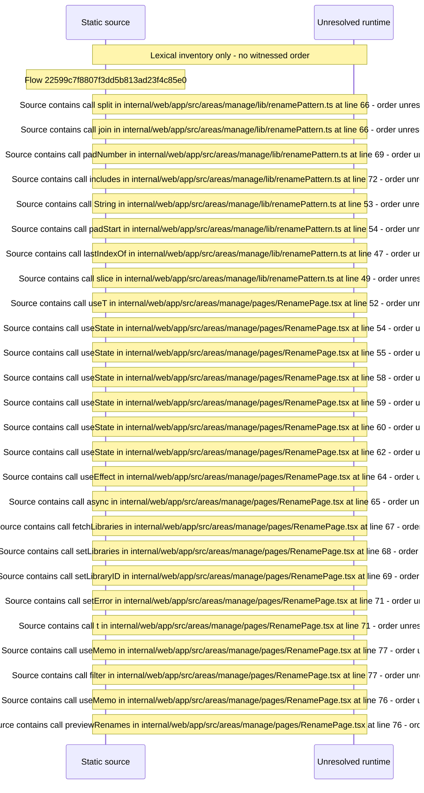

# Manage rename: pattern preview, batch rename managed paths, undo — flow-diagram

Source revision: 5ffe7939da2318f5153b1a20d0ef6ef94deef162. Trust: generated. Freshness: pinned source; run docs flows check for a later revision.

<!-- flowdocs:paragraph:a7ee900810878723a59ba48b854a0455 -->
Static source inventory only; sequence and runtime ordering are unresolved\.

Source: internal/web/app/src/areas/manage/lib/renamePattern\.ts:63; symbol: applyToStem; span SHA256: c1c4c153726740130c39d9ae2e15b73808657724c910cb51655d761791d61077.

