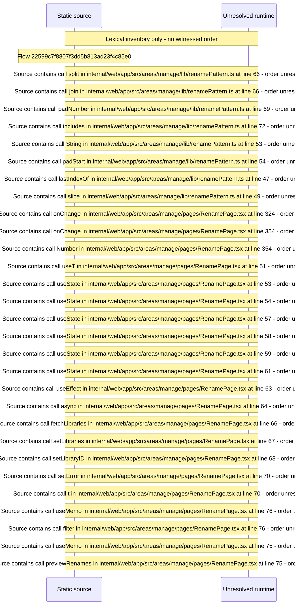

# Manage rename: pattern preview, batch rename managed paths, undo — flow-diagram

Source revision: 6742c2361d684c662e9ccb84d344a2200c377582. Trust: generated. Freshness: pinned source; run docs flows check for a later revision.

<!-- flowdocs:paragraph:a7ee900810878723a59ba48b854a0455 -->
Static source inventory only; sequence and runtime ordering are unresolved\.

Source: internal/web/app/src/areas/manage/lib/powertools\.ts:94; symbol: BATCH\_RENAME\_MUTATION; span SHA256: e5dd76e8dbf66d08a67333fab549d2fe731dd892ba3f96313995cd7a069e2b96.

