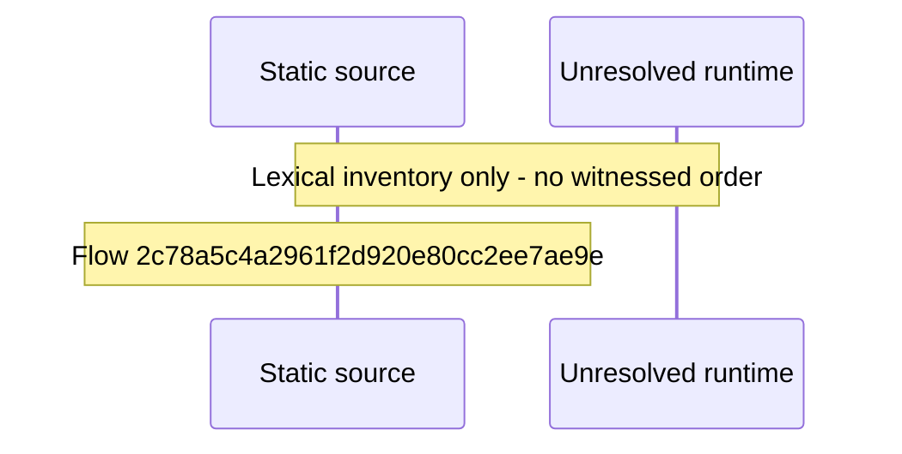

# GraphQL client wire types shared by every data call — flow-diagram

Source revision: 6742c2361d684c662e9ccb84d344a2200c377582. Trust: generated. Freshness: pinned source; run docs flows check for a later revision.

<!-- flowdocs:paragraph:5f4cfac7a994a079ff0594655af430dd -->
Static source inventory only; sequence and runtime ordering are unresolved\.

Source: internal/web/app/src/lib/graphql/types\.ts:839; symbol: APITokenInfo; span SHA256: 986fb0dd388840d93062ed7fc47886157049d0fe9e471c4bed36dd619e518a14.

