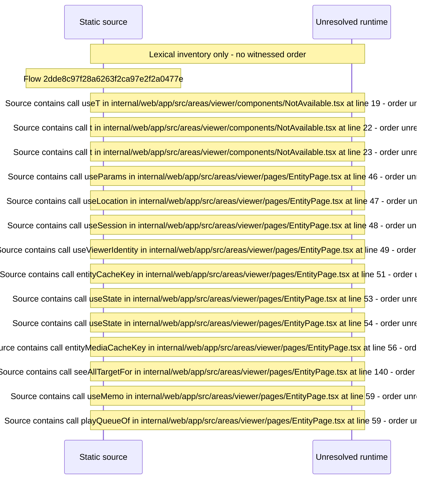

# Viewer entity detail page and not\-available state — flow-diagram

Source revision: d442b4a6a38de86be0670669b3a3f6aa47e80b22. Trust: generated. Freshness: pinned source; run docs flows check for a later revision.

<!-- flowdocs:paragraph:006b61f503bce0588abf5d333fc16f6f -->
Static source inventory only; sequence and runtime ordering are unresolved\.

Source: internal/web/app/src/areas/viewer/components/NotAvailable\.tsx:12; symbol: NotAvailable; span SHA256: bcc1fb11f85246e5aea8aaf1983829233de1717f09c48dc7c7b0bcd21e68c688.

