# Manage artwork slots and candidates — flow-diagram

Source revision: 6742c2361d684c662e9ccb84d344a2200c377582. Trust: generated. Freshness: pinned source; run docs flows check for a later revision.

<!-- flowdocs:paragraph:162629d2a5437184156d26a846172605 -->
Static source inventory only; sequence and runtime ordering are unresolved\.

Source: internal/web/app/src/areas/manage/pages/ArtworkPage\.tsx:34; symbol: ArtworkPage; span SHA256: 4de7fcc23356a35273de7275a550023fc96b76a9ce3b9990683a7e6a851f080d.

```mermaid
sequenceDiagram
    participant S as Static source
    participant U as Unresolved runtime
    Note over S,U: Lexical inventory only - no witnessed order
    Note over S: Flow 2ee85e517ea59a2a44c6f1b91291d7fd
    Note over S,U: Source contains call useT at line 35 - order unresolved
    Note over S,U: Source contains call useState at line 36 - order unresolved
    Note over S,U: Source contains call useState at line 37 - order unresolved
    Note over S,U: Source contains call useState at line 40 - order unresolved
    Note over S,U: Source contains call useT at line 117 - order unresolved
    Note over S,U: Source contains call t at line 122 - order unresolved
    Note over S,U: Source contains call t at line 124 - order unresolved
    Note over S,U: Source contains call t at line 126 - order unresolved
    Note over S,U: Source contains call map at line 129 - order unresolved
    Note over S,U: Source contains call isRelativePreviewURL at line 135 - order unresolved
    Note over S,U: Source contains call t at line 139 - order unresolved
    Note over S,U: Source contains call provenance at line 145 - order unresolved
    Note over S,U: Source contains call provenance at line 147 - order unresolved
    Note over S,U: Source contains call t at line 147 - order unresolved
    Note over S,U: Source contains call t at line 150 - order unresolved
    Note over S,U: Source contains call onPin at line 157 - order unresolved
    Note over S,U: Source contains call t at line 159 - order unresolved
    Note over S,U: Source contains call startsWith at line 22 - order unresolved
    Note over S,U: Source contains call filter at line 26 - order unresolved
    Note over S,U: Source contains call join at line 26 - order unresolved
    Note over S,U: Source contains call async at line 42 - order unresolved
    Note over S,U: Source contains call fetchArtworkCandidates at line 44 - order unresolved
    Note over S,U: Source contains call setSlots at line 45 - order unresolved
    Note over S,U: Source contains call setSlots at line 47 - order unresolved
    Note over S,U: Source contains call setError at line 48 - order unresolved
    Note over S,U: Source contains call t at line 48 - order unresolved
    Note over S,U: Source contains call async at line 52 - order unresolved
    Note over S,U: Source contains call setError at line 53 - order unresolved
    Note over S,U: Source contains call trim at line 54 - order unresolved
    Note over S,U: Source contains call setLoadedID at line 56 - order unresolved
    Note over S,U: Source contains call setSlots at line 57 - order unresolved
    Note over S,U: Source contains call all at line 58 - order unresolved
    Note over S,U: Source contains call map at line 58 - order unresolved
    Note over S,U: Source contains call loadSlot at line 58 - order unresolved
    Note over S,U: Source contains call async at line 61 - order unresolved
    Note over S,U: Source contains call setError at line 62 - order unresolved
    Note over S,U: Source contains call pinArtworkCandidate at line 64 - order unresolved
    Note over S,U: Source contains call loadSlot at line 66 - order unresolved
    Note over S,U: Source contains call setError at line 68 - order unresolved
    Note over S,U: Source contains call t at line 68 - order unresolved
```

