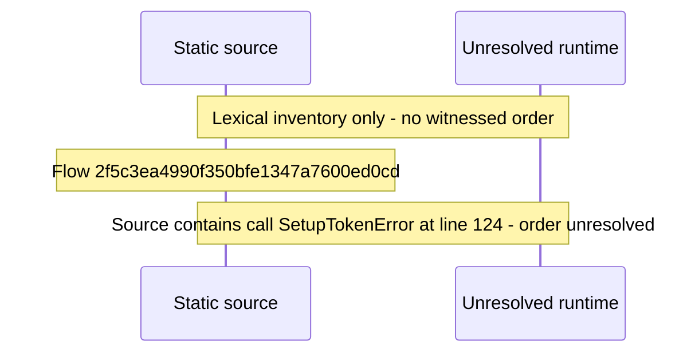

# Setup: choose sign\-in security mode and create the owner Profile — flow-diagram

Source revision: d442b4a6a38de86be0670669b3a3f6aa47e80b22. Trust: generated. Freshness: pinned source; run docs flows check for a later revision.

<!-- flowdocs:paragraph:383f60ef74dfd5713690f4a85a5785fe -->
Static source inventory only; sequence and runtime ordering are unresolved\.

Source: internal/web/app/src/areas/setup/orchestrate\.ts:107; symbol: bootstrapSetup; span SHA256: 3bb47051ddab2eb6bfcbd03e31797b9d0edd4a3547d7b65aa30e68460c621347.

