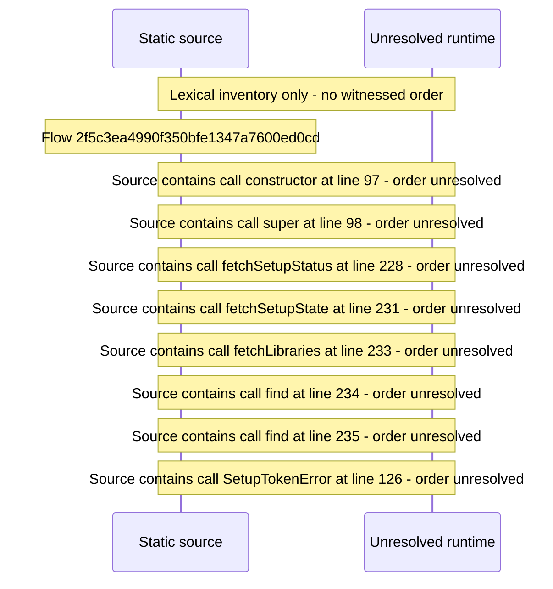

# Setup: choose sign\-in security mode and create the owner Profile — flow-diagram

Source revision: 6742c2361d684c662e9ccb84d344a2200c377582. Trust: generated. Freshness: pinned source; run docs flows check for a later revision.

<!-- flowdocs:paragraph:383f60ef74dfd5713690f4a85a5785fe -->
Static source inventory only; sequence and runtime ordering are unresolved\.

Source: internal/web/app/src/areas/setup/SetupWizard\.tsx:88; symbol: SECURITY\_MODES; span SHA256: 009350b6896c002518fa268b58f8440741d9067009d6d86cabe95062b7ec28f7.

