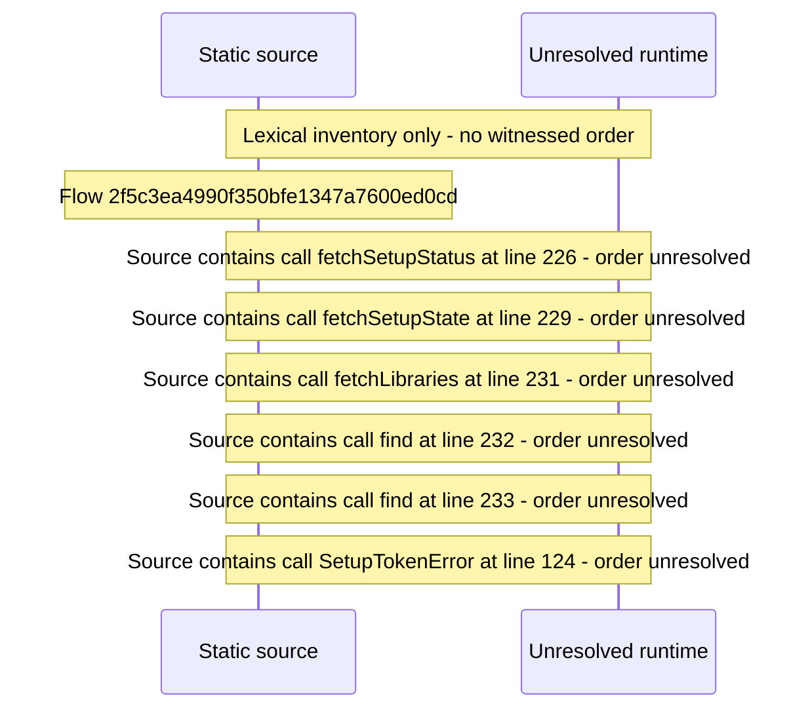

# Setup: choose sign\-in security mode and create the owner Profile — flow-diagram

Source revision: e417fb394873a04fbd27fb8d5bcbca5484c8747f. Trust: generated. Freshness: pinned source; run docs flows check for a later revision.

<!-- flowdocs:paragraph:383f60ef74dfd5713690f4a85a5785fe -->
Static source inventory only; sequence and runtime ordering are unresolved\.

Source: internal/web/app/src/areas/setup/orchestrate\.ts:225; symbol: bootstrapResume; span SHA256: a688d5610f848cc6ce5b1f97c8e93be757d4d0752bc0a1a7adb7f77f261c717a.

