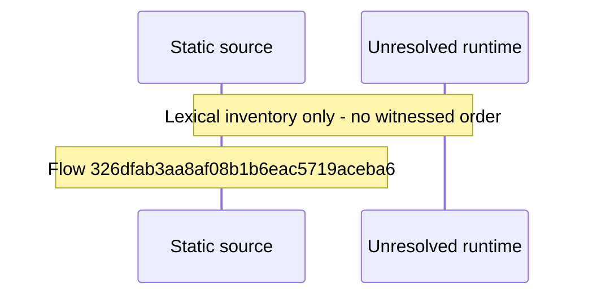

# Shell and per\-area error boundaries with reload panel — flow-diagram

Source revision: d442b4a6a38de86be0670669b3a3f6aa47e80b22. Trust: generated. Freshness: pinned source; run docs flows check for a later revision.

<!-- flowdocs:paragraph:649fcde6db25e31b1d40b6f848e8a733 -->
Static source inventory only; sequence and runtime ordering are unresolved\.

Source: internal/web/app/src/components/chrome/ErrorBoundary\.tsx:77; symbol: AreaErrorBoundary; span SHA256: 4dbf81195283cac8eb9990a580a78f24388c2e4d6586a5164893c5524057071f.

