# Console play history: filters, history table and rankings — flow-diagram

Source revision: 6742c2361d684c662e9ccb84d344a2200c377582. Trust: generated. Freshness: pinned source; run docs flows check for a later revision.

<!-- flowdocs:paragraph:1c42c21ee8caeaea6f5f5e8a17af475b -->
Static source inventory only; sequence and runtime ordering are unresolved\.

Source: internal/web/app/src/areas/console/sections/PlayHistory\.tsx:35; symbol: ALL; span SHA256: ff90f3c4c9e00f62141a4cbb65a7eb2dc81a58af6fd26e22ce851a90921cf523.

```mermaid
sequenceDiagram
    participant S as Static source
    participant U as Unresolved runtime
    Note over S,U: Lexical inventory only - no witnessed order
    Note over S: Flow 349614c235c4bddc845fb9b2075ffd06
    Note over S,U: Source contains call useT in internal/web/app/src/areas/console/sections/PlayHistory.tsx at line 57 - order unresolved
    Note over S,U: Source contains call useState in internal/web/app/src/areas/console/sections/PlayHistory.tsx at line 58 - order unresolved
    Note over S,U: Source contains call useState in internal/web/app/src/areas/console/sections/PlayHistory.tsx at line 59 - order unresolved
    Note over S,U: Source contains call useState in internal/web/app/src/areas/console/sections/PlayHistory.tsx at line 60 - order unresolved
    Note over S,U: Source contains call useState in internal/web/app/src/areas/console/sections/PlayHistory.tsx at line 61 - order unresolved
    Note over S,U: Source contains call useAsync in internal/web/app/src/areas/console/sections/PlayHistory.tsx at line 62 - order unresolved
    Note over S,U: Source contains call useAsync in internal/web/app/src/areas/console/sections/PlayHistory.tsx at line 63 - order unresolved
    Note over S,U: Source contains call useAsync in internal/web/app/src/areas/console/sections/PlayHistory.tsx at line 64 - order unresolved
    Note over S,U: Source contains call fetchPlayHistory in internal/web/app/src/areas/console/sections/PlayHistory.tsx at line 66 - order unresolved
    Note over S,U: Source contains call dayStart in internal/web/app/src/areas/console/sections/PlayHistory.tsx at line 70 - order unresolved
    Note over S,U: Source contains call dayStart in internal/web/app/src/areas/console/sections/PlayHistory.tsx at line 71 - order unresolved
    Note over S,U: Source contains call t in internal/web/app/src/areas/console/sections/PlayHistory.tsx at line 82 - order unresolved
    Note over S,U: Source contains call t in internal/web/app/src/areas/console/sections/PlayHistory.tsx at line 88 - order unresolved
    Note over S,U: Source contains call map in internal/web/app/src/areas/console/sections/PlayHistory.tsx at line 89 - order unresolved
    Note over S,U: Source contains call t in internal/web/app/src/areas/console/sections/PlayHistory.tsx at line 97 - order unresolved
    Note over S,U: Source contains call t in internal/web/app/src/areas/console/sections/PlayHistory.tsx at line 103 - order unresolved
    Note over S,U: Source contains call map in internal/web/app/src/areas/console/sections/PlayHistory.tsx at line 104 - order unresolved
    Note over S,U: Source contains call t in internal/web/app/src/areas/console/sections/PlayHistory.tsx at line 112 - order unresolved
    Note over S,U: Source contains call setFrom in internal/web/app/src/areas/console/sections/PlayHistory.tsx at line 119 - order unresolved
    Note over S,U: Source contains call t in internal/web/app/src/areas/console/sections/PlayHistory.tsx at line 122 - order unresolved
    Note over S,U: Source contains call setTo in internal/web/app/src/areas/console/sections/PlayHistory.tsx at line 129 - order unresolved
    Note over S,U: Source contains call t in internal/web/app/src/areas/console/sections/PlayHistory.tsx at line 142 - order unresolved
    Note over S,U: Source contains call t in internal/web/app/src/areas/console/sections/PlayHistory.tsx at line 143 - order unresolved
    Note over S,U: Source contains call t in internal/web/app/src/areas/console/sections/PlayHistory.tsx at line 144 - order unresolved
    Note over S,U: Source contains call t in internal/web/app/src/areas/console/sections/PlayHistory.tsx at line 145 - order unresolved
    Note over S,U: Source contains call t in internal/web/app/src/areas/console/sections/PlayHistory.tsx at line 146 - order unresolved
    Note over S,U: Source contains call map in internal/web/app/src/areas/console/sections/PlayHistory.tsx at line 150 - order unresolved
    Note over S,U: Source contains call Date in internal/web/app/src/areas/console/sections/PlayHistory.tsx at line 153 - order unresolved
    Note over S,U: Source contains call toLocaleString in internal/web/app/src/areas/console/sections/PlayHistory.tsx at line 153 - order unresolved
    Note over S,U: Source contains call t in internal/web/app/src/areas/console/sections/PlayHistory.tsx at line 163 - order unresolved
    Note over S,U: Source contains call watched in internal/web/app/src/areas/console/sections/PlayHistory.tsx at line 167 - order unresolved
    Note over S,U: Source contains call t in internal/web/app/src/areas/console/sections/PlayHistory.tsx at line 170 - order unresolved
    Note over S,U: Source contains call useT in internal/web/app/src/areas/console/sections/PlayHistory.tsx at line 191 - order unresolved
    Note over S,U: Source contains call max in internal/web/app/src/areas/console/sections/PlayHistory.tsx at line 192 - order unresolved
    Note over S,U: Source contains call map in internal/web/app/src/areas/console/sections/PlayHistory.tsx at line 192 - order unresolved
    Note over S,U: Source contains call t in internal/web/app/src/areas/console/sections/PlayHistory.tsx at line 195 - order unresolved
    Note over S,U: Source contains call map in internal/web/app/src/areas/console/sections/PlayHistory.tsx at line 197 - order unresolved
    Note over S,U: Source contains call t in internal/web/app/src/areas/console/sections/PlayHistory.tsx at line 205 - order unresolved
    Note over S,U: Source contains call watched in internal/web/app/src/areas/console/sections/PlayHistory.tsx at line 205 - order unresolved
    Note over S,U: Source contains call useT in internal/web/app/src/areas/console/sections/PlayHistory.tsx at line 215 - order unresolved
    Note over S,U: Source contains call useAsync in internal/web/app/src/areas/console/sections/PlayHistory.tsx at line 217 - order unresolved
    Note over S,U: Source contains call fetchPlayStats in internal/web/app/src/areas/console/sections/PlayHistory.tsx at line 217 - order unresolved
    Note over S,U: Source contains call map in internal/web/app/src/areas/console/sections/PlayHistory.tsx at line 218 - order unresolved
    Note over S,U: Source contains call map in internal/web/app/src/areas/console/sections/PlayHistory.tsx at line 224 - order unresolved
    Note over S,U: Source contains call map in internal/web/app/src/areas/console/sections/PlayHistory.tsx at line 237 - order unresolved
    Note over S,U: Source contains call setDays in internal/web/app/src/areas/console/sections/PlayHistory.tsx at line 243 - order unresolved
    Note over S,U: Source contains call t in internal/web/app/src/areas/console/sections/PlayHistory.tsx at line 245 - order unresolved
    Note over S,U: Source contains call split in internal/web/app/src/areas/console/sections/PlayHistory.tsx at line 51 - order unresolved
    Note over S,U: Source contains call map in internal/web/app/src/areas/console/sections/PlayHistory.tsx at line 51 - order unresolved
    Note over S,U: Source contains call Date in internal/web/app/src/areas/console/sections/PlayHistory.tsx at line 53 - order unresolved
    Note over S,U: Source contains call toISOString in internal/web/app/src/areas/console/sections/PlayHistory.tsx at line 53 - order unresolved
    Note over S,U: Source contains call max in internal/web/app/src/areas/console/sections/PlayHistory.tsx at line 41 - order unresolved
    Note over S,U: Source contains call round in internal/web/app/src/areas/console/sections/PlayHistory.tsx at line 41 - order unresolved
    Note over S,U: Source contains call floor in internal/web/app/src/areas/console/sections/PlayHistory.tsx at line 42 - order unresolved
    Note over S,U: Source contains call floor in internal/web/app/src/areas/console/sections/PlayHistory.tsx at line 43 - order unresolved
    Note over S,U: Source contains call map in internal/web/app/src/lib/graphql/console.ts at line 750 - order unresolved
```

