# Manage libraries: library list and folder tree — flow-diagram

Source revision: e417fb394873a04fbd27fb8d5bcbca5484c8747f. Trust: generated. Freshness: pinned source; run docs flows check for a later revision.

<!-- flowdocs:paragraph:3717a85144609c0c3c5ba214027809de -->
Static source inventory only; sequence and runtime ordering are unresolved\.

Source: internal/web/app/src/areas/manage/pages/LibrariesPage\.tsx:603; symbol: FolderTree; span SHA256: 316ee15a2c16f9aa021fe31e90cc057db9fcbff2d835dc3f2a92f1737f9d9e8a.

```mermaid
sequenceDiagram
    participant S as Static source
    participant U as Unresolved runtime
    Note over S,U: Lexical inventory only - no witnessed order
    Note over S: Flow 3713ebcf3fbafbc5f290f763e9561913
    Note over S,U: Source contains call useT at line 614 - order unresolved
    Note over S,U: Source contains call t at line 618 - order unresolved
    Note over S,U: Source contains call formatNodeSize at line 618 - order unresolved
    Note over S,U: Source contains call onSelect at line 628 - order unresolved
    Note over S,U: Source contains call preventDefault at line 631 - order unresolved
    Note over S,U: Source contains call onSelect at line 632 - order unresolved
    Note over S,U: Source contains call map at line 643 - order unresolved
    Note over S,U: Source contains call useT at line 66 - order unresolved
    Note over S,U: Source contains call useDisplayLocale at line 67 - order unresolved
    Note over S,U: Source contains call useState at line 70 - order unresolved
    Note over S,U: Source contains call useState at line 71 - order unresolved
    Note over S,U: Source contains call useState at line 72 - order unresolved
    Note over S,U: Source contains call useState at line 73 - order unresolved
    Note over S,U: Source contains call useT at line 200 - order unresolved
    Note over S,U: Source contains call useState at line 201 - order unresolved
    Note over S,U: Source contains call join at line 201 - order unresolved
    Note over S,U: Source contains call useState at line 202 - order unresolved
    Note over S,U: Source contains call useState at line 204 - order unresolved
    Note over S,U: Source contains call useState at line 206 - order unresolved
    Note over S,U: Source contains call useState at line 207 - order unresolved
    Note over S,U: Source contains call useState at line 208 - order unresolved
    Note over S,U: Source contains call useState at line 210 - order unresolved
    Note over S,U: Source contains call replace at line 657 - order unresolved
    Note over S,U: Source contains call lastIndexOf at line 658 - order unresolved
    Note over S,U: Source contains call slice at line 659 - order unresolved
    Note over S,U: Source contains call min at line 55 - order unresolved
    Note over S,U: Source contains call floor at line 55 - order unresolved
    Note over S,U: Source contains call log at line 55 - order unresolved
    Note over S,U: Source contains call String at line 57 - order unresolved
    Note over S,U: Source contains call toFixed at line 57 - order unresolved
    Note over S,U: Source contains call useCallback at line 75 - order unresolved
    Note over S,U: Source contains call async at line 75 - order unresolved
    Note over S,U: Source contains call setError at line 76 - order unresolved
    Note over S,U: Source contains call setLoading at line 77 - order unresolved
    Note over S,U: Source contains call all at line 79 - order unresolved
    Note over S,U: Source contains call fetchLibraries at line 79 - order unresolved
    Note over S,U: Source contains call fetchPlugins at line 79 - order unresolved
    Note over S,U: Source contains call setLibraries at line 80 - order unresolved
    Note over S,U: Source contains call setPlugins at line 81 - order unresolved
    Note over S,U: Source contains call setError at line 83 - order unresolved
    Note over S,U: Source contains call t at line 83 - order unresolved
    Note over S,U: Source contains call setLoading at line 85 - order unresolved
    Note over S,U: Source contains call useCallback at line 212 - order unresolved
    Note over S,U: Source contains call async at line 212 - order unresolved
    Note over S,U: Source contains call trim at line 213 - order unresolved
    Note over S,U: Source contains call setTree at line 214 - order unresolved
    Note over S,U: Source contains call setSelectedPath at line 215 - order unresolved
    Note over S,U: Source contains call fetchFolderTree at line 219 - order unresolved
    Note over S,U: Source contains call setTree at line 220 - order unresolved
    Note over S,U: Source contains call find at line 221 - order unresolved
    Note over S,U: Source contains call setSelectedPath at line 223 - order unresolved
    Note over S,U: Source contains call setSelectedKind at line 224 - order unresolved
    Note over S,U: Source contains call setTree at line 227 - order unresolved
    Note over S,U: Source contains call trim at line 281 - order unresolved
    Note over S,U: Source contains call includes at line 282 - order unresolved
    Note over S,U: Source contains call setRootsText at line 283 - order unresolved
    Note over S,U: Source contains call join at line 283 - order unresolved
    Note over S,U: Source contains call setNewRoot at line 284 - order unresolved
    Note over S,U: Source contains call async at line 111 - order unresolved
    Note over S,U: Source contains call trim at line 112 - order unresolved
    Note over S,U: Source contains call setError at line 114 - order unresolved
    Note over S,U: Source contains call createLibrary at line 116 - order unresolved
    Note over S,U: Source contains call setNewTitle at line 117 - order unresolved
    Note over S,U: Source contains call setNewPlugin at line 118 - order unresolved
    Note over S,U: Source contains call load at line 119 - order unresolved
    Note over S,U: Source contains call setError at line 121 - order unresolved
    Note over S,U: Source contains call t at line 121 - order unresolved
    Note over S,U: Source contains call async at line 293 - order unresolved
    Note over S,U: Source contains call trim at line 294 - order unresolved
    Note over S,U: Source contains call setBusy at line 296 - order unresolved
    Note over S,U: Source contains call onError at line 297 - order unresolved
    Note over S,U: Source contains call createManagedFolder at line 299 - order unresolved
    Note over S,U: Source contains call setFolderName at line 300 - order unresolved
    Note over S,U: Source contains call setSelectedPath at line 301 - order unresolved
    Note over S,U: Source contains call setSelectedKind at line 302 - order unresolved
    Note over S,U: Source contains call loadTree at line 303 - order unresolved
    Note over S,U: Source contains call onError at line 305 - order unresolved
    Note over S,U: Source contains call t at line 305 - order unresolved
    Note over S,U: Source contains call setBusy at line 307 - order unresolved
    Note over S,U: Source contains call async at line 347 - order unresolved
    Note over S,U: Source contains call confirm at line 349 - order unresolved
    Note over S,U: Source contains call t at line 349 - order unresolved
    Note over S,U: Source contains call setBusy at line 350 - order unresolved
    Note over S,U: Source contains call onError at line 351 - order unresolved
    Note over S,U: Source contains call deleteManagedPath at line 353 - order unresolved
    Note over S,U: Source contains call setLastTrash at line 354 - order unresolved
    Note over S,U: Source contains call setSelectedPath at line 355 - order unresolved
    Note over S,U: Source contains call dirname at line 355 - order unresolved
    Note over S,U: Source contains call setSelectedKind at line 356 - order unresolved
    Note over S,U: Source contains call loadTree at line 357 - order unresolved
    Note over S,U: Source contains call onError at line 359 - order unresolved
    Note over S,U: Source contains call t at line 359 - order unresolved
    Note over S,U: Source contains call setBusy at line 361 - order unresolved
    Note over S,U: Source contains call async at line 329 - order unresolved
    Note over S,U: Source contains call trim at line 330 - order unresolved
    Note over S,U: Source contains call setBusy at line 332 - order unresolved
    Note over S,U: Source contains call onError at line 333 - order unresolved
    Note over S,U: Source contains call moveManagedPath at line 335 - order unresolved
    Note over S,U: Source contains call setMoveDestination at line 336 - order unresolved
    Note over S,U: Source contains call setSelectedPath at line 337 - order unresolved
    Note over S,U: Source contains call setSelectedKind at line 338 - order unresolved
    Note over S,U: Source contains call loadTree at line 339 - order unresolved
    Note over S,U: Source contains call onError at line 341 - order unresolved
    Note over S,U: Source contains call t at line 341 - order unresolved
    Note over S,U: Source contains call setBusy at line 343 - order unresolved
    Note over S,U: Source contains call setRootsText at line 288 - order unresolved
    Note over S,U: Source contains call filter at line 288 - order unresolved
    Note over S,U: Source contains call join at line 288 - order unresolved
    Note over S,U: Source contains call async at line 311 - order unresolved
    Note over S,U: Source contains call trim at line 312 - order unresolved
    Note over S,U: Source contains call setBusy at line 314 - order unresolved
    Note over S,U: Source contains call onError at line 315 - order unresolved
    Note over S,U: Source contains call renameManagedPath at line 317 - order unresolved
    Note over S,U: Source contains call setRenameTo at line 318 - order unresolved
    Note over S,U: Source contains call setSelectedPath at line 319 - order unresolved
    Note over S,U: Source contains call setSelectedKind at line 320 - order unresolved
    Note over S,U: Source contains call loadTree at line 321 - order unresolved
    Note over S,U: Source contains call onError at line 323 - order unresolved
    Note over S,U: Source contains call t at line 323 - order unresolved
    Note over S,U: Source contains call setBusy at line 325 - order unresolved
    Note over S,U: Source contains call async at line 365 - order unresolved
    Note over S,U: Source contains call setBusy at line 367 - order unresolved
    Note over S,U: Source contains call onError at line 368 - order unresolved
    Note over S,U: Source contains call restoreManagedPath at line 370 - order unresolved
    Note over S,U: Source contains call setSelectedPath at line 371 - order unresolved
    Note over S,U: Source contains call setSelectedKind at line 372 - order unresolved
    Note over S,U: Source contains call setLastTrash at line 373 - order unresolved
    Note over S,U: Source contains call loadTree at line 374 - order unresolved
    Note over S,U: Source contains call onError at line 376 - order unresolved
    Note over S,U: Source contains call t at line 376 - order unresolved
    Note over S,U: Source contains call setBusy at line 378 - order unresolved
    Note over S,U: Source contains call useCallback at line 107 - order unresolved
    Note over S,U: Source contains call setLibraries at line 108 - order unresolved
    Note over S,U: Source contains call map at line 108 - order unresolved
    Note over S,U: Source contains call async at line 256 - order unresolved
    Note over S,U: Source contains call setBusy at line 257 - order unresolved
    Note over S,U: Source contains call onError at line 258 - order unresolved
    Note over S,U: Source contains call split at line 260 - order unresolved
    Note over S,U: Source contains call map at line 261 - order unresolved
    Note over S,U: Source contains call trim at line 261 - order unresolved
    Note over S,U: Source contains call filter at line 262 - order unresolved
    Note over S,U: Source contains call setLibraryRoots at line 264 - order unresolved
    Note over S,U: Source contains call setRootsText at line 265 - order unresolved
    Note over S,U: Source contains call join at line 265 - order unresolved
    Note over S,U: Source contains call onRootsSaved at line 266 - order unresolved
    Note over S,U: Source contains call loadTree at line 267 - order unresolved
    Note over S,U: Source contains call onError at line 269 - order unresolved
    Note over S,U: Source contains call t at line 269 - order unresolved
    Note over S,U: Source contains call setBusy at line 271 - order unresolved
    Note over S,U: Source contains call async at line 235 - order unresolved
    Note over S,U: Source contains call trim at line 236 - order unresolved
    Note over S,U: Source contains call onError at line 238 - order unresolved
    Note over S,U: Source contains call t at line 238 - order unresolved
    Note over S,U: Source contains call onError at line 242 - order unresolved
    Note over S,U: Source contains call t at line 242 - order unresolved
    Note over S,U: Source contains call setBusy at line 245 - order unresolved
    Note over S,U: Source contains call onError at line 246 - order unresolved
    Note over S,U: Source contains call scanLibrary at line 248 - order unresolved
    Note over S,U: Source contains call onError at line 250 - order unresolved
    Note over S,U: Source contains call t at line 250 - order unresolved
    Note over S,U: Source contains call setBusy at line 252 - order unresolved
    Note over S,U: Source contains call async at line 93 - order unresolved
    Note over S,U: Source contains call setError at line 94 - order unresolved
    Note over S,U: Source contains call setLibraryPreviewClips at line 96 - order unresolved
    Note over S,U: Source contains call setLibraries at line 97 - order unresolved
    Note over S,U: Source contains call map at line 98 - order unresolved
    Note over S,U: Source contains call setError at line 101 - order unresolved
    Note over S,U: Source contains call t at line 101 - order unresolved
```

