# Manage libraries: library list and folder tree — flow-diagram

Source revision: b952880cf4519beaa9738e25e349aabf600c9a41. Trust: generated. Freshness: pinned source; run docs flows check for a later revision.

<!-- flowdocs:paragraph:3717a85144609c0c3c5ba214027809de -->
Static source inventory only; sequence and runtime ordering are unresolved\.

Source: internal/web/app/src/areas/manage/pages/LibrariesPage\.tsx:614; symbol: FolderTree; span SHA256: 316ee15a2c16f9aa021fe31e90cc057db9fcbff2d835dc3f2a92f1737f9d9e8a.

```mermaid
sequenceDiagram
    participant S as Static source
    participant U as Unresolved runtime
    Note over S,U: Lexical inventory only - no witnessed order
    Note over S: Flow 3713ebcf3fbafbc5f290f763e9561913
    Note over S,U: Source contains call useT at line 625 - order unresolved
    Note over S,U: Source contains call t at line 629 - order unresolved
    Note over S,U: Source contains call formatNodeSize at line 629 - order unresolved
    Note over S,U: Source contains call onSelect at line 639 - order unresolved
    Note over S,U: Source contains call preventDefault at line 642 - order unresolved
    Note over S,U: Source contains call onSelect at line 643 - order unresolved
    Note over S,U: Source contains call map at line 654 - order unresolved
    Note over S,U: Source contains call useT at line 72 - order unresolved
    Note over S,U: Source contains call useDisplayLocale at line 73 - order unresolved
    Note over S,U: Source contains call useState at line 76 - order unresolved
    Note over S,U: Source contains call useState at line 77 - order unresolved
    Note over S,U: Source contains call useState at line 78 - order unresolved
    Note over S,U: Source contains call useState at line 79 - order unresolved
    Note over S,U: Source contains call useT at line 206 - order unresolved
    Note over S,U: Source contains call useState at line 207 - order unresolved
    Note over S,U: Source contains call join at line 207 - order unresolved
    Note over S,U: Source contains call useState at line 208 - order unresolved
    Note over S,U: Source contains call useState at line 210 - order unresolved
    Note over S,U: Source contains call useState at line 212 - order unresolved
    Note over S,U: Source contains call useState at line 213 - order unresolved
    Note over S,U: Source contains call useState at line 214 - order unresolved
    Note over S,U: Source contains call useState at line 216 - order unresolved
    Note over S,U: Source contains call useRescanState at line 217 - order unresolved
    Note over S,U: Source contains call replace at line 668 - order unresolved
    Note over S,U: Source contains call lastIndexOf at line 669 - order unresolved
    Note over S,U: Source contains call slice at line 670 - order unresolved
    Note over S,U: Source contains call min at line 61 - order unresolved
    Note over S,U: Source contains call floor at line 61 - order unresolved
    Note over S,U: Source contains call log at line 61 - order unresolved
    Note over S,U: Source contains call String at line 63 - order unresolved
    Note over S,U: Source contains call toFixed at line 63 - order unresolved
    Note over S,U: Source contains call useCallback at line 81 - order unresolved
    Note over S,U: Source contains call async at line 81 - order unresolved
    Note over S,U: Source contains call setError at line 82 - order unresolved
    Note over S,U: Source contains call setLoading at line 83 - order unresolved
    Note over S,U: Source contains call all at line 85 - order unresolved
    Note over S,U: Source contains call fetchLibraries at line 85 - order unresolved
    Note over S,U: Source contains call fetchPlugins at line 85 - order unresolved
    Note over S,U: Source contains call setLibraries at line 86 - order unresolved
    Note over S,U: Source contains call setPlugins at line 87 - order unresolved
    Note over S,U: Source contains call setError at line 89 - order unresolved
    Note over S,U: Source contains call t at line 89 - order unresolved
    Note over S,U: Source contains call setLoading at line 91 - order unresolved
    Note over S,U: Source contains call useCallback at line 220 - order unresolved
    Note over S,U: Source contains call async at line 220 - order unresolved
    Note over S,U: Source contains call trim at line 221 - order unresolved
    Note over S,U: Source contains call setTree at line 222 - order unresolved
    Note over S,U: Source contains call setSelectedPath at line 223 - order unresolved
    Note over S,U: Source contains call fetchFolderTree at line 227 - order unresolved
    Note over S,U: Source contains call setTree at line 228 - order unresolved
    Note over S,U: Source contains call find at line 229 - order unresolved
    Note over S,U: Source contains call setSelectedPath at line 231 - order unresolved
    Note over S,U: Source contains call setSelectedKind at line 232 - order unresolved
    Note over S,U: Source contains call setTree at line 235 - order unresolved
    Note over S,U: Source contains call trim at line 283 - order unresolved
    Note over S,U: Source contains call includes at line 284 - order unresolved
    Note over S,U: Source contains call setRootsText at line 285 - order unresolved
    Note over S,U: Source contains call join at line 285 - order unresolved
    Note over S,U: Source contains call setNewRoot at line 286 - order unresolved
    Note over S,U: Source contains call async at line 117 - order unresolved
    Note over S,U: Source contains call trim at line 118 - order unresolved
    Note over S,U: Source contains call setError at line 120 - order unresolved
    Note over S,U: Source contains call createLibrary at line 122 - order unresolved
    Note over S,U: Source contains call requestManifestRefresh at line 123 - order unresolved
    Note over S,U: Source contains call setNewTitle at line 124 - order unresolved
    Note over S,U: Source contains call setNewPlugin at line 125 - order unresolved
    Note over S,U: Source contains call load at line 126 - order unresolved
    Note over S,U: Source contains call setError at line 128 - order unresolved
    Note over S,U: Source contains call t at line 128 - order unresolved
    Note over S,U: Source contains call async at line 295 - order unresolved
    Note over S,U: Source contains call trim at line 296 - order unresolved
    Note over S,U: Source contains call setBusy at line 298 - order unresolved
    Note over S,U: Source contains call onError at line 299 - order unresolved
    Note over S,U: Source contains call createManagedFolder at line 301 - order unresolved
    Note over S,U: Source contains call setFolderName at line 302 - order unresolved
    Note over S,U: Source contains call setSelectedPath at line 303 - order unresolved
    Note over S,U: Source contains call setSelectedKind at line 304 - order unresolved
    Note over S,U: Source contains call loadTree at line 305 - order unresolved
    Note over S,U: Source contains call onError at line 307 - order unresolved
    Note over S,U: Source contains call t at line 307 - order unresolved
    Note over S,U: Source contains call setBusy at line 309 - order unresolved
    Note over S,U: Source contains call async at line 349 - order unresolved
    Note over S,U: Source contains call confirm at line 351 - order unresolved
    Note over S,U: Source contains call t at line 351 - order unresolved
    Note over S,U: Source contains call setBusy at line 352 - order unresolved
    Note over S,U: Source contains call onError at line 353 - order unresolved
    Note over S,U: Source contains call deleteManagedPath at line 355 - order unresolved
    Note over S,U: Source contains call setLastTrash at line 356 - order unresolved
    Note over S,U: Source contains call setSelectedPath at line 357 - order unresolved
    Note over S,U: Source contains call dirname at line 357 - order unresolved
    Note over S,U: Source contains call setSelectedKind at line 358 - order unresolved
    Note over S,U: Source contains call loadTree at line 359 - order unresolved
    Note over S,U: Source contains call onError at line 361 - order unresolved
    Note over S,U: Source contains call t at line 361 - order unresolved
    Note over S,U: Source contains call setBusy at line 363 - order unresolved
    Note over S,U: Source contains call async at line 331 - order unresolved
    Note over S,U: Source contains call trim at line 332 - order unresolved
    Note over S,U: Source contains call setBusy at line 334 - order unresolved
    Note over S,U: Source contains call onError at line 335 - order unresolved
    Note over S,U: Source contains call moveManagedPath at line 337 - order unresolved
    Note over S,U: Source contains call setMoveDestination at line 338 - order unresolved
    Note over S,U: Source contains call setSelectedPath at line 339 - order unresolved
    Note over S,U: Source contains call setSelectedKind at line 340 - order unresolved
    Note over S,U: Source contains call loadTree at line 341 - order unresolved
    Note over S,U: Source contains call onError at line 343 - order unresolved
    Note over S,U: Source contains call t at line 343 - order unresolved
    Note over S,U: Source contains call setBusy at line 345 - order unresolved
    Note over S,U: Source contains call setRootsText at line 290 - order unresolved
    Note over S,U: Source contains call filter at line 290 - order unresolved
    Note over S,U: Source contains call join at line 290 - order unresolved
    Note over S,U: Source contains call async at line 313 - order unresolved
    Note over S,U: Source contains call trim at line 314 - order unresolved
    Note over S,U: Source contains call setBusy at line 316 - order unresolved
    Note over S,U: Source contains call onError at line 317 - order unresolved
    Note over S,U: Source contains call renameManagedPath at line 319 - order unresolved
    Note over S,U: Source contains call setRenameTo at line 320 - order unresolved
    Note over S,U: Source contains call setSelectedPath at line 321 - order unresolved
    Note over S,U: Source contains call setSelectedKind at line 322 - order unresolved
    Note over S,U: Source contains call loadTree at line 323 - order unresolved
    Note over S,U: Source contains call onError at line 325 - order unresolved
    Note over S,U: Source contains call t at line 325 - order unresolved
    Note over S,U: Source contains call setBusy at line 327 - order unresolved
    Note over S,U: Source contains call async at line 367 - order unresolved
    Note over S,U: Source contains call setBusy at line 369 - order unresolved
    Note over S,U: Source contains call onError at line 370 - order unresolved
    Note over S,U: Source contains call restoreManagedPath at line 372 - order unresolved
    Note over S,U: Source contains call setSelectedPath at line 373 - order unresolved
    Note over S,U: Source contains call setSelectedKind at line 374 - order unresolved
    Note over S,U: Source contains call setLastTrash at line 375 - order unresolved
    Note over S,U: Source contains call loadTree at line 376 - order unresolved
    Note over S,U: Source contains call onError at line 378 - order unresolved
    Note over S,U: Source contains call t at line 378 - order unresolved
    Note over S,U: Source contains call setBusy at line 380 - order unresolved
    Note over S,U: Source contains call useCallback at line 113 - order unresolved
    Note over S,U: Source contains call setLibraries at line 114 - order unresolved
    Note over S,U: Source contains call map at line 114 - order unresolved
    Note over S,U: Source contains call async at line 263 - order unresolved
    Note over S,U: Source contains call setBusy at line 264 - order unresolved
    Note over S,U: Source contains call onError at line 265 - order unresolved
    Note over S,U: Source contains call Set at line 268 - order unresolved
    Note over S,U: Source contains call trim at line 268 - order unresolved
    Note over S,U: Source contains call filter at line 268 - order unresolved
    Note over S,U: Source contains call setLibraryRoots at line 270 - order unresolved
    Note over S,U: Source contains call setRootsText at line 271 - order unresolved
    Note over S,U: Source contains call join at line 271 - order unresolved
    Note over S,U: Source contains call setNewRoot at line 272 - order unresolved
    Note over S,U: Source contains call onRootsSaved at line 273 - order unresolved
    Note over S,U: Source contains call loadTree at line 274 - order unresolved
    Note over S,U: Source contains call onError at line 276 - order unresolved
    Note over S,U: Source contains call t at line 276 - order unresolved
    Note over S,U: Source contains call setBusy at line 278 - order unresolved
    Note over S,U: Source contains call async at line 243 - order unresolved
    Note over S,U: Source contains call trim at line 244 - order unresolved
    Note over S,U: Source contains call onError at line 246 - order unresolved
    Note over S,U: Source contains call t at line 246 - order unresolved
    Note over S,U: Source contains call onError at line 250 - order unresolved
    Note over S,U: Source contains call t at line 250 - order unresolved
    Note over S,U: Source contains call onError at line 253 - order unresolved
    Note over S,U: Source contains call startRescan at line 255 - order unresolved
    Note over S,U: Source contains call onError at line 255 - order unresolved
    Note over S,U: Source contains call t at line 255 - order unresolved
    Note over S,U: Source contains call async at line 99 - order unresolved
    Note over S,U: Source contains call setError at line 100 - order unresolved
    Note over S,U: Source contains call setLibraryPreviewClips at line 102 - order unresolved
    Note over S,U: Source contains call setLibraries at line 103 - order unresolved
    Note over S,U: Source contains call map at line 104 - order unresolved
    Note over S,U: Source contains call setError at line 107 - order unresolved
    Note over S,U: Source contains call t at line 107 - order unresolved
```

