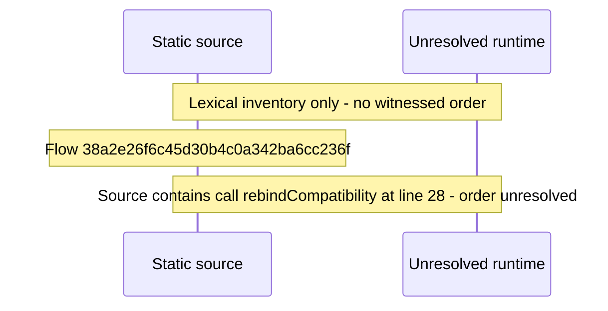

# Home\-mode admin password sign\-in on the enroll page — flow-diagram

Source revision: d442b4a6a38de86be0670669b3a3f6aa47e80b22. Trust: generated. Freshness: pinned source; run docs flows check for a later revision.

<!-- flowdocs:paragraph:bddfcc93862f2d798645e97dbb57ea4a -->
Static source inventory only; sequence and runtime ordering are unresolved\.

Source: internal/web/app/src/lib/graphql/auth\.ts:26; symbol: settleRebind; span SHA256: b13faca8956ab229de82053f9ca2976e5f0b4a1b28d78439f5d3ec44657139bb.

