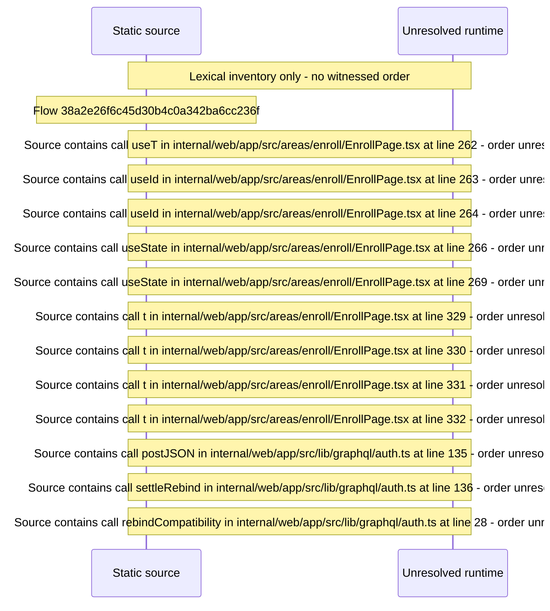

# Home\-mode admin password sign\-in on the enroll page — flow-diagram

Source revision: d658ad5b71dcb67da0ae540d6d5ff80ca8efefd5. Trust: generated. Freshness: pinned source; run docs flows check for a later revision.

<!-- flowdocs:paragraph:bddfcc93862f2d798645e97dbb57ea4a -->
Static source inventory only; sequence and runtime ordering are unresolved\.

Source: internal/web/app/src/areas/enroll/EnrollPage\.tsx:261; symbol: AdminSignInForm; span SHA256: 40ab7553bfdf2f87650f6fa92685559c630579854d7486f125171c6e0991e9bf.

