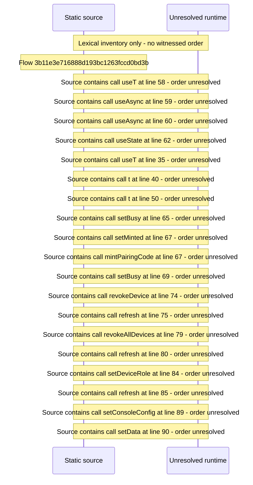

# Console access: devices and pairing codes — flow-diagram

Source revision: d442b4a6a38de86be0670669b3a3f6aa47e80b22. Trust: generated. Freshness: pinned source; run docs flows check for a later revision.

<!-- flowdocs:paragraph:627edae7273401dd1b8e57469578b420 -->
Static source inventory only; sequence and runtime ordering are unresolved\.

Source: internal/web/app/src/areas/console/sections/Devices\.tsx:57; symbol: Devices; span SHA256: 91122bd481a61a50c8979c2c0c3e5c18a73f7bcb28014fd595308c1dee7ffbf5.

