# Manage curation: fields, relations and files of a Media — flow-diagram

Source revision: 6742c2361d684c662e9ccb84d344a2200c377582. Trust: generated. Freshness: pinned source; run docs flows check for a later revision.

<!-- flowdocs:paragraph:7f169a212dc9701d4b5063f9b7ce8da6 -->
Static source inventory only; sequence and runtime ordering are unresolved\.

Source: internal/web/app/src/areas/manage/pages/CurationPage\.tsx:63; symbol: CurationPage; span SHA256: 787a5d250ba7be37e9ed701cd3b7ee65a118836277f33067c79d3c7d8fe41370.

```mermaid
sequenceDiagram
    participant S as Static source
    participant U as Unresolved runtime
    Note over S,U: Lexical inventory only - no witnessed order
    Note over S: Flow 3d8432e8a48564693b1c5b210720b534
    Note over S,U: Source contains call useT at line 64 - order unresolved
    Note over S,U: Source contains call useState at line 66 - order unresolved
    Note over S,U: Source contains call useState at line 68 - order unresolved
    Note over S,U: Source contains call useState at line 69 - order unresolved
    Note over S,U: Source contains call useT at line 183 - order unresolved
    Note over S,U: Source contains call t at line 186 - order unresolved
    Note over S,U: Source contains call t at line 190 - order unresolved
    Note over S,U: Source contains call t at line 196 - order unresolved
    Note over S,U: Source contains call t at line 201 - order unresolved
    Note over S,U: Source contains call t at line 202 - order unresolved
    Note over S,U: Source contains call t at line 203 - order unresolved
    Note over S,U: Source contains call map at line 207 - order unresolved
    Note over S,U: Source contains call useT at line 421 - order unresolved
    Note over S,U: Source contains call useState at line 424 - order unresolved
    Note over S,U: Source contains call t at line 428 - order unresolved
    Note over S,U: Source contains call t at line 429 - order unresolved
    Note over S,U: Source contains call useT at line 234 - order unresolved
    Note over S,U: Source contains call useState at line 235 - order unresolved
    Note over S,U: Source contains call useState at line 236 - order unresolved
    Note over S,U: Source contains call useState at line 237 - order unresolved
    Note over S,U: Source contains call t at line 241 - order unresolved
    Note over S,U: Source contains call t at line 242 - order unresolved
    Note over S,U: Source contains call async at line 71 - order unresolved
    Note over S,U: Source contains call setError at line 72 - order unresolved
    Note over S,U: Source contains call fetchEntity at line 74 - order unresolved
    Note over S,U: Source contains call setSubject at line 76 - order unresolved
    Note over S,U: Source contains call setLoaded at line 77 - order unresolved
    Note over S,U: Source contains call fetchEntityRelations at line 80 - order unresolved
    Note over S,U: Source contains call setSubject at line 81 - order unresolved
    Note over S,U: Source contains call setLoaded at line 91 - order unresolved
    Note over S,U: Source contains call all at line 95 - order unresolved
    Note over S,U: Source contains call fetchMediaFields at line 96 - order unresolved
    Note over S,U: Source contains call fetchMediaFiles at line 97 - order unresolved
    Note over S,U: Source contains call fetchMediaRelations at line 98 - order unresolved
    Note over S,U: Source contains call fetchMediaRelations at line 99 - order unresolved
    Note over S,U: Source contains call find at line 101 - order unresolved
    Note over S,U: Source contains call setSubject at line 102 - order unresolved
    Note over S,U: Source contains call setLoaded at line 112 - order unresolved
    Note over S,U: Source contains call async at line 249 - order unresolved
    Note over S,U: Source contains call onError at line 250 - order unresolved
    Note over S,U: Source contains call upsertEntityRelation at line 258 - order unresolved
    Note over S,U: Source contains call upsertEntityRelation at line 265 - order unresolved
    Note over S,U: Source contains call onChange at line 272 - order unresolved
    Note over S,U: Source contains call onError at line 274 - order unresolved
    Note over S,U: Source contains call t at line 274 - order unresolved
    Note over S,U: Source contains call async at line 278 - order unresolved
    Note over S,U: Source contains call onError at line 279 - order unresolved
    Note over S,U: Source contains call trim at line 280 - order unresolved
    Note over S,U: Source contains call trim at line 281 - order unresolved
    Note over S,U: Source contains call trim at line 283 - order unresolved
    Note over S,U: Source contains call Number at line 283 - order unresolved
    Note over S,U: Source contains call upsertEntityRelation at line 285 - order unresolved
    Note over S,U: Source contains call setTargetID at line 291 - order unresolved
    Note over S,U: Source contains call setOrder at line 292 - order unresolved
    Note over S,U: Source contains call onChange at line 293 - order unresolved
    Note over S,U: Source contains call onError at line 295 - order unresolved
    Note over S,U: Source contains call t at line 295 - order unresolved
    Note over S,U: Source contains call async at line 434 - order unresolved
    Note over S,U: Source contains call onError at line 435 - order unresolved
    Note over S,U: Source contains call trim at line 436 - order unresolved
    Note over S,U: Source contains call linkMediaRelation at line 439 - order unresolved
    Note over S,U: Source contains call setExtraID at line 440 - order unresolved
    Note over S,U: Source contains call onChange at line 441 - order unresolved
    Note over S,U: Source contains call onError at line 443 - order unresolved
    Note over S,U: Source contains call t at line 443 - order unresolved
    Note over S,U: Source contains call async at line 115 - order unresolved
    Note over S,U: Source contains call trim at line 116 - order unresolved
    Note over S,U: Source contains call load at line 119 - order unresolved
    Note over S,U: Source contains call setSubject at line 121 - order unresolved
    Note over S,U: Source contains call setLoaded at line 122 - order unresolved
    Note over S,U: Source contains call setError at line 123 - order unresolved
    Note over S,U: Source contains call t at line 123 - order unresolved
    Note over S,U: Source contains call load at line 129 - order unresolved
    Note over S,U: Source contains call catch at line 129 - order unresolved
    Note over S,U: Source contains call setError at line 129 - order unresolved
    Note over S,U: Source contains call t at line 129 - order unresolved
    Note over S,U: Source contains call t at line 301 - order unresolved
    Note over S,U: Source contains call t at line 303 - order unresolved
```

