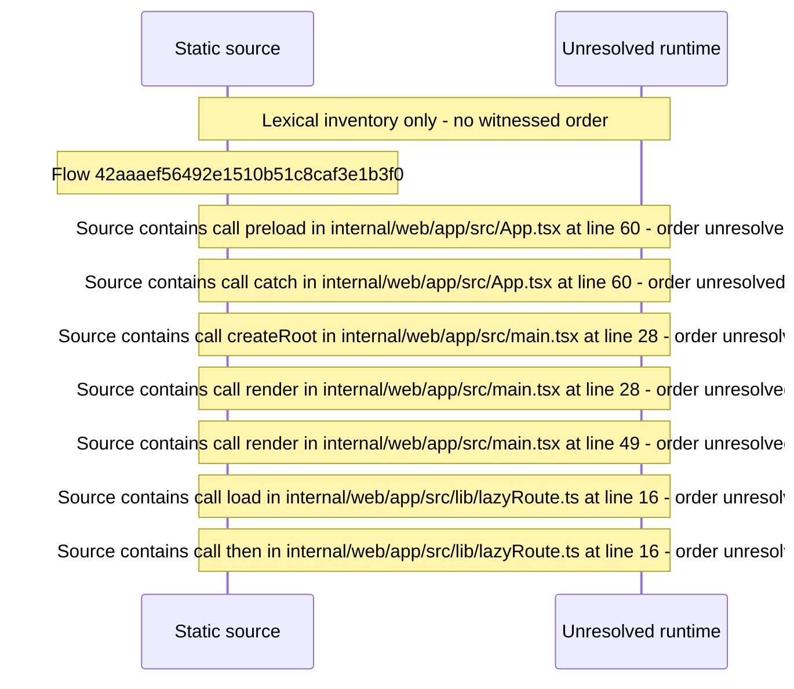

# App routing: /web basename, area code\-splitting, initial\-route preload — flow-diagram

Source revision: 5ffe7939da2318f5153b1a20d0ef6ef94deef162. Trust: generated. Freshness: pinned source; run docs flows check for a later revision.

<!-- flowdocs:paragraph:ed57e48c7b2c0e4680ad319b8db8255d -->
Static source inventory only; sequence and runtime ordering are unresolved\.

Source: internal/web/app/src/App\.tsx:46; symbol: preloadInitialRoute; span SHA256: d68dbb9aacaeafed1ab256cd81fa1cd9b83218a769c52aa085038942bef37e6c.

