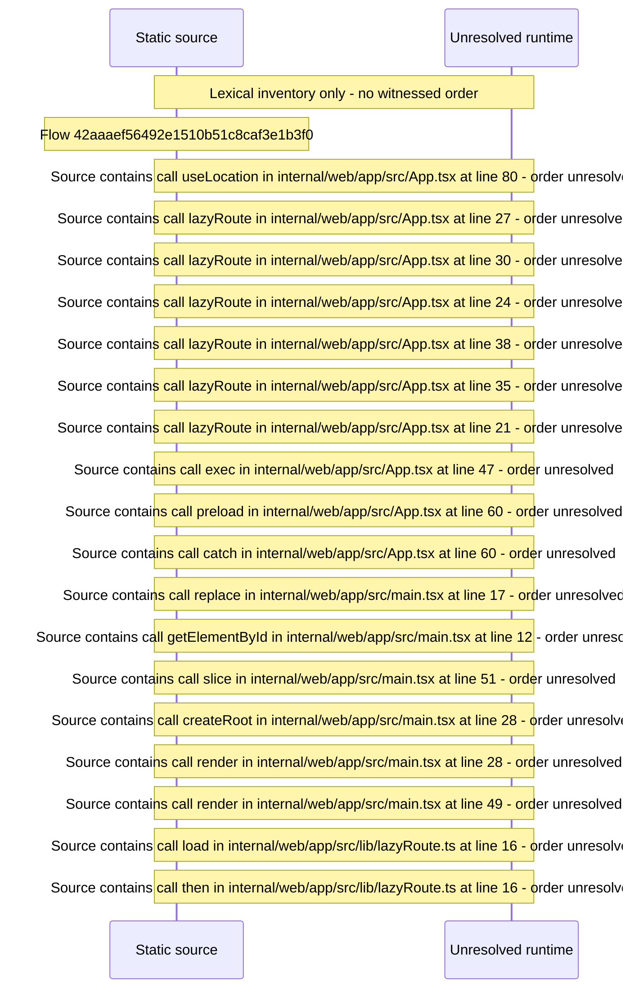

# App routing: /web basename, area code\-splitting, initial\-route preload — flow-diagram

Source revision: e2ffd915f3bda309ca8792f07724053b048ba15f. Trust: generated. Freshness: pinned source; run docs flows check for a later revision.

<!-- flowdocs:paragraph:ed57e48c7b2c0e4680ad319b8db8255d -->
Static source inventory only; sequence and runtime ordering are unresolved\.

Source: internal/web/app/src/App\.tsx:84; symbol: App; span SHA256: 85c130fae59b090533bc933b93a59e21e0235c72161a524b22ade1ce4a0b10fe.

