# Manage navigation overrides: nodes, theme, sections, history — flow-diagram

Source revision: 4d9f6ba81afcc8de0179eb7c056488d3e3bd8218. Trust: generated. Freshness: pinned source; run docs flows check for a later revision.

<!-- flowdocs:paragraph:cfec355f39d019cbb2990d69b192dbf3 -->
Static source inventory only; sequence and runtime ordering are unresolved\.

Source: internal/web/app/src/areas/manage/pages/NavOverridePage\.tsx:55; symbol: DEFAULT\_ACCENT; span SHA256: 0e0743561e7ec2fe0f7822aa260f0b9d8f8e55eac5a8a09f91a40f75a9962599.

```mermaid
sequenceDiagram
    participant S as Static source
    participant U as Unresolved runtime
    Note over S,U: Lexical inventory only - no witnessed order
    Note over S: Flow 48df4df13e249971d7603fc21fe8ed4b
    Note over S,U: Source contains call useT at line 573 - order unresolved
    Note over S,U: Source contains call t at line 576 - order unresolved
    Note over S,U: Source contains call t at line 577 - order unresolved
    Note over S,U: Source contains call onReset at line 584 - order unresolved
    Note over S,U: Source contains call t at line 586 - order unresolved
    Note over S,U: Source contains call t at line 591 - order unresolved
    Note over S,U: Source contains call t at line 596 - order unresolved
    Note over S,U: Source contains call t at line 597 - order unresolved
    Note over S,U: Source contains call t at line 598 - order unresolved
    Note over S,U: Source contains call map at line 602 - order unresolved
    Note over S,U: Source contains call formatDateTime at line 604 - order unresolved
    Note over S,U: Source contains call summarize at line 605 - order unresolved
    Note over S,U: Source contains call onRestore at line 611 - order unresolved
    Note over S,U: Source contains call t at line 613 - order unresolved
    Note over S,U: Source contains call useT at line 95 - order unresolved
    Note over S,U: Source contains call useState at line 99 - order unresolved
    Note over S,U: Source contains call useState at line 100 - order unresolved
    Note over S,U: Source contains call useT at line 227 - order unresolved
    Note over S,U: Source contains call useState at line 229 - order unresolved
    Note over S,U: Source contains call useT at line 417 - order unresolved
    Note over S,U: Source contains call useState at line 418 - order unresolved
    Note over S,U: Source contains call useEffect at line 421 - order unresolved
    Note over S,U: Source contains call setLayoutID at line 422 - order unresolved
    Note over S,U: Source contains call find at line 425 - order unresolved
    Note over S,U: Source contains call Set at line 430 - order unresolved
    Note over S,U: Source contains call useT at line 350 - order unresolved
    Note over S,U: Source contains call useState at line 351 - order unresolved
    Note over S,U: Source contains call useEffect at line 354 - order unresolved
    Note over S,U: Source contains call setAccent at line 354 - order unresolved
    Note over S,U: Source contains call test at line 357 - order unresolved
    Note over S,U: Source contains call trim at line 357 - order unresolved
    Note over S,U: Source contains call t at line 361 - order unresolved
    Note over S,U: Source contains call t at line 362 - order unresolved
    Note over S,U: Source contains call t at line 365 - order unresolved
    Note over S,U: Source contains call t at line 376 - order unresolved
    Note over S,U: Source contains call setAccent at line 383 - order unresolved
    Note over S,U: Source contains call trim at line 389 - order unresolved
    Note over S,U: Source contains call onApply at line 390 - order unresolved
    Note over S,U: Source contains call trim at line 390 - order unresolved
    Note over S,U: Source contains call t at line 392 - order unresolved
    Note over S,U: Source contains call onApply at line 399 - order unresolved
    Note over S,U: Source contains call t at line 401 - order unresolved
    Note over S,U: Source contains call splice at line 89 - order unresolved
    Note over S,U: Source contains call splice at line 90 - order unresolved
    Note over S,U: Source contains call Map at line 68 - order unresolved
    Note over S,U: Source contains call map at line 68 - order unresolved
    Note over S,U: Source contains call get at line 72 - order unresolved
    Note over S,U: Source contains call has at line 73 - order unresolved
    Note over S,U: Source contains call push at line 74 - order unresolved
    Note over S,U: Source contains call add at line 75 - order unresolved
    Note over S,U: Source contains call has at line 79 - order unresolved
    Note over S,U: Source contains call push at line 79 - order unresolved
    Note over S,U: Source contains call push at line 552 - order unresolved
    Note over S,U: Source contains call push at line 553 - order unresolved
    Note over S,U: Source contains call t at line 553 - order unresolved
    Note over S,U: Source contains call keys at line 554 - order unresolved
    Note over S,U: Source contains call push at line 555 - order unresolved
    Note over S,U: Source contains call push at line 556 - order unresolved
    Note over S,U: Source contains call t at line 556 - order unresolved
    Note over S,U: Source contains call keys at line 557 - order unresolved
    Note over S,U: Source contains call push at line 558 - order unresolved
    Note over S,U: Source contains call join at line 559 - order unresolved
    Note over S,U: Source contains call t at line 559 - order unresolved
    Note over S,U: Source contains call setEditing at line 250 - order unresolved
    Note over S,U: Source contains call setEditLabel at line 251 - order unresolved
    Note over S,U: Source contains call useMemo at line 231 - order unresolved
    Note over S,U: Source contains call Set at line 231 - order unresolved
    Note over S,U: Source contains call useCallback at line 102 - order unresolved
    Note over S,U: Source contains call async at line 102 - order unresolved
    Note over S,U: Source contains call setError at line 103 - order unresolved
    Note over S,U: Source contains call setLoading at line 104 - order unresolved
    Note over S,U: Source contains call all at line 106 - order unresolved
    Note over S,U: Source contains call fetchManifest at line 107 - order unresolved
    Note over S,U: Source contains call fetchNavOverride at line 108 - order unresolved
    Note over S,U: Source contains call fetchNavOverrideHistory at line 109 - order unresolved
    Note over S,U: Source contains call setManifest at line 111 - order unresolved
    Note over S,U: Source contains call setOverride at line 112 - order unresolved
    Note over S,U: Source contains call setHistory at line 113 - order unresolved
    Note over S,U: Source contains call setError at line 115 - order unresolved
    Note over S,U: Source contains call t at line 115 - order unresolved
    Note over S,U: Source contains call setLoading at line 117 - order unresolved
    Note over S,U: Source contains call useMemo at line 433 - order unresolved
    Note over S,U: Source contains call Map at line 437 - order unresolved
    Note over S,U: Source contains call map at line 437 - order unresolved
    Note over S,U: Source contains call get at line 441 - order unresolved
    Note over S,U: Source contains call has at line 442 - order unresolved
    Note over S,U: Source contains call push at line 443 - order unresolved
    Note over S,U: Source contains call add at line 444 - order unresolved
    Note over S,U: Source contains call has at line 447 - order unresolved
    Note over S,U: Source contains call push at line 447 - order unresolved
    Note over S,U: Source contains call onApply at line 458 - order unresolved
    Note over S,U: Source contains call trim at line 255 - order unresolved
    Note over S,U: Source contains call setEditing at line 259 - order unresolved
    Note over S,U: Source contains call onApply at line 260 - order unresolved
```

