# Manage navigation overrides: nodes, theme, sections, history — flow-diagram

Source revision: d658ad5b71dcb67da0ae540d6d5ff80ca8efefd5. Trust: generated. Freshness: pinned source; run docs flows check for a later revision.

<!-- flowdocs:paragraph:cfec355f39d019cbb2990d69b192dbf3 -->
Static source inventory only; sequence and runtime ordering are unresolved\.

Source: internal/web/app/src/areas/manage/pages/NavOverridePage\.tsx:55; symbol: DEFAULT\_ACCENT; span SHA256: f8d513443d51f97f7d43dbc891aa1b8152ff430a1220277997181e47c564f541.

```mermaid
sequenceDiagram
    participant S as Static source
    participant U as Unresolved runtime
    Note over S,U: Lexical inventory only - no witnessed order
    Note over S: Flow 48df4df13e249971d7603fc21fe8ed4b
    Note over S,U: Source contains call useT at line 578 - order unresolved
    Note over S,U: Source contains call t at line 581 - order unresolved
    Note over S,U: Source contains call t at line 583 - order unresolved
    Note over S,U: Source contains call onReset at line 590 - order unresolved
    Note over S,U: Source contains call t at line 592 - order unresolved
    Note over S,U: Source contains call t at line 597 - order unresolved
    Note over S,U: Source contains call t at line 602 - order unresolved
    Note over S,U: Source contains call t at line 603 - order unresolved
    Note over S,U: Source contains call t at line 604 - order unresolved
    Note over S,U: Source contains call map at line 608 - order unresolved
    Note over S,U: Source contains call formatDateTime at line 610 - order unresolved
    Note over S,U: Source contains call summarize at line 611 - order unresolved
    Note over S,U: Source contains call onRestore at line 617 - order unresolved
    Note over S,U: Source contains call t at line 619 - order unresolved
    Note over S,U: Source contains call useT at line 95 - order unresolved
    Note over S,U: Source contains call useState at line 99 - order unresolved
    Note over S,U: Source contains call useState at line 100 - order unresolved
    Note over S,U: Source contains call useT at line 230 - order unresolved
    Note over S,U: Source contains call useState at line 232 - order unresolved
    Note over S,U: Source contains call useT at line 421 - order unresolved
    Note over S,U: Source contains call useState at line 422 - order unresolved
    Note over S,U: Source contains call useEffect at line 425 - order unresolved
    Note over S,U: Source contains call setLayoutID at line 426 - order unresolved
    Note over S,U: Source contains call find at line 429 - order unresolved
    Note over S,U: Source contains call Set at line 434 - order unresolved
    Note over S,U: Source contains call useT at line 353 - order unresolved
    Note over S,U: Source contains call useState at line 354 - order unresolved
    Note over S,U: Source contains call useEffect at line 357 - order unresolved
    Note over S,U: Source contains call setAccent at line 357 - order unresolved
    Note over S,U: Source contains call test at line 360 - order unresolved
    Note over S,U: Source contains call trim at line 360 - order unresolved
    Note over S,U: Source contains call t at line 364 - order unresolved
    Note over S,U: Source contains call t at line 366 - order unresolved
    Note over S,U: Source contains call t at line 369 - order unresolved
    Note over S,U: Source contains call t at line 380 - order unresolved
    Note over S,U: Source contains call setAccent at line 387 - order unresolved
    Note over S,U: Source contains call trim at line 393 - order unresolved
    Note over S,U: Source contains call onApply at line 394 - order unresolved
    Note over S,U: Source contains call trim at line 394 - order unresolved
    Note over S,U: Source contains call t at line 396 - order unresolved
    Note over S,U: Source contains call onApply at line 403 - order unresolved
    Note over S,U: Source contains call t at line 405 - order unresolved
    Note over S,U: Source contains call splice at line 89 - order unresolved
    Note over S,U: Source contains call splice at line 90 - order unresolved
    Note over S,U: Source contains call Map at line 68 - order unresolved
    Note over S,U: Source contains call map at line 68 - order unresolved
    Note over S,U: Source contains call get at line 72 - order unresolved
    Note over S,U: Source contains call has at line 73 - order unresolved
    Note over S,U: Source contains call push at line 74 - order unresolved
    Note over S,U: Source contains call add at line 75 - order unresolved
    Note over S,U: Source contains call has at line 79 - order unresolved
    Note over S,U: Source contains call push at line 79 - order unresolved
    Note over S,U: Source contains call push at line 557 - order unresolved
    Note over S,U: Source contains call push at line 558 - order unresolved
    Note over S,U: Source contains call t at line 558 - order unresolved
    Note over S,U: Source contains call keys at line 559 - order unresolved
    Note over S,U: Source contains call push at line 560 - order unresolved
    Note over S,U: Source contains call push at line 561 - order unresolved
    Note over S,U: Source contains call t at line 561 - order unresolved
    Note over S,U: Source contains call keys at line 562 - order unresolved
    Note over S,U: Source contains call push at line 563 - order unresolved
    Note over S,U: Source contains call join at line 564 - order unresolved
    Note over S,U: Source contains call t at line 564 - order unresolved
    Note over S,U: Source contains call setEditing at line 253 - order unresolved
    Note over S,U: Source contains call setEditLabel at line 254 - order unresolved
    Note over S,U: Source contains call useMemo at line 234 - order unresolved
    Note over S,U: Source contains call Set at line 234 - order unresolved
    Note over S,U: Source contains call useCallback at line 102 - order unresolved
    Note over S,U: Source contains call async at line 102 - order unresolved
    Note over S,U: Source contains call setError at line 103 - order unresolved
    Note over S,U: Source contains call setLoading at line 104 - order unresolved
    Note over S,U: Source contains call all at line 106 - order unresolved
    Note over S,U: Source contains call fetchManifest at line 107 - order unresolved
    Note over S,U: Source contains call fetchNavOverride at line 108 - order unresolved
    Note over S,U: Source contains call fetchNavOverrideHistory at line 109 - order unresolved
    Note over S,U: Source contains call setManifest at line 111 - order unresolved
    Note over S,U: Source contains call setOverride at line 112 - order unresolved
    Note over S,U: Source contains call setHistory at line 113 - order unresolved
    Note over S,U: Source contains call setError at line 115 - order unresolved
    Note over S,U: Source contains call t at line 115 - order unresolved
    Note over S,U: Source contains call setLoading at line 117 - order unresolved
    Note over S,U: Source contains call useMemo at line 437 - order unresolved
    Note over S,U: Source contains call Map at line 441 - order unresolved
    Note over S,U: Source contains call map at line 441 - order unresolved
    Note over S,U: Source contains call get at line 445 - order unresolved
    Note over S,U: Source contains call has at line 446 - order unresolved
    Note over S,U: Source contains call push at line 447 - order unresolved
    Note over S,U: Source contains call add at line 448 - order unresolved
    Note over S,U: Source contains call has at line 451 - order unresolved
    Note over S,U: Source contains call push at line 451 - order unresolved
    Note over S,U: Source contains call onApply at line 462 - order unresolved
    Note over S,U: Source contains call trim at line 258 - order unresolved
    Note over S,U: Source contains call setEditing at line 262 - order unresolved
    Note over S,U: Source contains call onApply at line 263 - order unresolved
```

