# Manage navigation overrides: nodes, theme, sections, history — flow-diagram

Source revision: d442b4a6a38de86be0670669b3a3f6aa47e80b22. Trust: generated. Freshness: pinned source; run docs flows check for a later revision.

<!-- flowdocs:paragraph:cfec355f39d019cbb2990d69b192dbf3 -->
Static source inventory only; sequence and runtime ordering are unresolved\.

Source: internal/web/app/src/areas/manage/pages/NavOverridePage\.tsx:94; symbol: NavOverridePage; span SHA256: ab214fe8c8411316e5b91e4558a1dd9402db91d5aee9f404635914768f2f0e70.

```mermaid
sequenceDiagram
    participant S as Static source
    participant U as Unresolved runtime
    Note over S,U: Lexical inventory only - no witnessed order
    Note over S: Flow 48df4df13e249971d7603fc21fe8ed4b
    Note over S,U: Source contains call useT at line 95 - order unresolved
    Note over S,U: Source contains call useState at line 99 - order unresolved
    Note over S,U: Source contains call useState at line 100 - order unresolved
    Note over S,U: Source contains call useT at line 230 - order unresolved
    Note over S,U: Source contains call useState at line 232 - order unresolved
    Note over S,U: Source contains call Map at line 68 - order unresolved
    Note over S,U: Source contains call map at line 68 - order unresolved
    Note over S,U: Source contains call get at line 72 - order unresolved
    Note over S,U: Source contains call has at line 73 - order unresolved
    Note over S,U: Source contains call push at line 74 - order unresolved
    Note over S,U: Source contains call add at line 75 - order unresolved
    Note over S,U: Source contains call has at line 79 - order unresolved
    Note over S,U: Source contains call push at line 79 - order unresolved
    Note over S,U: Source contains call setEditing at line 253 - order unresolved
    Note over S,U: Source contains call setEditLabel at line 254 - order unresolved
    Note over S,U: Source contains call useMemo at line 234 - order unresolved
    Note over S,U: Source contains call Set at line 234 - order unresolved
    Note over S,U: Source contains call useCallback at line 102 - order unresolved
    Note over S,U: Source contains call async at line 102 - order unresolved
    Note over S,U: Source contains call setError at line 103 - order unresolved
    Note over S,U: Source contains call setLoading at line 104 - order unresolved
    Note over S,U: Source contains call all at line 106 - order unresolved
    Note over S,U: Source contains call fetchManifest at line 107 - order unresolved
    Note over S,U: Source contains call fetchNavOverride at line 108 - order unresolved
    Note over S,U: Source contains call fetchNavOverrideHistory at line 109 - order unresolved
    Note over S,U: Source contains call setManifest at line 111 - order unresolved
    Note over S,U: Source contains call setOverride at line 112 - order unresolved
    Note over S,U: Source contains call setHistory at line 113 - order unresolved
    Note over S,U: Source contains call setError at line 115 - order unresolved
    Note over S,U: Source contains call t at line 115 - order unresolved
    Note over S,U: Source contains call setLoading at line 117 - order unresolved
    Note over S,U: Source contains call useMemo at line 437 - order unresolved
    Note over S,U: Source contains call Map at line 441 - order unresolved
    Note over S,U: Source contains call map at line 441 - order unresolved
    Note over S,U: Source contains call get at line 445 - order unresolved
    Note over S,U: Source contains call has at line 446 - order unresolved
    Note over S,U: Source contains call push at line 447 - order unresolved
    Note over S,U: Source contains call add at line 448 - order unresolved
    Note over S,U: Source contains call has at line 451 - order unresolved
    Note over S,U: Source contains call push at line 451 - order unresolved
    Note over S,U: Source contains call onApply at line 462 - order unresolved
    Note over S,U: Source contains call trim at line 258 - order unresolved
    Note over S,U: Source contains call setEditing at line 262 - order unresolved
    Note over S,U: Source contains call onApply at line 263 - order unresolved
```

