# Console update awareness: update check, release channel and update\-available guidance — flow-diagram

Source revision: 6742c2361d684c662e9ccb84d344a2200c377582. Trust: generated. Freshness: pinned source; run docs flows check for a later revision.

<!-- flowdocs:paragraph:e0de9263216b4c650f14e5993fe9cf5b -->
Static source inventory only; sequence and runtime ordering are unresolved\.

Source: internal/web/app/src/areas/console/sections/Operations\.tsx:32; symbol: UPDATE\_STATE\_DISPLAY; span SHA256: 65aa5f072cfbdf321366c62d1c4e62076ce808f6ddf0938c4c83915546b723c2.

```mermaid
sequenceDiagram
    participant S as Static source
    participant U as Unresolved runtime
    Note over S,U: Lexical inventory only - no witnessed order
    Note over S: Flow 48faca79d66aadef005267598d56311e
    Note over S,U: Source contains call useT at line 55 - order unresolved
    Note over S,U: Source contains call t at line 60 - order unresolved
    Note over S,U: Source contains call t at line 65 - order unresolved
    Note over S,U: Source contains call t at line 66 - order unresolved
    Note over S,U: Source contains call t at line 71 - order unresolved
    Note over S,U: Source contains call t at line 77 - order unresolved
    Note over S,U: Source contains call t at line 78 - order unresolved
    Note over S,U: Source contains call t at line 84 - order unresolved
    Note over S,U: Source contains call t at line 85 - order unresolved
    Note over S,U: Source contains call t at line 90 - order unresolved
    Note over S,U: Source contains call t at line 91 - order unresolved
    Note over S,U: Source contains call t at line 92 - order unresolved
    Note over S,U: Source contains call t at line 93 - order unresolved
    Note over S,U: Source contains call t at line 94 - order unresolved
    Note over S,U: Source contains call t at line 97 - order unresolved
    Note over S,U: Source contains call t at line 98 - order unresolved
    Note over S,U: Source contains call t at line 101 - order unresolved
    Note over S,U: Source contains call t at line 102 - order unresolved
    Note over S,U: Source contains call t at line 105 - order unresolved
    Note over S,U: Source contains call t at line 106 - order unresolved
    Note over S,U: Source contains call t at line 109 - order unresolved
    Note over S,U: Source contains call t at line 110 - order unresolved
    Note over S,U: Source contains call t at line 117 - order unresolved
    Note over S,U: Source contains call t at line 120 - order unresolved
    Note over S,U: Source contains call t at line 123 - order unresolved
    Note over S,U: Source contains call t at line 135 - order unresolved
    Note over S,U: Source contains call t at line 138 - order unresolved
    Note over S,U: Source contains call t at line 139 - order unresolved
    Note over S,U: Source contains call t at line 141 - order unresolved
    Note over S,U: Source contains call t at line 143 - order unresolved
    Note over S,U: Source contains call t at line 146 - order unresolved
    Note over S,U: Source contains call t at line 149 - order unresolved
    Note over S,U: Source contains call t at line 154 - order unresolved
    Note over S,U: Source contains call useT at line 164 - order unresolved
    Note over S,U: Source contains call useAsync at line 165 - order unresolved
    Note over S,U: Source contains call useAsync at line 166 - order unresolved
    Note over S,U: Source contains call useState at line 167 - order unresolved
    Note over S,U: Source contains call useState at line 168 - order unresolved
    Note over S,U: Source contains call useEffect at line 170 - order unresolved
    Note over S,U: Source contains call setEnabled at line 172 - order unresolved
    Note over S,U: Source contains call setChannel at line 173 - order unresolved
    Note over S,U: Source contains call preventDefault at line 177 - order unresolved
    Note over S,U: Source contains call setConsoleConfig at line 178 - order unresolved
    Note over S,U: Source contains call setData at line 182 - order unresolved
    Note over S,U: Source contains call refresh at line 183 - order unresolved
```

