# UI primitives: button, dialog, alert dialog, select, table, tabs, tree and form controls — flow-diagram

Source revision: 6742c2361d684c662e9ccb84d344a2200c377582. Trust: generated. Freshness: pinned source; run docs flows check for a later revision.

<!-- flowdocs:paragraph:c807f657be23d446e9b8bcab2bb7d537 -->
Static source inventory only; sequence and runtime ordering are unresolved\.

Source: internal/web/app/src/components/ui/alert\-dialog\.tsx:6; symbol: AlertDialog; span SHA256: b853d2ebb9ad95551db45746bf8333e3b3100ce740d7e4a6bd00b0c2d24b0321.

```mermaid
sequenceDiagram
    participant S as Static source
    participant U as Unresolved runtime
    Note over S,U: Lexical inventory only - no witnessed order
    Note over S: Flow 49d9d967e94d5d9e0e31611a9ef4330d
    Note over S,U: Source contains call cn in internal/web/app/src/components/ui/alert-dialog.tsx at line 115 - order unresolved
    Note over S,U: Source contains call buttonVariants in internal/web/app/src/components/ui/alert-dialog.tsx at line 115 - order unresolved
    Note over S,U: Source contains call cn in internal/web/app/src/components/ui/alert-dialog.tsx at line 124 - order unresolved
    Note over S,U: Source contains call buttonVariants in internal/web/app/src/components/ui/alert-dialog.tsx at line 124 - order unresolved
    Note over S,U: Source contains call cn in internal/web/app/src/components/ui/alert-dialog.tsx at line 55 - order unresolved
    Note over S,U: Source contains call cn in internal/web/app/src/components/ui/alert-dialog.tsx at line 105 - order unresolved
    Note over S,U: Source contains call cn in internal/web/app/src/components/ui/alert-dialog.tsx at line 79 - order unresolved
    Note over S,U: Source contains call cn in internal/web/app/src/components/ui/alert-dialog.tsx at line 69 - order unresolved
    Note over S,U: Source contains call cn in internal/web/app/src/components/ui/alert-dialog.tsx at line 37 - order unresolved
    Note over S,U: Source contains call cn in internal/web/app/src/components/ui/alert-dialog.tsx at line 92 - order unresolved
    Note over S,U: Source contains call isValidElement in internal/web/app/src/components/ui/alert-dialog.tsx at line 18 - order unresolved
    Note over S,U: Source contains call cn in internal/web/app/src/components/ui/badge.tsx at line 35 - order unresolved
    Note over S,U: Source contains call badgeVariants in internal/web/app/src/components/ui/badge.tsx at line 35 - order unresolved
    Note over S,U: Source contains call cva in internal/web/app/src/components/ui/badge.tsx at line 7 - order unresolved
    Note over S,U: Source contains call cva in internal/web/app/src/components/ui/button.tsx at line 18 - order unresolved
    Note over S,U: Source contains call cn in internal/web/app/src/components/ui/card.tsx at line 9 - order unresolved
    Note over S,U: Source contains call cn in internal/web/app/src/components/ui/card.tsx at line 55 - order unresolved
    Note over S,U: Source contains call cn in internal/web/app/src/components/ui/card.tsx at line 62 - order unresolved
    Note over S,U: Source contains call cn in internal/web/app/src/components/ui/card.tsx at line 45 - order unresolved
    Note over S,U: Source contains call cn in internal/web/app/src/components/ui/card.tsx at line 69 - order unresolved
    Note over S,U: Source contains call cn in internal/web/app/src/components/ui/card.tsx at line 22 - order unresolved
    Note over S,U: Source contains call cn in internal/web/app/src/components/ui/card.tsx at line 35 - order unresolved
    Note over S,U: Source contains call cn in internal/web/app/src/components/ui/checkbox.tsx at line 11 - order unresolved
    Note over S,U: Source contains call useT in internal/web/app/src/components/ui/dialog.tsx at line 60 - order unresolved
    Note over S,U: Source contains call cn in internal/web/app/src/components/ui/dialog.tsx at line 67 - order unresolved
    Note over S,U: Source contains call t in internal/web/app/src/components/ui/dialog.tsx at line 80 - order unresolved
    Note over S,U: Source contains call cn in internal/web/app/src/components/ui/dialog.tsx at line 125 - order unresolved
    Note over S,U: Source contains call cn in internal/web/app/src/components/ui/dialog.tsx at line 102 - order unresolved
    Note over S,U: Source contains call cn in internal/web/app/src/components/ui/dialog.tsx at line 92 - order unresolved
    Note over S,U: Source contains call cn in internal/web/app/src/components/ui/dialog.tsx at line 43 - order unresolved
    Note over S,U: Source contains call cn in internal/web/app/src/components/ui/dialog.tsx at line 112 - order unresolved
    Note over S,U: Source contains call isValidElement in internal/web/app/src/components/ui/dialog.tsx at line 20 - order unresolved
    Note over S,U: Source contains call cn in internal/web/app/src/components/ui/input.tsx at line 10 - order unresolved
    Note over S,U: Source contains call cn in internal/web/app/src/components/ui/label.tsx at line 10 - order unresolved
    Note over S,U: Source contains call useRef in internal/web/app/src/components/ui/select.tsx at line 33 - order unresolved
    Note over S,U: Source contains call selectItems in internal/web/app/src/components/ui/select.tsx at line 38 - order unresolved
    Note over S,U: Source contains call cn in internal/web/app/src/components/ui/select.tsx at line 137 - order unresolved
    Note over S,U: Source contains call useContext in internal/web/app/src/components/ui/select.tsx at line 168 - order unresolved
    Note over S,U: Source contains call cn in internal/web/app/src/components/ui/select.tsx at line 173 - order unresolved
    Note over S,U: Source contains call toggleAttribute in internal/web/app/src/components/ui/select.tsx at line 178 - order unresolved
    Note over S,U: Source contains call cn in internal/web/app/src/components/ui/select.tsx at line 156 - order unresolved
    Note over S,U: Source contains call cn in internal/web/app/src/components/ui/select.tsx at line 228 - order unresolved
    Note over S,U: Source contains call cn in internal/web/app/src/components/ui/select.tsx at line 213 - order unresolved
    Note over S,U: Source contains call cn in internal/web/app/src/components/ui/select.tsx at line 200 - order unresolved
    Note over S,U: Source contains call cn in internal/web/app/src/components/ui/select.tsx at line 110 - order unresolved
    Note over S,U: Source contains call forEach in internal/web/app/src/components/ui/select.tsx at line 20 - order unresolved
    Note over S,U: Source contains call isValidElement in internal/web/app/src/components/ui/select.tsx at line 21 - order unresolved
    Note over S,U: Source contains call push in internal/web/app/src/components/ui/select.tsx at line 24 - order unresolved
    Note over S,U: Source contains call push in internal/web/app/src/components/ui/select.tsx at line 27 - order unresolved
    Note over S,U: Source contains call selectItems in internal/web/app/src/components/ui/select.tsx at line 27 - order unresolved
    Note over S,U: Source contains call cn in internal/web/app/src/components/ui/separator.tsx at line 17 - order unresolved
    Note over S,U: Source contains call cn in internal/web/app/src/components/ui/skeleton.tsx at line 9 - order unresolved
    Note over S,U: Source contains call cn in internal/web/app/src/components/ui/switch.tsx at line 10 - order unresolved
    Note over S,U: Source contains call cn in internal/web/app/src/components/ui/switch.tsx at line 18 - order unresolved
    Note over S,U: Source contains call cn in internal/web/app/src/components/ui/table.tsx at line 10 - order unresolved
    Note over S,U: Source contains call cn in internal/web/app/src/components/ui/table.tsx at line 25 - order unresolved
    Note over S,U: Source contains call cn in internal/web/app/src/components/ui/table.tsx at line 84 - order unresolved
    Note over S,U: Source contains call cn in internal/web/app/src/components/ui/table.tsx at line 71 - order unresolved
    Note over S,U: Source contains call cn in internal/web/app/src/components/ui/table.tsx at line 35 - order unresolved
    Note over S,U: Source contains call cn in internal/web/app/src/components/ui/table.tsx at line 58 - order unresolved
    Note over S,U: Source contains call cn in internal/web/app/src/components/ui/table.tsx at line 18 - order unresolved
    Note over S,U: Source contains call cn in internal/web/app/src/components/ui/table.tsx at line 45 - order unresolved
    Note over S,U: Source contains call cn in internal/web/app/src/components/ui/tabs.tsx at line 20 - order unresolved
    Note over S,U: Source contains call className in internal/web/app/src/components/ui/tabs.tsx at line 20 - order unresolved
    Note over S,U: Source contains call cn in internal/web/app/src/components/ui/tabs.tsx at line 21 - order unresolved
    Note over S,U: Source contains call toggleAttribute in internal/web/app/src/components/ui/tabs.tsx at line 29 - order unresolved
    Note over S,U: Source contains call cn in internal/web/app/src/components/ui/textarea.tsx at line 9 - order unresolved
    Note over S,U: Source contains call min in internal/web/app/src/components/ui/tree.tsx at line 15 - order unresolved
    Note over S,U: Source contains call max in internal/web/app/src/components/ui/tree.tsx at line 16 - order unresolved
    Note over S,U: Source contains call Number in internal/web/app/src/components/ui/tree.tsx at line 18 - order unresolved
    Note over S,U: Source contains call getAttribute in internal/web/app/src/components/ui/tree.tsx at line 18 - order unresolved
    Note over S,U: Source contains call min in internal/web/app/src/components/ui/tree.tsx at line 20 - order unresolved
    Note over S,U: Source contains call Number in internal/web/app/src/components/ui/tree.tsx at line 21 - order unresolved
    Note over S,U: Source contains call getAttribute in internal/web/app/src/components/ui/tree.tsx at line 21 - order unresolved
    Note over S,U: Source contains call Number in internal/web/app/src/components/ui/tree.tsx at line 27 - order unresolved
    Note over S,U: Source contains call getAttribute in internal/web/app/src/components/ui/tree.tsx at line 27 - order unresolved
```

