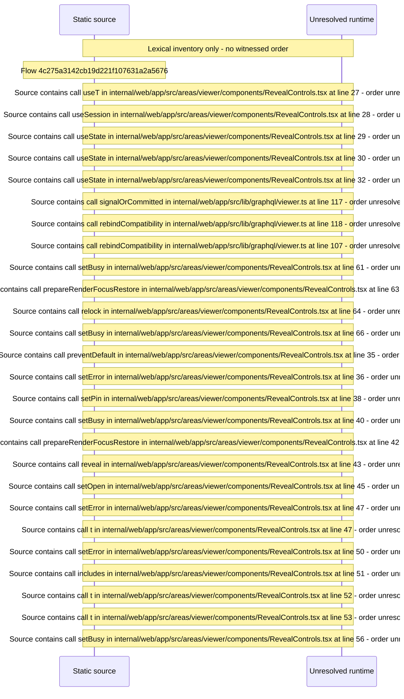

# Viewer reveal and relock of restricted content — flow-diagram

Source revision: d658ad5b71dcb67da0ae540d6d5ff80ca8efefd5. Trust: generated. Freshness: pinned source; run docs flows check for a later revision.

<!-- flowdocs:paragraph:155aa66bc436e5243a600319294accf5 -->
Static source inventory only; sequence and runtime ordering are unresolved\.

Source: internal/web/app/src/areas/viewer/components/RevealControls\.tsx:26; symbol: RevealControls; span SHA256: af47a5d0f814e0002788bd166a6a35cbe7e495208ec4ff0bb72fe2686a99cc24.

