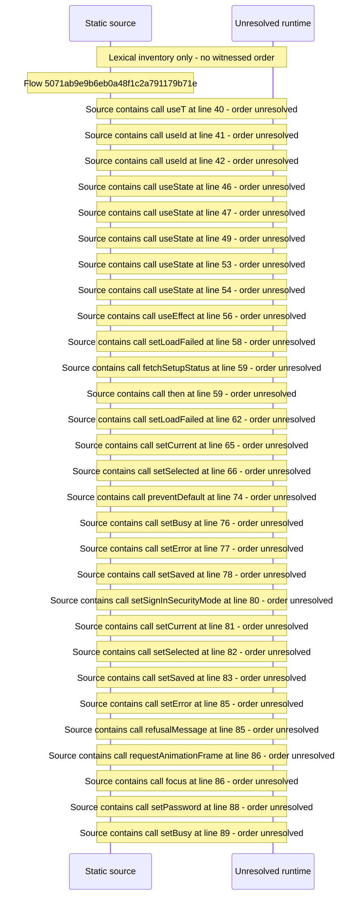

# Console access: sign\-in security mode — flow-diagram

Source revision: e2ffd915f3bda309ca8792f07724053b048ba15f. Trust: generated. Freshness: pinned source; run docs flows check for a later revision.

<!-- flowdocs:paragraph:4e6f76a2bfc906a4baf513653da37290 -->
Static source inventory only; sequence and runtime ordering are unresolved\.

Source: internal/web/app/src/areas/console/sections/SignInSecurity\.tsx:20; symbol: MODES; span SHA256: 90e6161f267e5263014b4b349fff23872e6b22df4a24310a8031f8712616117d.

