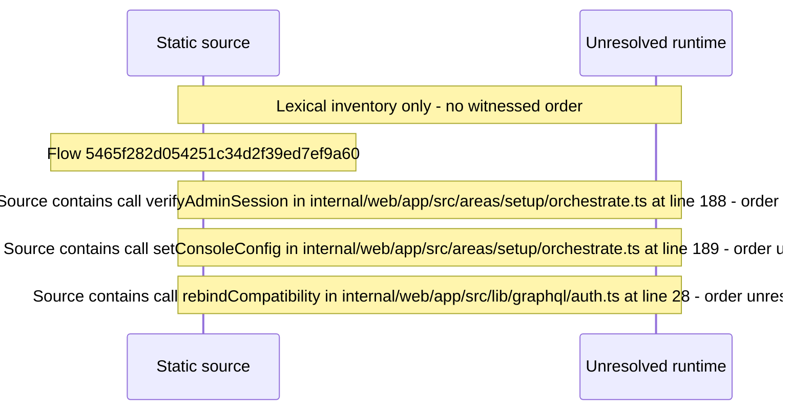

# Setup: configure the update\-check channel — flow-diagram

Source revision: 6742c2361d684c662e9ccb84d344a2200c377582. Trust: generated. Freshness: pinned source; run docs flows check for a later revision.

<!-- flowdocs:paragraph:90dc49e6a5b16314d1d9c6d9da74ea5e -->
Static source inventory only; sequence and runtime ordering are unresolved\.

Source: internal/web/app/src/areas/setup/orchestrate\.ts:38; symbol: UpdateCheckChannel; span SHA256: bd5955f7abfd6b60f80d302824d8ee419c7c19aa76ad7abc062bdee76afbfb44.

