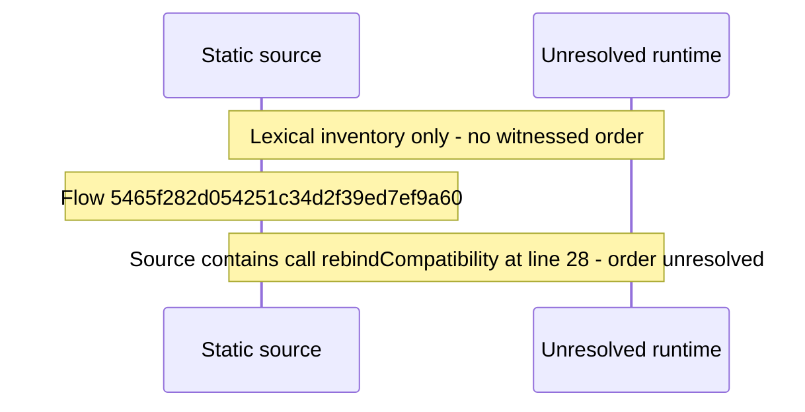

# Setup: configure the update\-check channel — flow-diagram

Source revision: 5ffe7939da2318f5153b1a20d0ef6ef94deef162. Trust: generated. Freshness: pinned source; run docs flows check for a later revision.

<!-- flowdocs:paragraph:90dc49e6a5b16314d1d9c6d9da74ea5e -->
Static source inventory only; sequence and runtime ordering are unresolved\.

Source: internal/web/app/src/lib/graphql/auth\.ts:26; symbol: settleRebind; span SHA256: b13faca8956ab229de82053f9ca2976e5f0b4a1b28d78439f5d3ec44657139bb.

