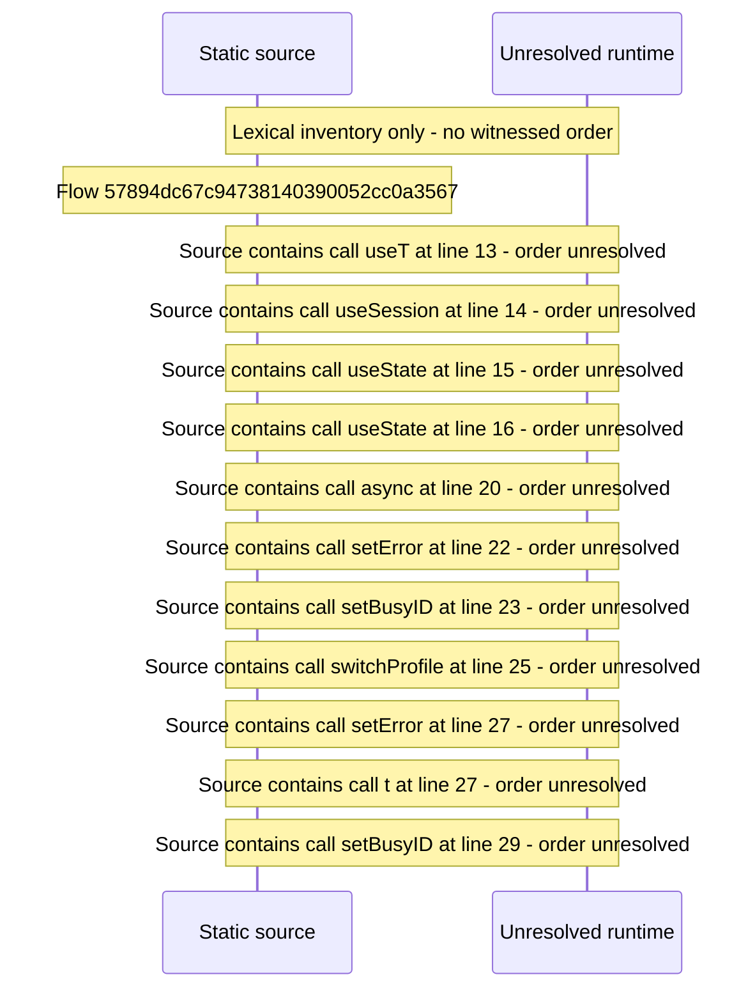

# Manage profile page — flow-diagram

Source revision: 6742c2361d684c662e9ccb84d344a2200c377582. Trust: generated. Freshness: pinned source; run docs flows check for a later revision.

<!-- flowdocs:paragraph:84364f8020cc8f5596a0e5de1ed3a682 -->
Static source inventory only; sequence and runtime ordering are unresolved\.

Source: internal/web/app/src/areas/manage/pages/ProfilePage\.tsx:12; symbol: ProfilePage; span SHA256: 8352e86aab9b2df2d8cd9db9436977b6fe453d18647faf91fedb9b916b31b79d.

