# First\-run setup wizard shell: token intake, step navigation — flow-diagram

Source revision: 6742c2361d684c662e9ccb84d344a2200c377582. Trust: generated. Freshness: pinned source; run docs flows check for a later revision.

<!-- flowdocs:paragraph:bd078539d1bee603a51632232872fc2b -->
Static source inventory only; sequence and runtime ordering are unresolved\.

Source: internal/web/app/src/areas/setup/SetupWizard\.tsx:1178; symbol: FIELD; span SHA256: b88719071fbc13ba27f154d2f78edd5b2e6531ff428ff3a3279d99dd2dfc11d1.

```mermaid
sequenceDiagram
    participant S as Static source
    participant U as Unresolved runtime
    Note over S,U: Lexical inventory only - no witnessed order
    Note over S: Flow 5d042754bf5df5a7cb8957d1623ccc68
    Note over S,U: Source contains call useI18n at line 128 - order unresolved
    Note over S,U: Source contains call useState at line 132 - order unresolved
    Note over S,U: Source contains call consumeSetupToken at line 137 - order unresolved
    Note over S,U: Source contains call useState at line 138 - order unresolved
    Note over S,U: Source contains call useState at line 140 - order unresolved
    Note over S,U: Source contains call useState at line 141 - order unresolved
    Note over S,U: Source contains call useState at line 147 - order unresolved
    Note over S,U: Source contains call useState at line 148 - order unresolved
    Note over S,U: Source contains call useState at line 157 - order unresolved
    Note over S,U: Source contains call useState at line 160 - order unresolved
    Note over S,U: Source contains call t at line 160 - order unresolved
    Note over S,U: Source contains call Set at line 163 - order unresolved
    Note over S,U: Source contains call useState at line 164 - order unresolved
    Note over S,U: Source contains call useState at line 173 - order unresolved
    Note over S,U: Source contains call useState at line 179 - order unresolved
    Note over S,U: Source contains call useState at line 182 - order unresolved
    Note over S,U: Source contains call useState at line 183 - order unresolved
    Note over S,U: Source contains call useState at line 193 - order unresolved
    Note over S,U: Source contains call useId at line 199 - order unresolved
    Note over S,U: Source contains call useId at line 200 - order unresolved
    Note over S,U: Source contains call useId at line 201 - order unresolved
    Note over S,U: Source contains call useId at line 202 - order unresolved
    Note over S,U: Source contains call useId at line 203 - order unresolved
    Note over S,U: Source contains call useId at line 204 - order unresolved
    Note over S,U: Source contains call useId at line 205 - order unresolved
    Note over S,U: Source contains call useEffect at line 207 - order unresolved
    Note over S,U: Source contains call useEffect at line 217 - order unresolved
    Note over S,U: Source contains call bootstrapResume at line 219 - order unresolved
    Note over S,U: Source contains call then at line 220 - order unresolved
    Note over S,U: Source contains call setTokenStepSkipped at line 226 - order unresolved
    Note over S,U: Source contains call setStep at line 227 - order unresolved
    Note over S,U: Source contains call setProbing at line 229 - order unresolved
    Note over S,U: Source contains call setFirstLibraryProgress at line 233 - order unresolved
    Note over S,U: Source contains call assign at line 239 - order unresolved
    Note over S,U: Source contains call setBootstrapped at line 244 - order unresolved
    Note over S,U: Source contains call setResumedFromRestart at line 245 - order unresolved
    Note over S,U: Source contains call setStep at line 246 - order unresolved
    Note over S,U: Source contains call setProbing at line 247 - order unresolved
    Note over S,U: Source contains call catch at line 249 - order unresolved
    Note over S,U: Source contains call setProbing at line 254 - order unresolved
    Note over S,U: Source contains call useEffect at line 264 - order unresolved
    Note over S,U: Source contains call contains at line 267 - order unresolved
    Note over S,U: Source contains call focus at line 272 - order unresolved
    Note over S,U: Source contains call useEffect at line 281 - order unresolved
    Note over S,U: Source contains call fetchPlugins at line 284 - order unresolved
    Note over S,U: Source contains call then at line 284 - order unresolved
    Note over S,U: Source contains call setPlugins at line 286 - order unresolved
    Note over S,U: Source contains call some at line 287 - order unresolved
    Note over S,U: Source contains call setActivePlugins at line 288 - order unresolved
    Note over S,U: Source contains call has at line 288 - order unresolved
    Note over S,U: Source contains call Set at line 288 - order unresolved
    Note over S,U: Source contains call add at line 288 - order unresolved
    Note over S,U: Source contains call useEffect at line 299 - order unresolved
    Note over S,U: Source contains call loadProviderKeys at line 302 - order unresolved
    Note over S,U: Source contains call then at line 303 - order unresolved
    Note over S,U: Source contains call setProviderKeys at line 304 - order unresolved
    Note over S,U: Source contains call catch at line 306 - order unresolved
    Note over S,U: Source contains call filter at line 313 - order unresolved
    Note over S,U: Source contains call keyNeeded at line 314 - order unresolved
    Note over S,U: Source contains call some at line 314 - order unresolved
    Note over S,U: Source contains call has at line 314 - order unresolved
    Note over S,U: Source contains call filter at line 320 - order unresolved
    Note over S,U: Source contains call has at line 320 - order unresolved
    Note over S,U: Source contains call useEffect at line 325 - order unresolved
    Note over S,U: Source contains call some at line 326 - order unresolved
    Note over S,U: Source contains call setLibraryType at line 327 - order unresolved
    Note over S,U: Source contains call useEffect at line 331 - order unresolved
    Note over S,U: Source contains call URL at line 118 - order unresolved
    Note over S,U: Source contains call get at line 119 - order unresolved
    Note over S,U: Source contains call has at line 120 - order unresolved
    Note over S,U: Source contains call delete at line 122 - order unresolved
    Note over S,U: Source contains call replaceState at line 123 - order unresolved
    Note over S,U: Source contains call setError at line 371 - order unresolved
    Note over S,U: Source contains call setErrorField at line 372 - order unresolved
    Note over S,U: Source contains call requestAnimationFrame at line 373 - order unresolved
    Note over S,U: Source contains call focus at line 373 - order unresolved
    Note over S,U: Source contains call setPickerNode at line 653 - order unresolved
    Note over S,U: Source contains call setPickerError at line 654 - order unresolved
    Note over S,U: Source contains call requestAnimationFrame at line 655 - order unresolved
    Note over S,U: Source contains call focus at line 655 - order unresolved
    Note over S,U: Source contains call assign at line 534 - order unresolved
    Note over S,U: Source contains call setPickerBusy at line 627 - order unresolved
    Note over S,U: Source contains call setPickerError at line 628 - order unresolved
    Note over S,U: Source contains call browseServerFolders at line 630 - order unresolved
    Note over S,U: Source contains call setPickerNode at line 631 - order unresolved
    Note over S,U: Source contains call setPickerError at line 634 - order unresolved
    Note over S,U: Source contains call t at line 634 - order unresolved
    Note over S,U: Source contains call setPickerBusy at line 637 - order unresolved
    Note over S,U: Source contains call setError at line 619 - order unresolved
    Note over S,U: Source contains call setStep at line 620 - order unresolved
    Note over S,U: Source contains call max at line 620 - order unresolved
    Note over S,U: Source contains call preventDefault at line 561 - order unresolved
    Note over S,U: Source contains call setTokenError at line 563 - order unresolved
    Note over S,U: Source contains call finishSetup at line 566 - order unresolved
    Note over S,U: Source contains call validate at line 570 - order unresolved
    Note over S,U: Source contains call setTokenError at line 573 - order unresolved
    Note over S,U: Source contains call focusTokenField at line 574 - order unresolved
    Note over S,U: Source contains call fieldError at line 575 - order unresolved
    Note over S,U: Source contains call setError at line 578 - order unresolved
    Note over S,U: Source contains call trim at line 584 - order unresolved
    Note over S,U: Source contains call setTokenError at line 585 - order unresolved
    Note over S,U: Source contains call t at line 585 - order unresolved
    Note over S,U: Source contains call setStep at line 586 - order unresolved
    Note over S,U: Source contains call focusTokenField at line 587 - order unresolved
    Note over S,U: Source contains call runBootstrap at line 590 - order unresolved
    Note over S,U: Source contains call setStep at line 592 - order unresolved
    Note over S,U: Source contains call runPluginActivation at line 599 - order unresolved
    Note over S,U: Source contains call setStep at line 601 - order unresolved
    Note over S,U: Source contains call runLibraryCreation at line 608 - order unresolved
    Note over S,U: Source contains call setStep at line 610 - order unresolved
    Note over S,U: Source contains call setStep at line 614 - order unresolved
    Note over S,U: Source contains call min at line 614 - order unresolved
    Note over S,U: Source contains call trim at line 645 - order unresolved
    Note over S,U: Source contains call loadPickerFolder at line 646 - order unresolved
    Note over S,U: Source contains call loadPickerFolder at line 647 - order unresolved
    Note over S,U: Source contains call setPickerError at line 648 - order unresolved
    Note over S,U: Source contains call t at line 648 - order unresolved
    Note over S,U: Source contains call fetchJobs at line 341 - order unresolved
    Note over S,U: Source contains call find at line 342 - order unresolved
    Note over S,U: Source contains call setScanJob at line 344 - order unresolved
    Note over S,U: Source contains call setError at line 347 - order unresolved
    Note over S,U: Source contains call setErrorField at line 355 - order unresolved
    Note over S,U: Source contains call setError at line 356 - order unresolved
    Note over S,U: Source contains call t at line 356 - order unresolved
    Note over S,U: Source contains call setBusy at line 399 - order unresolved
    Note over S,U: Source contains call setError at line 400 - order unresolved
    Note over S,U: Source contains call bootstrapSetup at line 402 - order unresolved
    Note over S,U: Source contains call trim at line 403 - order unresolved
    Note over S,U: Source contains call t at line 404 - order unresolved
    Note over S,U: Source contains call trim at line 405 - order unresolved
    Note over S,U: Source contains call t at line 405 - order unresolved
    Note over S,U: Source contains call setBootstrapped at line 409 - order unresolved
    Note over S,U: Source contains call setTokenError at line 415 - order unresolved
    Note over S,U: Source contains call t at line 415 - order unresolved
    Note over S,U: Source contains call setTokenStepSkipped at line 416 - order unresolved
    Note over S,U: Source contains call setStep at line 417 - order unresolved
    Note over S,U: Source contains call focusTokenField at line 418 - order unresolved
    Note over S,U: Source contains call announceError at line 421 - order unresolved
    Note over S,U: Source contains call t at line 422 - order unresolved
    Note over S,U: Source contains call failureMessage at line 422 - order unresolved
    Note over S,U: Source contains call setToken at line 427 - order unresolved
    Note over S,U: Source contains call setBusy at line 428 - order unresolved
    Note over S,U: Source contains call setBusy at line 488 - order unresolved
    Note over S,U: Source contains call setError at line 489 - order unresolved
    Note over S,U: Source contains call createFirstLibrary at line 491 - order unresolved
    Note over S,U: Source contains call trim at line 492 - order unresolved
    Note over S,U: Source contains call t at line 492 - order unresolved
    Note over S,U: Source contains call trim at line 494 - order unresolved
    Note over S,U: Source contains call setFirstLibraryProgress at line 497 - order unresolved
    Note over S,U: Source contains call setScanJob at line 498 - order unresolved
    Note over S,U: Source contains call setFirstLibraryProgress at line 507 - order unresolved
    Note over S,U: Source contains call setRootPath at line 508 - order unresolved
    Note over S,U: Source contains call announceError at line 510 - order unresolved
    Note over S,U: Source contains call libraryErrorMessage at line 510 - order unresolved
    Note over S,U: Source contains call setBusy at line 513 - order unresolved
    Note over S,U: Source contains call setBusy at line 436 - order unresolved
    Note over S,U: Source contains call setError at line 437 - order unresolved
    Note over S,U: Source contains call configureUpdateCheck at line 444 - order unresolved
    Note over S,U: Source contains call activatePlugins at line 450 - order unresolved
    Note over S,U: Source contains call saveProviderKeys at line 451 - order unresolved
    Note over S,U: Source contains call announceError at line 453 - order unresolved
    Note over S,U: Source contains call failureMessage at line 453 - order unresolved
    Note over S,U: Source contains call setBusy at line 456 - order unresolved
    Note over S,U: Source contains call trim at line 464 - order unresolved
    Note over S,U: Source contains call setScraperCredential at line 467 - order unresolved
    Note over S,U: Source contains call setProviderKeys at line 468 - order unresolved
    Note over S,U: Source contains call map at line 469 - order unresolved
    Note over S,U: Source contains call setKeySecrets at line 473 - order unresolved
    Note over S,U: Source contains call announceError at line 475 - order unresolved
    Note over S,U: Source contains call t at line 475 - order unresolved
    Note over S,U: Source contains call setActivePlugins at line 664 - order unresolved
    Note over S,U: Source contains call Set at line 665 - order unresolved
    Note over S,U: Source contains call has at line 666 - order unresolved
    Note over S,U: Source contains call delete at line 666 - order unresolved
    Note over S,U: Source contains call add at line 667 - order unresolved
    Note over S,U: Source contains call setRootPath at line 659 - order unresolved
    Note over S,U: Source contains call closePicker at line 660 - order unresolved
    Note over S,U: Source contains call trim at line 542 - order unresolved
    Note over S,U: Source contains call t at line 544 - order unresolved
    Note over S,U: Source contains call trim at line 546 - order unresolved
    Note over S,U: Source contains call t at line 547 - order unresolved
    Note over S,U: Source contains call t at line 550 - order unresolved
    Note over S,U: Source contains call trim at line 554 - order unresolved
    Note over S,U: Source contains call t at line 554 - order unresolved
```

