# First\-run setup wizard shell: token intake, step navigation — flow-diagram

Source revision: d442b4a6a38de86be0670669b3a3f6aa47e80b22. Trust: generated. Freshness: pinned source; run docs flows check for a later revision.

<!-- flowdocs:paragraph:bd078539d1bee603a51632232872fc2b -->
Static source inventory only; sequence and runtime ordering are unresolved\.

Source: internal/web/app/src/components/beamfall/CinemaBackdrop\.tsx:4; symbol: CinemaBackdrop; span SHA256: 6880dafb3ea09575091d6bcad24c3bd43e0f7efd6ad47049f784578830fbf852.

```mermaid
sequenceDiagram
    participant S as Static source
    participant U as Unresolved runtime
    Note over S,U: Lexical inventory only - no witnessed order
    Note over S: Flow 5d042754bf5df5a7cb8957d1623ccc68
    Note over S,U: Source contains call setError at line 361 - order unresolved
    Note over S,U: Source contains call requestAnimationFrame at line 362 - order unresolved
    Note over S,U: Source contains call focus at line 362 - order unresolved
    Note over S,U: Source contains call setPickerNode at line 596 - order unresolved
    Note over S,U: Source contains call setPickerError at line 597 - order unresolved
    Note over S,U: Source contains call assign at line 501 - order unresolved
    Note over S,U: Source contains call setPickerBusy at line 577 - order unresolved
    Note over S,U: Source contains call setPickerError at line 578 - order unresolved
    Note over S,U: Source contains call browseServerFolders at line 580 - order unresolved
    Note over S,U: Source contains call setPickerNode at line 581 - order unresolved
    Note over S,U: Source contains call setPickerError at line 583 - order unresolved
    Note over S,U: Source contains call t at line 583 - order unresolved
    Note over S,U: Source contains call setPickerBusy at line 585 - order unresolved
    Note over S,U: Source contains call setError at line 569 - order unresolved
    Note over S,U: Source contains call setStep at line 570 - order unresolved
    Note over S,U: Source contains call max at line 570 - order unresolved
    Note over S,U: Source contains call preventDefault at line 521 - order unresolved
    Note over S,U: Source contains call setTokenError at line 523 - order unresolved
    Note over S,U: Source contains call finishSetup at line 526 - order unresolved
    Note over S,U: Source contains call validate at line 530 - order unresolved
    Note over S,U: Source contains call setTokenError at line 532 - order unresolved
    Note over S,U: Source contains call announceError at line 533 - order unresolved
    Note over S,U: Source contains call setError at line 536 - order unresolved
    Note over S,U: Source contains call runBootstrap at line 540 - order unresolved
    Note over S,U: Source contains call setStep at line 542 - order unresolved
    Note over S,U: Source contains call runPluginActivation at line 549 - order unresolved
    Note over S,U: Source contains call setStep at line 551 - order unresolved
    Note over S,U: Source contains call runLibraryCreation at line 558 - order unresolved
    Note over S,U: Source contains call setStep at line 560 - order unresolved
    Note over S,U: Source contains call setStep at line 564 - order unresolved
    Note over S,U: Source contains call min at line 564 - order unresolved
    Note over S,U: Source contains call loadPickerFolder at line 592 - order unresolved
    Note over S,U: Source contains call trim at line 592 - order unresolved
    Note over S,U: Source contains call fetchJobs at line 334 - order unresolved
    Note over S,U: Source contains call find at line 335 - order unresolved
    Note over S,U: Source contains call setScanJob at line 337 - order unresolved
    Note over S,U: Source contains call setError at line 340 - order unresolved
    Note over S,U: Source contains call announceError at line 346 - order unresolved
    Note over S,U: Source contains call t at line 346 - order unresolved
    Note over S,U: Source contains call setBusy at line 367 - order unresolved
    Note over S,U: Source contains call setError at line 368 - order unresolved
    Note over S,U: Source contains call bootstrapSetup at line 370 - order unresolved
    Note over S,U: Source contains call trim at line 371 - order unresolved
    Note over S,U: Source contains call t at line 372 - order unresolved
    Note over S,U: Source contains call trim at line 373 - order unresolved
    Note over S,U: Source contains call t at line 373 - order unresolved
    Note over S,U: Source contains call setBootstrapped at line 377 - order unresolved
    Note over S,U: Source contains call setTokenError at line 383 - order unresolved
    Note over S,U: Source contains call t at line 383 - order unresolved
    Note over S,U: Source contains call setTokenStepSkipped at line 384 - order unresolved
    Note over S,U: Source contains call setStep at line 385 - order unresolved
    Note over S,U: Source contains call announceError at line 388 - order unresolved
    Note over S,U: Source contains call t at line 390 - order unresolved
    Note over S,U: Source contains call t at line 391 - order unresolved
    Note over S,U: Source contains call setToken at line 396 - order unresolved
    Note over S,U: Source contains call setBusy at line 397 - order unresolved
    Note over S,U: Source contains call setBusy at line 461 - order unresolved
    Note over S,U: Source contains call setError at line 462 - order unresolved
    Note over S,U: Source contains call createFirstLibrary at line 464 - order unresolved
    Note over S,U: Source contains call trim at line 465 - order unresolved
    Note over S,U: Source contains call t at line 465 - order unresolved
    Note over S,U: Source contains call trim at line 467 - order unresolved
    Note over S,U: Source contains call setFirstLibraryProgress at line 470 - order unresolved
    Note over S,U: Source contains call setScanJob at line 471 - order unresolved
    Note over S,U: Source contains call setFirstLibraryProgress at line 480 - order unresolved
    Note over S,U: Source contains call setRootPath at line 481 - order unresolved
    Note over S,U: Source contains call announceError at line 483 - order unresolved
    Note over S,U: Source contains call t at line 488 - order unresolved
    Note over S,U: Source contains call setBusy at line 492 - order unresolved
    Note over S,U: Source contains call setBusy at line 405 - order unresolved
    Note over S,U: Source contains call setError at line 406 - order unresolved
    Note over S,U: Source contains call configureUpdateCheck at line 413 - order unresolved
    Note over S,U: Source contains call activatePlugins at line 419 - order unresolved
    Note over S,U: Source contains call saveProviderKeys at line 420 - order unresolved
    Note over S,U: Source contains call announceError at line 422 - order unresolved
    Note over S,U: Source contains call t at line 424 - order unresolved
    Note over S,U: Source contains call classifySetupError at line 424 - order unresolved
    Note over S,U: Source contains call t at line 425 - order unresolved
    Note over S,U: Source contains call setBusy at line 429 - order unresolved
    Note over S,U: Source contains call trim at line 437 - order unresolved
    Note over S,U: Source contains call setScraperCredential at line 440 - order unresolved
    Note over S,U: Source contains call setProviderKeys at line 441 - order unresolved
    Note over S,U: Source contains call map at line 442 - order unresolved
    Note over S,U: Source contains call setKeySecrets at line 446 - order unresolved
    Note over S,U: Source contains call announceError at line 448 - order unresolved
    Note over S,U: Source contains call t at line 448 - order unresolved
    Note over S,U: Source contains call setActivePlugins at line 606 - order unresolved
    Note over S,U: Source contains call Set at line 607 - order unresolved
    Note over S,U: Source contains call has at line 608 - order unresolved
    Note over S,U: Source contains call delete at line 608 - order unresolved
    Note over S,U: Source contains call add at line 609 - order unresolved
    Note over S,U: Source contains call setRootPath at line 601 - order unresolved
    Note over S,U: Source contains call closePicker at line 602 - order unresolved
    Note over S,U: Source contains call trim at line 508 - order unresolved
    Note over S,U: Source contains call t at line 508 - order unresolved
    Note over S,U: Source contains call t at line 510 - order unresolved
    Note over S,U: Source contains call t at line 511 - order unresolved
    Note over S,U: Source contains call trim at line 514 - order unresolved
    Note over S,U: Source contains call t at line 514 - order unresolved
```

