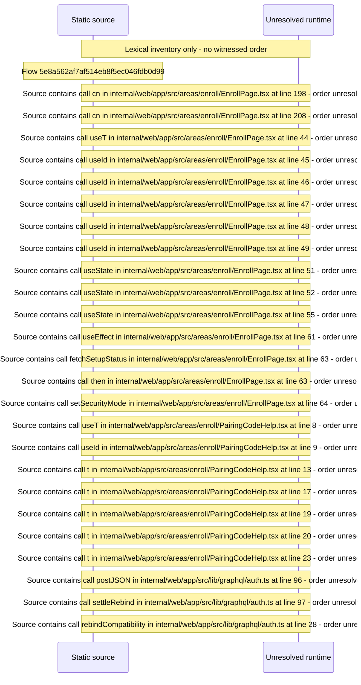

# Enroll a browser with a pairing code — flow-diagram

Source revision: e417fb394873a04fbd27fb8d5bcbca5484c8747f. Trust: generated. Freshness: pinned source; run docs flows check for a later revision.

<!-- flowdocs:paragraph:f0990662dc3d6a908622cc8299903ec4 -->
Static source inventory only; sequence and runtime ordering are unresolved\.

Source: internal/web/app/src/areas/enroll/EnrollPage\.tsx:181; symbol: CardHeading; span SHA256: f7e73c414493680f27a87f3e71e6d41ea30bb012047e4a11e1bdbb2d33579ffc.

