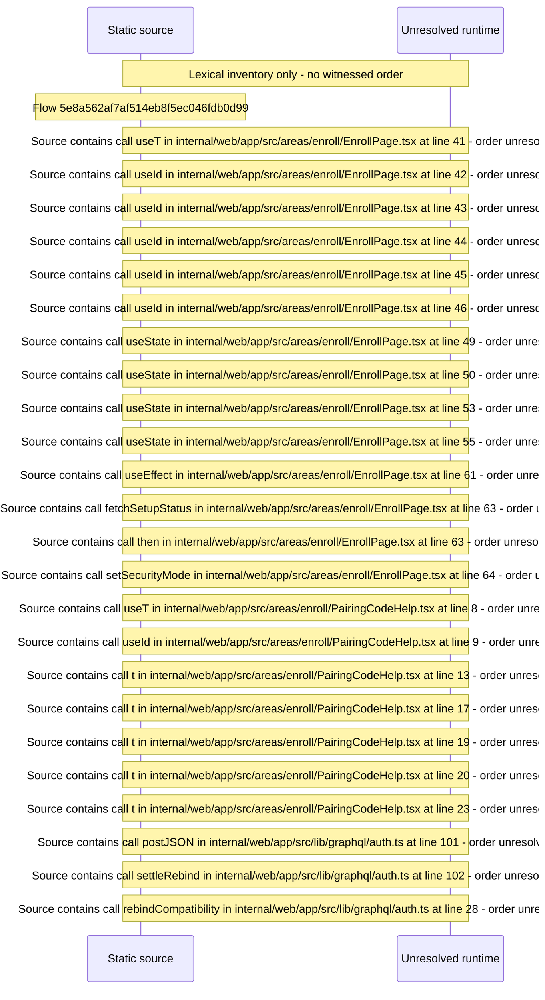

# Enroll a browser with a pairing code — flow-diagram

Source revision: 6742c2361d684c662e9ccb84d344a2200c377582. Trust: generated. Freshness: pinned source; run docs flows check for a later revision.

<!-- flowdocs:paragraph:f0990662dc3d6a908622cc8299903ec4 -->
Static source inventory only; sequence and runtime ordering are unresolved\.

Source: internal/web/app/src/areas/enroll/EnrollPage\.tsx:40; symbol: EnrollPage; span SHA256: c47f9fbfc591d8600ffb4e5bf8ad928e38cf084157f16d18d570897e045204fa.

