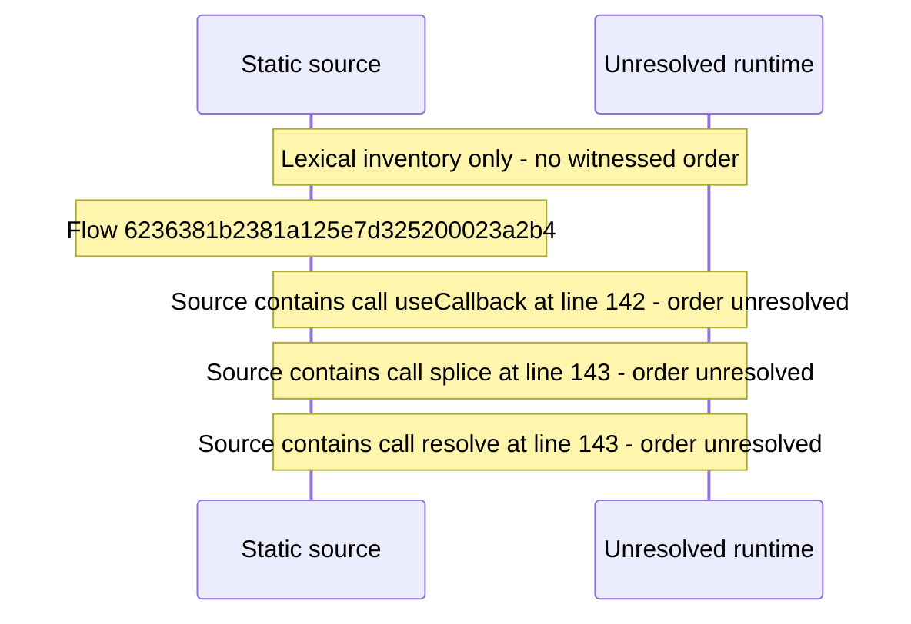

# Manage area shell: route table, nav groups, admin lock — flow-diagram

Source revision: d442b4a6a38de86be0670669b3a3f6aa47e80b22. Trust: generated. Freshness: pinned source; run docs flows check for a later revision.

<!-- flowdocs:paragraph:6d8542ad14b6a67b4e935b8d909e9802 -->
Static source inventory only; sequence and runtime ordering are unresolved\.

Source: internal/web/app/src/areas/manage/index\.tsx:142; symbol: settle; span SHA256: 805d130ed5a0b8c016f4019d490ffa176df97596e5124bc0586275a0ce594356.

