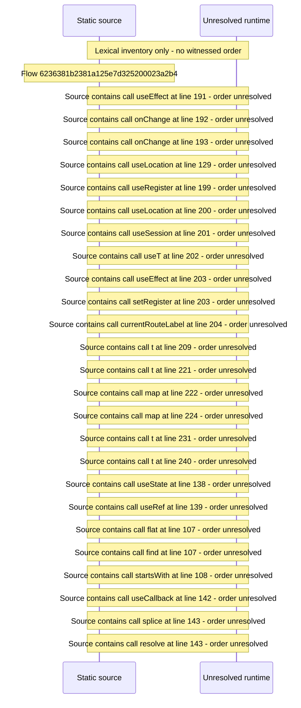

# Manage area shell: route table, nav groups, admin lock — flow-diagram

Source revision: d658ad5b71dcb67da0ae540d6d5ff80ca8efefd5. Trust: generated. Freshness: pinned source; run docs flows check for a later revision.

<!-- flowdocs:paragraph:6d8542ad14b6a67b4e935b8d909e9802 -->
Static source inventory only; sequence and runtime ordering are unresolved\.

Source: internal/web/app/src/areas/manage/index\.tsx:190; symbol: AdminUnlocked; span SHA256: 2fbb9c781a0203abe431258f0a69e258cc97a537c32fb8a006ec511fe1ae2a91.

